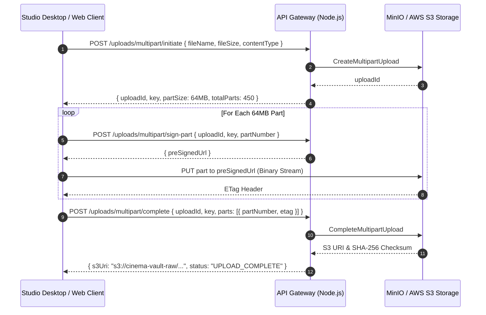
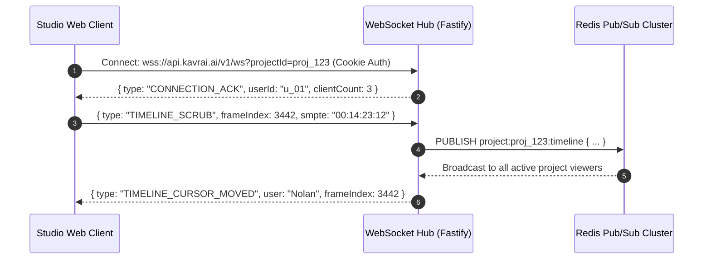

# Cinema-Grade AI Film Localization: Backend API Contracts & Interface Specification
**Document ID:** API-SPEC-2026-V1  
**Target Platform:** Cinema-Grade Multilingual Localization & Dubbing (BRAHMA AI / VAANI / ATMAN Inspired)  
**Parent Specifications:** [docs/MASTER_ARCHITECTURE.md](file:///c:/Users/acer/3D%20Objects/kavrai%20AI/docs/MASTER_ARCHITECTURE.md), [docs/ARCHITECTURE_GAP_ANALYSIS.md](file:///c:/Users/acer/3D%20Objects/kavrai%20AI/docs/ARCHITECTURE_GAP_ANALYSIS.md), [docs/SYSTEM_DESIGN.md](file:///c:/Users/acer/3D%20Objects/kavrai%20AI/docs/SYSTEM_DESIGN.md), [docs/DATA_STORAGE_DESIGN.md](file:///c:/Users/acer/3D%20Objects/kavrai%20AI/docs/DATA_STORAGE_DESIGN.md)  
**Status:** Canonical API Contract Specification  

---

## 1. Global API Standards & Conventions

### 1.1 Base URLs & Versioning
- **Production API Gateway:** `https://api.kavrai.ai/api/v1`
- **Local Development Gateway:** `http://localhost:4000/api/v1`
- **WebSocket Gateway:** `wss://api.kavrai.ai/v1/ws` (Local: `ws://localhost:4000/v1/ws`)
- **Versioning Strategy:** URI path versioning (`/api/v1`). Breaking schema changes increment the major version (`/api/v2`). Minor non-breaking field additions occur backward-compatibly within the current major version.

### 1.2 Content Types & Standard Headers
- **Request Payloads:** `Content-Type: application/json`
- **Successful Responses:** `Content-Type: application/json`
- **Error Responses:** `Content-Type: application/problem+json` (RFC 7807)
- **Standard Request Headers:**
  - `Authorization: Bearer <token>` (Used by CLI / Service Accounts)
  - `X-Request-ID: <UUID>` (Unique trace identifier across microservices)
  - `X-Idempotency-Key: <UUID>` (Required for all mutating state actions `POST /render`, `POST /export`)
- **Standard Response Headers:**
  - `X-Request-ID: <UUID>`
  - `X-RateLimit-Limit: 1000`
  - `X-RateLimit-Remaining: 984`
  - `X-RateLimit-Reset: 1771982400`

### 1.3 Pagination Standard
All list endpoints adopt cursor-based pagination to guarantee frame-accurate query stability during concurrent shot insertions:
- **Query Parameters:** `cursor=<UUID>`, `limit=<int>` (default: 50, max: 200).
- **Pagination Response Structure:**
```json
{
  "items": [...],
  "pageInfo": {
    "hasMore": true,
    "nextCursor": "8f9a2b1c-3d4e-4f5a-b6c7-d8e9f0a1b2c3",
    "totalCount": 1420
  }
}
```

---

## 2. Authentication, Authorization & Session Management

The platform supports a dual authentication architecture:
1. **Studio Web Users:** Dual-token JWT with short-lived access tokens (15 minutes) and rotating refresh tokens (7 days) stored in `HTTP-Only`, `Secure`, `SameSite=Strict` cookies.
2. **Service Accounts & Pipeline Workers:** Cryptographically hashed API Keys passed via `Authorization: Bearer kavrai_sk_<token>`.

### 2.1 `POST /api/v1/auth/login`
Authenticates studio users and issues secure cookies.
- **Request Body:**
```json
{
  "email": "director.nolan@syncstudio.com",
  "password": "CorrectHorseBatteryStaple!2026"
}
```
- **Response Headers:**
  - `Set-Cookie: access_token=eyJhbGci...; HttpOnly; Secure; SameSite=Strict; Max-Age=900; Path=/`
  - `Set-Cookie: refresh_token=d98f7e2a...; HttpOnly; Secure; SameSite=Strict; Max-Age=604800; Path=/api/v1/auth`
- **Response Body (`200 OK`):**
```json
{
  "user": {
    "id": "u_98765432-1234-5678-abcd-000000000001",
    "organizationId": "org_11112222-3333-4444-5555-666677778888",
    "email": "director.nolan@syncstudio.com",
    "fullName": "Christopher Nolan",
    "systemRole": "USER",
    "organization": {
      "id": "org_11112222-3333-4444-5555-666677778888",
      "name": "Sync Theatrical Studios",
      "tpnGoldCertified": true
    }
  }
}
```

### 2.2 `POST /api/v1/auth/refresh`
Rotates the refresh token and returns a fresh access token cookie.
- **Request:** Cookie `refresh_token` sent automatically.
- **Response (`200 OK`):** Returns updated `access_token` and rotated `refresh_token` cookies.

### 2.3 `POST /api/v1/auth/logout`
Revokes the refresh token in Redis and clears browser cookies.
- **Response (`200 OK`):** `{ "message": "Successfully logged out" }`.

### 2.4 `POST /api/v1/auth/api-keys`
Generates a hashed service account API key for CI/CD workers (Requires `STUDIO_ADMIN` role).
- **Request Body:**
```json
{
  "name": "K8s-GPU-Worker-Cluster-01",
  "scopes": ["jobs:process", "shots:read", "renders:write"],
  "expiresInDays": 90
}
```
- **Response Body (`201 Created`):**
```json
{
  "apiKey": "kavrai_sk_live_9a8b7c6d5e4f3a2b1c0d9e8f7a6b5c4d",
  "id": "key_123456",
  "name": "K8s-GPU-Worker-Cluster-01",
  "expiresAt": "2026-11-25T00:00:00Z"
}
```

### 2.5 Role-Based Access Control (RBAC) Permission Matrix

| Endpoint Domain | `EXECUTIVE_PRODUCER` | `DIRECTOR` | `LEAD_VFX_SUPERVISOR` | `SOUND_SUPERVISOR` | `DIALOGUE_EDITOR` | `VIEWER` |
| :--- | :---: | :---: | :---: | :---: | :---: | :---: |
| **Manage Project / Reel Settings** | Write | Write | Read | Read | Read | Read |
| **Upload Master Media & Chunking** | Write | Write | Read | Read | Read | Read |
| **Transcreation & Script Edits** | Write | Write | Read | Write | Write | Read |
| **Voice Cloning & TTS Generation** | Write | Write | Read | Write | Read | Read |
| **Tier 1 Preview Lip-Sync Render**| Write | Write | Write | Read | Read | Read |
| **Tier 2 Master Lip-Sync Render** | Write | Write | Write | Read | None | Read |
| **QC Annotations & Frame Comments**| Write | Write | Write | Write | Write | Read |
| **Approve & Lock Shot Version** | Write | Write | Write (VFX only)| None | None | None |
| **Theatrical Master Conform Export**| Write | Write | None | None | None | None |

---

## 3. Performer Rights & Consent Governance (SAG-AFTRA 2023)

No voice cloning or visual reenactment task can be scheduled without a cryptographically verified performer consent token.

### 3.1 `POST /api/v1/performers/consent`
Registers a signed actor consent contract.
- **Request Body:**
```json
{
  "performerLegalName": "Cillian Murphy",
  "stageName": "Cillian Murphy",
  "unionAffiliation": "SAG-AFTRA",
  "unionMemberId": "SAG-987412",
  "consentContractSha256": "e3b0c44298fc1c149afbf4c8996fb92427ae41e4649b934ca495991b7852b855",
  "voiceCloningPermitted": true,
  "visualReenactmentPermitted": true,
  "authorizedLanguages": ["hi-IN", "es-ES", "de-DE", "ja-JP"],
  "validFrom": "2026-01-01T00:00:00Z",
  "validUntil": "2028-01-01T00:00:00Z",
  "contractPdfS3Uri": "s3://cinema-vault-raw/contracts/cillian_murphy_sag2023.pdf"
}
```
- **Response Body (`201 Created`):**
```json
{
  "consentTokenId": "8f9a2b1c-3d4e-4f5a-b6c7-d8e9f0a1b2c3",
  "performerLegalName": "Cillian Murphy",
  "status": "ACTIVE_VERIFIED",
  "validUntil": "2028-01-01T00:00:00Z"
}
```

### 3.2 `POST /api/v1/projects/{projectId}/characters`
Registers a character in a project, linking script identity to the verified consent token and biometric reference samples.
- **Request Body:**
```json
{
  "characterName": "J. Robert Oppenheimer",
  "actorName": "Cillian Murphy",
  "consentTokenId": "8f9a2b1c-3d4e-4f5a-b6c7-d8e9f0a1b2c3",
  "isLeadCharacter": true,
  "referenceAudioS3Uri": "s3://cinema-vault-stems/dune2/characters/oppenheimer_ref_clean.wav",
  "referenceFaceCropS3Uri": "s3://cinema-vault-stems/dune2/characters/oppenheimer_face_4k.png"
}
```
- **Response Body (`201 Created`):**
```json
{
  "characterId": "char_99887766-5544-3322-1100-aabbccddeeff",
  "projectId": "proj_dune2_reel01",
  "characterName": "J. Robert Oppenheimer",
  "biometricStatus": "EMBEDDINGS_EXTRACTED",
  "voiceEmbeddingDims": 256,
  "faceEmbeddingDims": 512
}
```

---

## 4. Projects, Reels & Direct Multipart Upload API

Large cinematic masters (20GB–100GB ProRes 422 HQ / DCP files) bypass the API Gateway and stream directly to S3/MinIO via signed multipart upload URLs.

### 4.1 Direct S3/MinIO Multipart Upload Lifecycle



#### Step 1: Initiate Multipart Upload
- **Endpoint:** `POST /api/v1/uploads/multipart/initiate`
- **Request Body:**
```json
{
  "projectId": "proj_dune2_reel01",
  "fileName": "oppenheimer_reel_01_prores4444.mov",
  "fileSizeBytes": 48318382080,
  "contentType": "video/quicktime"
}
```
- **Response (`201 Created`):**
```json
{
  "uploadId": "mp_upload_9876543210_abcdef",
  "key": "org_123/proj_dune2/reels/oppenheimer_reel_01_prores4444.mov",
  "partSizeBytes": 67108864,
  "totalPartsExpected": 720
}
```

#### Step 2: Sign Part URL
- **Endpoint:** `POST /api/v1/uploads/multipart/sign-part`
- **Request Body:**
```json
{
  "uploadId": "mp_upload_9876543210_abcdef",
  "key": "org_123/proj_dune2/reels/oppenheimer_reel_01_prores4444.mov",
  "partNumber": 1
}
```
- **Response (`200 OK`):**
```json
{
  "partNumber": 1,
  "preSignedUrl": "https://cinema-vault-raw.s3.amazonaws.com/org_123/proj_dune2/reels/oppenheimer_reel_01_prores4444.mov?partNumber=1&uploadId=mp_upload_9876543210_abcdef&X-Amz-Signature=..."
}
```

#### Step 3: Complete Multipart Upload
- **Endpoint:** `POST /api/v1/uploads/multipart/complete`
- **Request Body:**
```json
{
  "uploadId": "mp_upload_9876543210_abcdef",
  "key": "org_123/proj_dune2/reels/oppenheimer_reel_01_prores4444.mov",
  "parts": [
    { "partNumber": 1, "etag": "\"d41d8cd98f00b204e9800998ecf8427e\"" },
    { "partNumber": 2, "etag": "\"0cc175b9c0f1b6a831c399e269772661\"" }
  ]
}
```
- **Response (`200 OK`):**
```json
{
  "status": "COMPLETED",
  "s3Uri": "s3://cinema-vault-raw/org_123/proj_dune2/reels/oppenheimer_reel_01_prores4444.mov",
  "fileSizeBytes": 48318382080,
  "sha256": "4b227777d4dd1fc61c6f884f48641d02b4d121d3fd328cb08b5531fcacdabf8a"
}
```

---

## 5. Scene Analysis, Shot Indexing & Timecode Navigation

### 5.1 `POST /api/v1/projects/{projectId}/analyze-scenes`
Dispatches PySceneDetect ContentAware cut detection on the uploaded reel.
- **Request Body:**
```json
{
  "reelId": "reel_01122334-4455-6677-8899-aabbccddeeff",
  "detectorType": "CONTENT_AWARE",
  "threshold": 27.0,
  "minSceneLengthFrames": 15
}
```
- **Response Body (`202 Accepted`):**
```json
{
  "jobId": "job_scene_detect_001122",
  "status": "QUEUED",
  "estimatedSeconds": 45
}
```

### 5.2 `GET /api/v1/projects/{projectId}/shots`
Retrieves shots with SMPTE timecode boundaries and active localized dialogue status.
- **Query Parameters:**
  - `reelId`: UUID
  - `hasDialogue`: boolean
  - `qcStatus`: enum (`IN_REVIEW`, `APPROVED_DIRECTOR`)
  - `cursor`: UUID
  - `limit`: 50
- **Response Body (`200 OK`):**
```json
{
  "shots": [
    {
      "id": "shot_0142_uuid",
      "shotIndex": 142,
      "sceneIndex": 12,
      "startFrame": 3412,
      "endFrame": 3478,
      "startSmpte": "00:14:22:10",
      "endSmpte": "00:14:25:04",
      "hasActiveDialogue": true,
      "activeCharacter": {
        "id": "char_99887766",
        "characterName": "J. Robert Oppenheimer"
      },
      "isOffscreenDialogue": false,
      "qcStatus": "APPROVED_DIRECTOR",
      "activeRenderVersion": {
        "versionNumber": 3,
        "tier": "TIER_2_MASTER",
        "lseConfidence": 9.14,
        "lseDistance": 5.42,
        "videoUri": "https://cdn.kavrai.ai/dune2/shots/shot_0142_v3.mp4"
      }
    }
  ],
  "pageInfo": {
    "hasMore": false,
    "nextCursor": null,
    "totalCount": 1
  }
}
```

### 5.3 `PATCH /api/v1/shots/{shotId}`
Manually nudges a shot cut point when directors demand micro-edits.
- **Request Body:**
```json
{
  "startFrame": 3410,
  "endFrame": 3480
}
```
- **Response Body (`200 OK`):**
```json
{
  "id": "shot_0142_uuid",
  "startFrame": 3410,
  "endFrame": 3480,
  "startSmpte": "00:14:22:08",
  "endSmpte": "00:14:25:06",
  "updatedAt": "2026-10-26T00:04:00Z"
}
```

---

## 6. VAANI Audio Pipeline (Transcription, Transcreation, Dubbing)

### 6.1 `POST /api/v1/shots/{shotId}/transcribe`
Triggers Demucs v4 stem separation and WhisperX phoneme forced alignment.
- **Response (`202 Accepted`):** `{ "jobId": "job_vaani_transcribe_443322", "status": "QUEUED" }`.

### 6.2 `POST /api/v1/shots/{shotId}/transcreate`
Executes timing-constrained transcreation via Claude 3.5 Sonnet / vLLM.
- **Request Body:**
```json
{
  "targetLanguage": "hi-IN",
  "syllableBudgetTolerance": 1,
  "matchVisemeClosures": true
}
```
- **Response Body (`200 OK`):**
```json
{
  "transcreationId": "trans_11223344-5566-7788-9900-aabbccddeeff",
  "shotId": "shot_0142_uuid",
  "targetLanguage": "hi-IN",
  "sourceText": "We cannot cross the perimeter before dusk.",
  "sourceSyllables": 11,
  "translatedText": "हम शाम से पहले सीमा पार नहीं कर सकते।",
  "targetSyllables": 11,
  "syllableDelta": 0,
  "visemeAnchors": [
    { "viseme": "bilabial", "targetFrame": 3424, "phoneme": "p", "isClosure": true },
    { "viseme": "bilabial", "targetFrame": 3456, "phoneme": "m", "isClosure": true }
  ],
  "isApproved": false
}
```

### 6.3 `POST /api/v1/transcreations/{transcreationId}/synthesize`
Generates voice cloning via CosyVoice 2 / StyleTTS 2 with spatial room convolution.
- **Request Body:**
```json
{
  "targetLanguage": "hi-IN",
  "emotionProfile": "WHISPER_URGENT",
  "applyRoomImpulseResponse": true,
  "targetLufs": -24.0
}
```
- **Response Body (`201 Created`):**
```json
{
  "voiceTrackId": "vt_aabbccdd-1122-3344-5566-778899001122",
  "transcreationId": "trans_11223344",
  "takeNumber": 1,
  "synthesizedAudioUri": "s3://cinema-vault-stems/dune2/shots/shot_0142/hi_take_01_dry.wav",
  "convolvedAudioUri": "s3://cinema-vault-stems/dune2/shots/shot_0142/hi_take_01_convolved.wav",
  "measuredDurationMs": 2740,
  "targetDurationMs": 2750,
  "durationDeltaMs": -10,
  "measuredLufs": -24.1,
  "speakerSimilaritySec": 0.894
}
```

---

## 7. ATMAN Visual Pipeline (Lip-Sync & Rendering)

### 7.1 `POST /api/v1/shots/{shotId}/render/preview`
Triggers Tier 1 fast preview rendering via MuseTalk (Target: 25–35 FPS).
- **Request Body:**
```json
{
  "voiceTrackId": "vt_aabbccdd-1122-3344-5566-778899001122",
  "renderTier": "TIER_1_PREVIEW",
  "guidanceScale": 1.2
}
```
- **Response (`202 Accepted`):**
```json
{
  "jobId": "job_render_preview_987",
  "tier": "TIER_1_PREVIEW",
  "status": "QUEUED",
  "estimatedSeconds": 3
}
```

### 7.2 `POST /api/v1/shots/{shotId}/render/master`
Triggers Tier 2 theatrical master rendering via LatentSync diffusion + RestoreFormer++.
- **Request Body:**
```json
{
  "voiceTrackId": "vt_aabbccdd-1122-3344-5566-778899001122",
  "renderTier": "TIER_2_MASTER",
  "diffusionSteps": 20,
  "guidanceScale": 1.5,
  "enableRestoration": true,
  "restorationModel": "RestoreFormer++",
  "colorSpace": "ACEScg"
}
```
- **Response (`202 Accepted`):**
```json
{
  "jobId": "job_render_master_456",
  "tier": "TIER_2_MASTER",
  "status": "QUEUED",
  "estimatedSeconds": 14
}
```

### 7.3 `POST /api/v1/shots/{shotId}/versions/{versionNumber}/lock`
Locks an approved render version, setting it as active for master export.
- **Response Body (`200 OK`):**
```json
{
  "shotId": "shot_0142_uuid",
  "activeRenderVersion": 3,
  "tier": "TIER_2_MASTER",
  "qcStatus": "LOCKED",
  "lockedBy": "u_98765432-1234",
  "lockedAt": "2026-10-26T00:04:30Z"
}
```

---

## 8. Studio QC Workbench, Annotations & Approvals

### 8.1 `POST /api/v1/shots/{shotId}/annotations`
Creates a timecode-pinned director annotation on a specific render take.
- **Request Body:**
```json
{
  "renderVersionId": "rv_77889900-aabb-ccdd-eeff-112233445566",
  "frameIndex": 3442,
  "smpteTimecode": "00:14:23:12",
  "annotationType": "LIP_DESYNC",
  "boundingBoxRect": { "x": 0.42, "y": 0.65, "width": 0.16, "height": 0.12 },
  "comment": "Mouth closure is late by 2 frames on syllable 'प' (pa). Nudge viseme anchor back."
}
```
- **Response Body (`201 Created`):**
```json
{
  "annotationId": "ann_112233-4455",
  "frameIndex": 3442,
  "smpteTimecode": "00:14:23:12",
  "authorName": "Christopher Nolan",
  "authorRole": "DIRECTOR",
  "createdAt": "2026-10-26T00:04:45Z"
}
```

---

## 9. Theatrical Export & C2PA Provenance Manifest

### 9.1 `POST /api/v1/projects/{projectId}/export`
Executes full-movie lossless conform, ACES color grading, 5.1/7.1 audio mastering, and C2PA provenance injection.
- **Request Body:**
```json
{
  "targetLanguage": "hi-IN",
  "packageFormat": "PRORES_422_HQ",
  "audioFormat": "5.1_SURROUND",
  "loudnessStandard": "ITU_R_BS_1770_4_ATSC_A85",
  "targetLufs": -24.0,
  "injectC2paManifest": true
}
```
- **Response Body (`202 Accepted`):**
```json
{
  "exportJobId": "exp_job_dune2_hindi_theatrical",
  "status": "QUEUED",
  "estimatedDurationMinutes": 8,
  "c2paSigningEntity": "Sync Theatrical Studios (Verified Certificate)"
}
```

---

## 10. Long-Running Job Monitoring & Webhooks

### 10.1 `GET /api/v1/jobs/{jobId}`
Queries the state of asynchronous GPU tasks.
- **Response Body (`200 OK`):**
```json
{
  "jobId": "job_render_master_456",
  "type": "ATMAN_LIP_SYNC_MASTER",
  "state": "PROCESSING",
  "workerNodeId": "g-node-l40s-03",
  "progressPercentage": 74.20,
  "currentFrame": 49,
  "totalFrames": 66,
  "currentFps": 6.4,
  "estimatedSecondsRemaining": 3,
  "createdAt": "2026-10-26T00:05:00Z",
  "startedAt": "2026-10-26T00:05:02Z"
}
```

### 10.2 Outbound Webhook Event Format
When registering webhooks via `POST /api/v1/webhooks`, external systems receive CloudEvents:
```json
{
  "specversion": "1.0",
  "type": "kavrai.job.completed",
  "source": "/projects/proj_dune2_reel01/jobs/job_render_master_456",
  "id": "evt_99887766",
  "time": "2026-10-26T00:05:16Z",
  "datacontenttype": "application/json",
  "data": {
    "jobId": "job_render_master_456",
    "shotId": "shot_0142_uuid",
    "versionNumber": 3,
    "metrics": {
      "lseConfidence": 9.14,
      "lseDistance": 5.42,
      "lpips": 0.032
    }
  }
}
```

---

## 11. Real-Time WebSocket Protocol (`/v1/ws/timeline`)

The WebSocket connection delivers 60fps cursor synchronization, collaborative scrubbing, and real-time render telemetry.



### 11.1 WebSocket Message Schema

```typescript
// Client-to-Server Messages
type ClientWsMessage = 
  | {
      type: "TIMELINE_SCRUB";
      frameIndex: number;
      smpteTimecode: string;
      isPlaying: boolean;
      playbackRate: number;
    }
  | {
      type: "VISEME_NUDGE";
      transcreationId: string;
      visemeIndex: number;
      deltaFrames: number;
    }
  | {
      type: "USER_PRESENCE";
      currentShotId: string;
      viewportMode: "SPLIT_A_B" | "DIFFERENCE_HEATMAP" | "SOLO_LOCALIZED";
    };

// Server-to-Client Broadcasts
type ServerWsMessage =
  | {
      type: "TIMELINE_CURSOR_MOVED";
      userId: string;
      userName: string;
      frameIndex: number;
      smpteTimecode: string;
    }
  | {
      type: "RENDER_PROGRESS";
      shotId: string;
      tier: "TIER_1_PREVIEW" | "TIER_2_MASTER";
      progressPercentage: number;
      currentFrame: number;
      totalFrames: number;
    }
  | {
      type: "QC_STATUS_CHANGED";
      shotId: string;
      newStatus: "IN_REVIEW" | "APPROVED_DIRECTOR" | "LOCKED";
      updatedBy: string;
    };
```

---

## 12. Standardized Error Handling (RFC 7807 Problem Details)

All error responses strictly return `application/problem+json` envelopes according to RFC 7807 standards.

### 12.1 Error Code Registry

| Error Code | HTTP Status | Description | User Recovery Action |
| :--- | :---: | :--- | :--- |
| `ERR_UNAUTHORIZED` | `401` | Missing, expired, or invalid JWT cookie / API key. | Re-authenticate via `/api/v1/auth/login`. |
| `ERR_FORBIDDEN_INSUFFICIENT_ROLE` | `403` | User lacks the required project permission (e.g. Director lock). | Contact the Executive Producer for elevated privileges. |
| `ERR_CONSENT_MISSING_OR_REVOKED` | `403` | Performer consent token has expired, been revoked, or is absent. | Register a valid SAG-AFTRA consent contract before scheduling AI tasks. |
| `ERR_RESOURCE_NOT_FOUND` | `404` | The requested shot, project, or render version does not exist. | Verify UUID parameters. |
| `ERR_SHOT_VERSION_LOCKED` | `409` | Mutating a shot whose active render version has been locked. | Unlock the shot before modifying translated scripts or rendering new takes. |
| `ERR_SYLLABLE_BUDGET_EXCEEDED` | `422` | Transcreated script syllable count deviates beyond allowed tolerance. | Adjust translation or increase tolerance budget override. |
| `ERR_SMPTE_TIMECODE_MISMATCH` | `422` | Start timecode is greater than or equal to end timecode. | Correct frame index boundaries. |
| `ERR_CUDA_OOM_RETRYABLE` | `503` | GPU node temporarily exhausted VRAM during diffusion pass. | System automatically retries; client should apply exponential backoff. |

### 12.2 RFC 7807 JSON Error Examples

#### Example 1: 422 Unprocessable Entity (Syllable Budget Violation)
```json
{
  "type": "https://errors.kavrai.ai/syllable-budget-exceeded",
  "title": "Unprocessable Entity",
  "status": 422,
  "detail": "The transcreated Hindi dialogue has 15 syllables, exceeding the source budget of 11 syllables by 4.",
  "instance": "/api/v1/shots/shot_0142_uuid/transcreate",
  "code": "ERR_SYLLABLE_BUDGET_EXCEEDED",
  "invalidParams": [
    {
      "name": "targetText",
      "reason": "Syllable count 15 exceeds maximum threshold 12."
    }
  ],
  "timestamp": "2026-10-26T00:06:00Z"
}
```

#### Example 2: 403 Forbidden (SAG-AFTRA Consent Revoked)
```json
{
  "type": "https://errors.kavrai.ai/consent-revoked",
  "title": "Performer Rights Violation",
  "status": 403,
  "detail": "Biometric synthesis blocked: Performer Consent Token for actor 'Cillian Murphy' was revoked on 2026-06-01.",
  "instance": "/api/v1/shots/shot_0142_uuid/render/master",
  "code": "ERR_CONSENT_MISSING_OR_REVOKED",
  "consentTokenId": "8f9a2b1c-3d4e-4f5a-b6c7-d8e9f0a1b2c3",
  "timestamp": "2026-10-26T00:06:15Z"
}
```

---

## 13. System Verification & Sign-Off

This document constitutes the binding API Contract specification for the backend gateway, frontend Studio QC Workbench, and distributed AI microservices. All routes, controllers, serializers, and client SDKs must strictly adhere to the schemas, headers, status codes, and error invariants defined herein.
