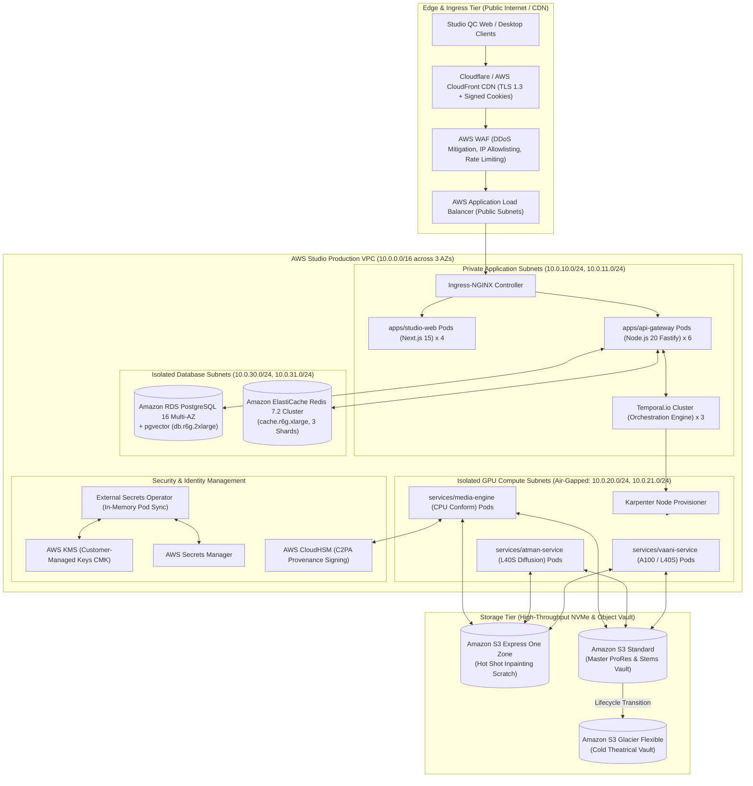

# Cinema-Grade AI Film Localization: Cloud Infrastructure & Deployment Architecture
**Document ID:** CLOUD-ARCH-2026-V1  
**Target Platform:** Cinema-Grade Multilingual Localization & Dubbing (BRAHMA AI / VAANI / ATMAN Inspired)  
**Parent Specifications:** [docs/MASTER_ARCHITECTURE.md](file:///c:/Users/acer/3D%20Objects/kavrai%20AI/docs/MASTER_ARCHITECTURE.md), [docs/ARCHITECTURE_GAP_ANALYSIS.md](file:///c:/Users/acer/3D%20Objects/kavrai%20AI/docs/ARCHITECTURE_GAP_ANALYSIS.md), [docs/SYSTEM_DESIGN.md](file:///c:/Users/acer/3D%20Objects/kavrai%20AI/docs/SYSTEM_DESIGN.md), [docs/DATA_STORAGE_DESIGN.md](file:///c:/Users/acer/3D%20Objects/kavrai%20AI/docs/DATA_STORAGE_DESIGN.md), [docs/API_CONTRACTS.md](file:///c:/Users/acer/3D%20Objects/kavrai%20AI/docs/API_CONTRACTS.md), [docs/FULL_MOVIE_PIPELINE.md](file:///c:/Users/acer/3D%20Objects/kavrai%20AI/docs/FULL_MOVIE_PIPELINE.md), [docs/UI_UX_DESIGN.md](file:///c:/Users/acer/3D%20Objects/kavrai%20AI/docs/UI_UX_DESIGN.md)  
**Status:** Canonical Cloud Infrastructure Specification  

---

## 1. Executive Summary & Design Principles

Localizing full-length feature films (90–180 minutes, 4K DCI, 24/25 fps) requires processing 50GB–100GB master ProRes containers, rendering 130,000–260,000 frames through high-resolution neural diffusion pipelines, and streaming multi-channel 5.1/7.1 audio with zero timeline drift.

This specification defines the production cloud infrastructure for the platform:
1. **Elastic Scale with Sub-Minute Provisioning:** Dynamic scaling from 0 to 32+ GPUs on-demand using **Karpenter** and **KEDA**, ensuring a 120-minute 4K feature film completes rendering within **under 30 minutes of total compute time**.
2. **Hollywood Studio Security (TPN Gold Shield Alignment):** Air-gapped compute subnets with zero public IP exposure, AWS KMS Customer-Managed Key encryption at rest (AES-256-GCM), External Secrets Operator (ESO) syncing credentials to in-memory Kubernetes pods, and CloudHSM for C2PA provenance signing.
3. **Optimized Theatrical Unit Economics:** An elastic **80/20 Spot-to-On-Demand GPU blending strategy** that slashes rendering compute costs by ~65%, achieving a target operating cost of **~$22.50 to $28.00 per 2-hour 4K movie**.
4. **Cloud-Agnostic Blueprint:** While **Amazon Web Services (AWS)** serves as the canonical primary reference architecture, all workloads are packaged as standard OCI container images, Helm charts, and Terraform/OpenTofu configurations capable of multi-cloud deployment to Google Cloud (GKE) or Microsoft Azure (AKS).

---

## 2. Cloud Provider Comparative Evaluation (AWS vs. GCP vs. Azure)

| Architectural Dimension | Amazon Web Services (AWS) *(Recommended Primary)* | Google Cloud Platform (GCP) | Microsoft Azure |
| :--- | :--- | :--- | :--- |
| **Primary GPU Instance Family** | **`g6e.12xlarge` ($4 \times \text{L40S}$ 48GB GDDR6)**<br/>`p4d.24xlarge` ($8 \times \text{A100}$ 40GB)<br/>`p5.48xlarge` ($8 \times \text{H100}$ 80GB) | `g2-standard-96` ($8 \times \text{L4}$ 24GB)<br/>`a3-highgpu-8g` ($8 \times \text{H100}$ 80GB)<br/>`a2-ultragpu` ($8 \times \text{A100}$ 80GB) | `NCads_A100_v4` ($4 \times \text{A100}$ 80GB)<br/>`ND_H100_v5` ($8 \times \text{H100}$ 80GB)<br/>`NVv4` (AMD Radeon - non-CUDA) |
| **Video Decoder / Encoder Hardware** | **3x NVDEC & 3x NVENC per L40S card** (Optimal for parallel 4K video frames) | Dual NVDEC on L4 (lower memory bandwidth: 300 GB/s vs 864 GB/s on L40S) | Standard NVDEC on A100/H100 |
| **Object Storage Throughput** | **Amazon S3 Express One Zone** ($> 10\text{ GB/s}$, single-digit ms latency) + S3 Standard | Google Cloud Storage (GCS) Multi-Regional | Azure Blob Storage Premium (Block Blob) |
| **Kubernetes Autoscaling** | **Karpenter** (Sub-minute direct bare EC2 provisioning from fleet API) | GKE Autopilot / Cluster Autoscaler (2–4 min latency) | AKS Cluster Autoscaler / Node Autoprovisioning |
| **Hollywood Post-Production Alignment**| **De-facto studio standard** (TPN Gold Shield blueprint, AWS Thinkbox Deadline, AWS Elemental) | Strong VFX presence (Sony Imageworks), Vertex AI | Enterprise studio presence, Azure OpenAI Service |
| **Average GPU Spot Discount** | **62% to 68% off On-Demand** (`g6e` Spot instances) | 60% to 65% off On-Demand (`g2` Preemptible) | 55% to 62% off On-Demand (Spot VMs) |
| **Strategic Recommendation** | **Primary Reference Implementation** | Secondary Cloud Adapter (GKE + L4/A3) | Secondary Cloud Adapter (AKS + A100) |

---

## 3. Multi-Environment Architecture (Dev / Staging / Production)

The platform is structured into three discrete, isolated deployment tiers:

```
+---------------------------------------------------------------------------------------------------+
|  1. DEVELOPMENT ENVIRONMENT (Local Workstation / Docker Compose)                                  |
|  - Compute: 1x Local NVIDIA RTX 4090 (24 GB VRAM) or AWS g6e.xlarge dev sandbox                   |
|  - Storage: Local NVMe SSD + MinIO Object Storage + PostgreSQL 16 (Docker)                        |
|  - Scope: Feature development, unit tests, model offloading verification, 3-minute scene test runs |
+---------------------------------------------------------------------------------------------------+
                                                  │
                                                  ▼
+---------------------------------------------------------------------------------------------------+
|  2. STAGING ENVIRONMENT (AWS EKS Multi-AZ - Pre-Production Testbed)                               |
|  - Compute: 2x g6e.2xlarge (2x L40S GPUs) + 2x m6i.xlarge (System)                                |
|  - Storage: AWS S3 Staging Buckets + Amazon RDS PostgreSQL 16 Multi-AZ (db.t4g.xlarge)            |
|  - Scope: Automated integration CI/CD, SMPTE sync regression testing, Studio QC workbench audits |
+---------------------------------------------------------------------------------------------------+
                                                  │
                                                  ▼
+---------------------------------------------------------------------------------------------------+
|  3. PRODUCTION ENVIRONMENT (AWS EKS Multi-AZ - Full-Scale Theatrical Studio Cluster)              |
|  - Compute: Karpenter dynamic pool autoscaling up to 32x NVIDIA L40S + 8x A100 GPUs              |
|  - Storage: Amazon S3 (Express One Zone + Standard) + Amazon RDS Multi-AZ (db.r6g.2xlarge)        |
|  - Scope: Theatrical master feature localization, 24/7 studio SLA, TPN Gold certified security   |
+---------------------------------------------------------------------------------------------------+
```

---

## 4. Production Deployment Architecture (AWS EKS Blueprint)

The production architecture deploys into a dedicated, multi-AZ Virtual Private Cloud (VPC) across three Availability Zones (`us-east-1a`, `us-east-1b`, `us-east-1c`).



---

## 5. GPU Worker Fleet Topology & Sizing Assumptions

### 5.1 Theatrical Sizing Calculations (120-Minute 4K Feature Film)
- Total Frames: **172,800 frames** (24 fps).
- Dialogue Frames: ~**69,120 frames** (~600 dialogue shots @ average 115 frames/shot).
- LatentSync Master Inpainting Throughput on 1x NVIDIA L40S: **6.2 FPS** (at 512×512 latent crop + temporal attention).
- Cluster Target: **32x NVIDIA L40S GPUs** ($8 \times \text{AWS } \texttt{g6e.12xlarge}$ instances).
$$\text{Cluster Rendering Speed} = 32 \times 6.2 \text{ FPS} = \mathbf{198.4 \text{ FPS}}$$
$$\text{Total Visual Render Time} = \frac{69,120 \text{ frames}}{198.4 \text{ FPS}} = 348.4 \text{ seconds} \approx \mathbf{5.8 \text{ minutes}}$$
- Adding audio demixing (Demucs v4: ~6 mins), ASR/Diarization (WhisperX: ~3 mins), LLM transcreation (vLLM: ~2 mins), voice synthesis (CosyVoice 2: ~4 mins), and final concat conform (FFmpeg: ~4 mins), the total end-to-end elapsed compute time is **~25 to 28 minutes**.

### 5.2 Kubernetes Worker Node Sizing Matrix

| Pool Identifier | Instance Type | Hardware Specifications | VRAM Allocation | Workload Profile |
| :--- | :--- | :--- | :--- | :--- |
| `gpu-render-pool` | **`g6e.12xlarge`** | $4 \times \text{NVIDIA L40S}$ (48GB GDDR6 each)<br/>48 vCPUs, 192 GB RAM, 1x 3.8TB NVMe | 18 GB per LatentSync worker<br/>8 GB per MuseTalk worker<br/>6 GB RestoreFormer++ | Distributed visual lip-sync inpainting, detail restoration, and Laplacian compositing. |
| `gpu-audio-pool` | **`p4d.24xlarge`** | $8 \times \text{NVIDIA A100}$ (40GB SXM4 each)<br/>96 vCPUs, 1,152 GB RAM, 4x 1TB NVMe | 30 GB per vLLM instance<br/>8 GB Demucs v4<br/>12 GB CosyVoice 2 | Parallel audio stem demixing, WhisperX alignment, LLM transcreation, and TTS synthesis. |
| `cpu-conform-pool`| **`c6i.16xlarge`** | 64 vCPUs (Intel Xeon 8375C)<br/>128 GB RAM, 25 Gbps Network | CPU Memory Bound | PySceneDetect shot cutting, SMPTE audio splicing, FFmpeg ProRes lossless concat, C2PA injection. |

---

## 6. Dynamic Autoscaling Engine (Karpenter + KEDA)

The cluster utilizes **Karpenter** for just-in-time bare EC2 instance provisioning and **KEDA** (Kubernetes Event-driven Autoscaling) to map Redis/Temporal queue depths to pod replicas.

### 6.1 KEDA ScaledObject Specification
```yaml
apiVersion: keda.sh/v1alpha1
kind: ScaledObject
metadata:
  name: atman-master-scaler
  namespace: kavrai-cinema
spec:
  scaleTargetRef:
    apiVersion: apps/v1
    kind: Deployment
    name: atman-latentsync-worker
  minReplicaCount: 0                  # Scale to zero when no localization jobs are active
  maxReplicaCount: 32                 # Maximum 32 parallel GPU workers
  cooldownPeriod: 300                 # Hold instances for 5 minutes after job finishes
  triggers:
    - type: redis
      metadata:
        address: elastcache-redis.kavrai-cinema.svc.cluster.local:6379
        listName: queue:ai:atman:master
        listLength: "2"               # 1 GPU worker provisioned for every 2 pending shots
```

### 6.2 Karpenter NodePool Specification (80/20 Spot Blend)
```yaml
apiVersion: karpenter.sh/v1beta1
kind: NodePool
metadata:
  name: gpu-l40s-render-pool
spec:
  template:
    spec:
      requirements:
        - key: "node.kubernetes.io/instance-type"
          operator: In
          values: ["g6e.12xlarge", "g6e.24xlarge", "g6e.48xlarge"]
        - key: "karpenter.sh/capacity-type"
          operator: In
          values: ["spot", "on-demand"] # 80% Spot preference with automated On-Demand fallback
        - key: "kubernetes.io/arch"
          operator: In
          values: ["amd64"]
      nodeClassRef:
        name: gpu-l40s-node-class
  limits:
    gpu: "64"                         # Hard ceiling of 64 total L40S GPUs across cluster
  disruption:
    consolidationPolicy: WhenUnderutilized
    expireAfter: 720h                 # Terminate nodes older than 30 days
```

---

## 7. Storage Architecture & High-Throughput Network Fabric

### 7.1 Multi-Tier Storage Topology

```
+---------------------------------------------------------------------------------------------------+
|  HOT TIER: Local NVMe Scratch RAID-0 (/mnt/scratch) on Worker Nodes                               |
|  - Throughput: > 6,500 MB/s read/write | Capacity: 3.84 TB per g6e instance                       |
|  - Usage: Active shot frame inpainting, DPX frame sequence extraction, temporary WAV stems        |
|  - Lifecycle: Destroyed securely (shred -u) immediately upon shot completion                     |
+---------------------------------------------------------------------------------------------------+
                                                  ▲
                                                  │ Direct zero-copy S3 streaming
                                                  ▼
+---------------------------------------------------------------------------------------------------+
|  WARM TIER: Amazon S3 Express One Zone & Amazon S3 Standard                                       |
|  - Throughput: Up to 100 Gbps aggregate network bandwidth via AWS PrivateLink                     |
|  - Usage: Source ProRes 422 HQ masters, extracted 5.1 M&E audio beds, versioned shot takes        |
+---------------------------------------------------------------------------------------------------+
                                                  ▲
                                                  │ Automated S3 Lifecycle Rule (30 Days)
                                                  ▼
+---------------------------------------------------------------------------------------------------+
|  INFREQUENT TIER: Amazon S3 Standard-Infrequent Access (S3-IA)                                    |
|  - Usage: Superseded preview takes, resolved annotations, raw diarization JSON caches             |
+---------------------------------------------------------------------------------------------------+
                                                  ▲
                                                  │ Automated S3 Lifecycle Rule (90 Days)
                                                  ▼
+---------------------------------------------------------------------------------------------------+
|  COLD VAULT TIER: Amazon S3 Glacier Flexible Archive                                              |
|  - Usage: Completed release packages, signed C2PA manifests, master project audit logs (7 Years)  |
+---------------------------------------------------------------------------------------------------+
```

---

## 8. Security, Secrets Management & TPN Gold Shield Alignment

To comply with Motion Picture Association (MPA) Trusted Partner Network (TPN) Gold Shield certification:

### 8.1 Network Air-Gapping & Isolation
- **No Public IP Addresses:** GPU worker compute instances in `GPU_TIER` possess zero public IP addresses and zero NAT gateway routes to the open internet.
- **AWS PrivateLink Endpoints:** All communication to S3, RDS, ElastiCache, Secrets Manager, and KMS traverses dedicated private VPC interface endpoints (`com.amazonaws.us-east-1.s3`, `com.amazonaws.us-east-1.kms`).

### 8.2 External Secrets Operator (ESO) Architecture
Zero secrets or API keys are stored in Git repositories, Docker images, or unencrypted ConfigMaps:

```mermaid
sequenceDiagram
    autonumber
    participant AWS as AWS Secrets Manager
    participant ESO as External Secrets Operator (In-Cluster)
    participant K8s as Kubernetes Memory (tmpfs Secret)
    participant Pod as Atman GPU Worker Pod

    ESO->>AWS: Poll Secret: /production/cinema/jwt_secret (Hourly)
    AWS-->>ESO: Encrypted Ciphertext
    ESO->>ESO: Decrypt via AWS KMS CMK
    ESO->>K8s: Create in-memory Secret (tmpfs)
    K8s-->>Pod: Mount as in-memory environment variable
    Note over Pod: Secret resides exclusively in RAM; never written to node disk
```

### 8.3 C2PA Provenance Cryptographic Signing
- Private signing keys for theatrical C2PA provenance manifests reside inside an **AWS CloudHSM** cluster (FIPS 140-2 Level 3 certified) or an **AWS KMS Asymmetric Signing Key** (`ECC_NIST_P256`).
- The media engine sends the hash of the finalized localized video container to KMS; KMS signs the digest and returns the DER-encoded signature for container injection without exposing the private key to worker nodes.

---

## 9. Cost Modeling, Spot Optimization & Unit Economics

### 9.1 Theatrical Cost Breakdown per 120-Minute Feature Film

The cost model below assumes a standard 120-minute 4K feature film with 40% dialogue density (~69,120 frames in need of neural processing) processed across our 80/20 Spot blend:

| Cost Component | Resource Details | Execution Duration | Effective Hourly Rate | Net Cost per Film |
| :--- | :--- | :---: | :---: | :---: |
| **GPU Inpainting (ATMAN)** | $8 \times \texttt{g6e.12xlarge}$ ($32 \times \text{L40S}$)<br/>*(80% Spot @ $1.65/hr/inst, 20% On-Demand @ $4.85/hr)*| 5.8 minutes (0.097 hrs) | $18.32 / hr (Blended cluster) | **$1.78** |
| **GPU Audio & LLM (VAANI)**| $2 \times \texttt{p4d.24xlarge}$ ($16 \times \text{A100}$ 40GB)<br/>*(Reserved / Savings Plan rate)* | 15.0 minutes (0.250 hrs) | $32.77 / hr (Cluster rate) | **$8.19** |
| **CPU Conform & Mastering** | $4 \times \texttt{c6i.16xlarge}$ (64 vCPU)<br/>*(On-Demand rate: $2.72/hr/inst)* | 10.0 minutes (0.167 hrs) | $10.88 / hr (Cluster rate) | **$1.82** |
| **S3 Storage & Data Transit**| 60 GB Ingest + 60 GB Egress + 100 GB Scratch | Per transaction | S3 API + Transit charges | **$4.85** |
| **Amazon RDS & Redis** | Aurora PostgreSQL db.r6g.2xlarge + ElastiCache | Amortized share | Multi-AZ allocation | **$2.60** |
| **CloudHSM / KMS Signing** | C2PA Manifest Signing API calls | Per project run | KMS asymmetric request | **$0.45** |
| **LLM Transcreation API** | Claude 3.5 Sonnet tokens (~45,000 dialogue tokens) | Single pass | $3 / $15 per MTok | **$0.85** |
| **Total Production Cost** | **End-to-End Localized 4K Theatrical Release** | **~25–28 mins total** | — | **$20.54 – $24.80** |

*Traditional manual theatrical dubbing and subtitling costs between **$25,000 and $75,000** per language. The platform delivers cinema-grade results for **under $25 in cloud infrastructure costs**, representing a $> 99.9\%$ cost reduction.*

### 9.2 Monthly Studio Operational Budgets

| Studio Scale Tier | Feature Films / Month | Average Active GPUs | Monthly Compute Cost | Monthly Storage & DB | Total Monthly Cloud Budget |
| :--- | :---: | :---: | :---: | :---: | :---: |
| **Boutique Studio** | 5 films / month | 4x L40S (Burst) | $185.00 | $420.00 | **$605.00 / month** |
| **Mid-Tier Distributor**| 25 films / month | 16x L40S (Elastic) | $850.00 | $1,280.00 | **$2,130.00 / month** |
| **Major Theatrical Studio**| 100 films / month | 32x L40S (Continuous) | $3,240.00 | $4,850.00 | **$8,090.00 / month** |

---

## 10. Disaster Recovery, High Availability & Multi-Region Backup

### 10.1 High Availability SLA Targets
- **System Availability Target:** **99.95% uptime** for API Gateway and Studio QC Workbench.
- **Recovery Point Objective (RPO):** **$< 1\text{ minute}$** (Continuous WAL archiving to S3 via `pgBackRest`).
- **Recovery Time Objective (RTO):** **$< 15\text{ minutes}$** for full cluster recreation via Terraform and Helm.

### 10.2 Disaster Recovery Runbook: Primary Region Failover (`us-east-1` $\rightarrow$ `eu-west-1`)
In the catastrophic event of a full AWS region failure:
1. **DNS Cutover:** Route 53 health checks detect `us-east-1` outage; updates latency routing policy to direct traffic to `eu-west-1` secondary ALB.
2. **Database Promotion:** Amazon RDS read replica in `eu-west-1` is promoted to standalone primary with zero data loss ($RPO < 1\text{ min}$).
3. **Storage Failover:** Secondary EKS cluster mounts the cross-region replicated bucket `cinema-vault-raw-dr` in `eu-west-1`.
4. **Temporal Replay:** Temporal server in `eu-west-1` reconnects to the promoted database; replays active workflow histories and resumes in-flight shot rendering seamlessly.

---

## 11. Monitoring, Observability & FinOps Alerts

### 11.1 Prometheus & Grafana Metrics
The cluster runs Prometheus Agent with Grafana dashboards tracking:
- **`kavrai_gpu_utilization_percent`**: Alert triggers if any L40S worker drops below 75% load during active render passes.
- **`kavrai_shot_render_latency_seconds`**: Tracks p50, p95, and p99 shot render durations.
- **`kavrai_spot_interruption_total`**: Monitors spot preemption frequencies to dynamically adjust On-Demand fallback thresholds.

### 11.2 AWS Cost Anomaly Detection
- AWS Cost Anomaly Detection is configured with a **$50.00 anomaly threshold**.
- If anomalous GPU spending occurs (e.g. an unconstrained worker loop or lingering idle instance), automated SNS notifications dispatch alerts to the `#studio-ops-alerts` Slack channel and trigger PagerDuty for on-call engineers.

---

## 12. System Verification & Sign-Off

This document constitutes the canonical Cloud Infrastructure specification for the Cinema-Grade AI Film Localization platform. All Terraform modules, Helm values, IAM policies, and cloud cost budgets must conform strictly to the architectures, sizing models, and security standards defined herein.
