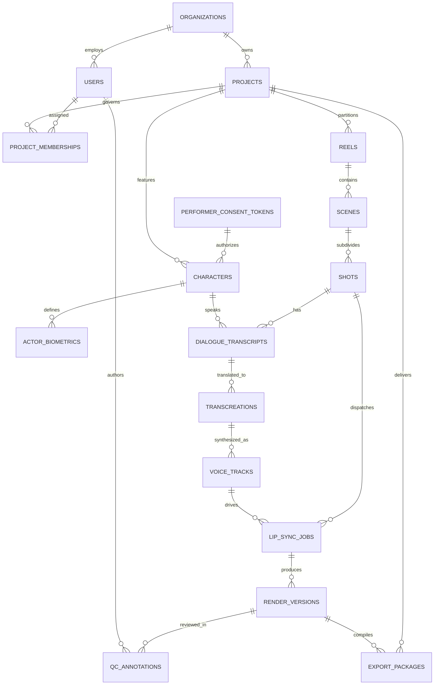
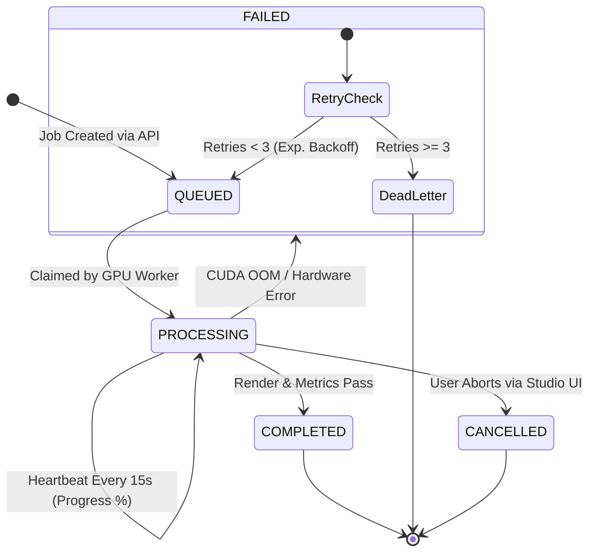
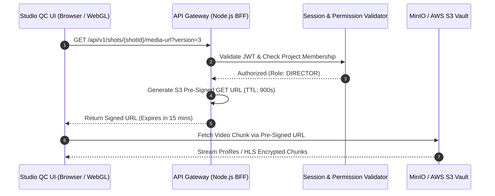

# Cinema-Grade AI Film Localization: Data Storage & Persistence Architecture
**Document ID:** DATA-ARCH-2026-V1  
**Target Platform:** Cinema-Grade Multilingual Localization & Dubbing (BRAHMA AI / VAANI / ATMAN Inspired)  
**Parent Specifications:** [docs/MASTER_ARCHITECTURE.md](file:///c:/Users/acer/3D%20Objects/kavrai%20AI/docs/MASTER_ARCHITECTURE.md), [docs/ARCHITECTURE_GAP_ANALYSIS.md](file:///c:/Users/acer/3D%20Objects/kavrai%20AI/docs/ARCHITECTURE_GAP_ANALYSIS.md), [docs/SYSTEM_DESIGN.md](file:///c:/Users/acer/3D%20Objects/kavrai%20AI/docs/SYSTEM_DESIGN.md)  
**Status:** Canonical Data Architecture Specification  

---

## 1. Executive Summary & Core Data Principles

This document defines the production data architecture for the cinema-grade AI film localization platform. Media localization on feature-length films requires orchestrating terabytes of high-bitrate video plates (ProRes 422 HQ / 4444, uncompressed DPX), multi-track audio beds (5.1/7.1 surround), sub-millisecond phoneme alignments, biometric performer likeness vectors, and multi-version render lineages.

### Core Data Principles
1. **ACID Relational Integrity:** Project structure, scenes, shots, transcreations, approval locks, and user permissions are managed in PostgreSQL 16 with strict transactional guarantees.
2. **Deterministic Frame-Accurate Indexing:** Every visual and acoustic asset is indexed against SMPTE timecodes (`HH:MM:SS:FF`) and absolute integer frame offsets tied to the project master frame rate (23.976, 24.000, 25.000, 29.970, or 30.000 fps).
3. **Immutable Render Versioning (Non-Destructive Editing):** AI generated shots, synthesized audio stems, and intermediate masks are written as immutable versioned objects (`v1`, `v2`, ... `vN`). Editing a script line or nudging a viseme creates a new child version, preserving complete historical lineage for studio A/B audit.
4. **Biometric Vault & Performer Rights Isolation:** Actor face embeddings (ArcFace 512-d) and voice vectors (ECAPA2 256-d) are isolated in dedicated tables with row-level security, cryptographically linked to SAG-AFTRA 2023 performer consent tokens.
5. **Separation of Metadata and Bulk Media:** High-throughput relational metadata resides in PostgreSQL and Redis; bulk video frames, audio stems, and neural weight caches reside in distributed S3/MinIO NVMe object storage.
6. **Zero Direct Media Exposure:** Client browsers and desktop QC applications never access raw storage directly. All media access is mediated via short-lived (15-minute TTL) pre-signed URLs or cryptographically signed CDN cookies bound to authenticated user sessions.

---

## 2. Conceptual & Logical Data Model (Entity-Relationship Diagram)



---

## 3. PostgreSQL 16 Relational & Vector Schema (Full DDL)

The complete SQL schema below leverages PostgreSQL 16, `uuid-ossp`, `pgcrypto`, and `pgvector`. It is fully normalized, enforces foreign key constraints with strict delete behaviors, and provides optimized indexes for real-time timeline queries.

```sql
-- ============================================================================
-- EXTENSIONS & CUSTOM DOMAINS / ENUMS
-- ============================================================================
CREATE EXTENSION IF NOT EXISTS "uuid-ossp";
CREATE EXTENSION IF NOT EXISTS "pgcrypto";
CREATE EXTENSION IF NOT EXISTS "vector";

CREATE TYPE user_system_role AS ENUM (
    'SUPER_ADMIN', 
    'STUDIO_ADMIN', 
    'USER'
);

CREATE TYPE project_role AS ENUM (
    'EXECUTIVE_PRODUCER', 
    'DIRECTOR', 
    'LEAD_VFX_SUPERVISOR', 
    'SOUND_SUPERVISOR', 
    'DIALOGUE_EDITOR', 
    'LINGUIST_QC', 
    'VIEWER'
);

CREATE TYPE qc_status_type AS ENUM (
    'PENDING_PROCESSING', 
    'IN_REVIEW', 
    'CHANGES_REQUESTED', 
    'APPROVED_INTERNAL', 
    'APPROVED_DIRECTOR', 
    'LOCKED'
);

CREATE TYPE render_tier_type AS ENUM (
    'TIER_1_PREVIEW', 
    'TIER_2_MASTER'
);

CREATE TYPE job_state_type AS ENUM (
    'QUEUED', 
    'PROCESSING', 
    'COMPLETED', 
    'FAILED', 
    'CANCELLED'
);

CREATE TYPE loudness_standard_type AS ENUM (
    'ITU_R_BS_1770_4_EBU_R128',   -- -23.0 LUFS (Broadcast EU)
    'ITU_R_BS_1770_4_ATSC_A85',    -- -24.0 LKFS (US Broadcast / Theatrical OTT)
    'NETFLIX_STANDARD_DIALOGUE'    -- -27.0 LKFS (+/- 1.0)
);

-- ============================================================================
-- 1. ORGANIZATIONS, USERS & ACCESS GOVERNANCE
-- ============================================================================
CREATE TABLE organizations (
    id UUID PRIMARY KEY DEFAULT gen_random_uuid(),
    name VARCHAR(255) NOT NULL,
    slug VARCHAR(100) NOT NULL UNIQUE,
    billing_tier VARCHAR(50) NOT NULL DEFAULT 'ENTERPRISE_STUDIO',
    tpn_gold_certified BOOLEAN NOT NULL DEFAULT FALSE,
    created_at TIMESTAMP WITH TIME ZONE DEFAULT CURRENT_TIMESTAMP,
    updated_at TIMESTAMP WITH TIME ZONE DEFAULT CURRENT_TIMESTAMP
);

CREATE TABLE users (
    id UUID PRIMARY KEY DEFAULT gen_random_uuid(),
    organization_id UUID NOT NULL REFERENCES organizations(id) ON DELETE RESTRICT,
    email VARCHAR(255) NOT NULL UNIQUE,
    password_hash VARCHAR(255) NOT NULL,
    full_name VARCHAR(255) NOT NULL,
    system_role user_system_role NOT NULL DEFAULT 'USER',
    is_active BOOLEAN NOT NULL DEFAULT TRUE,
    last_login_at TIMESTAMP WITH TIME ZONE,
    created_at TIMESTAMP WITH TIME ZONE DEFAULT CURRENT_TIMESTAMP,
    updated_at TIMESTAMP WITH TIME ZONE DEFAULT CURRENT_TIMESTAMP
);

CREATE INDEX idx_users_org ON users(organization_id);

-- ============================================================================
-- 2. PERFORMER RIGHTS & CONSENT LEDGER (SAG-AFTRA 2023 COMPLIANCE)
-- ============================================================================
CREATE TABLE performer_consent_tokens (
    id UUID PRIMARY KEY DEFAULT gen_random_uuid(),
    organization_id UUID NOT NULL REFERENCES organizations(id) ON DELETE RESTRICT,
    performer_legal_name VARCHAR(255) NOT NULL,
    stage_name VARCHAR(255),
    union_affiliation VARCHAR(50) NOT NULL DEFAULT 'SAG-AFTRA',
    union_member_id VARCHAR(100),
    consent_contract_sha256 VARCHAR(64) NOT NULL,
    voice_cloning_permitted BOOLEAN NOT NULL DEFAULT TRUE,
    visual_reenactment_permitted BOOLEAN NOT NULL DEFAULT TRUE,
    authorized_languages VARCHAR(10)[] NOT NULL,
    valid_from TIMESTAMP WITH TIME ZONE NOT NULL,
    valid_until TIMESTAMP WITH TIME ZONE NOT NULL,
    revoked BOOLEAN NOT NULL DEFAULT FALSE,
    revocation_timestamp TIMESTAMP WITH TIME ZONE,
    contract_pdf_s3_uri TEXT NOT NULL,
    created_at TIMESTAMP WITH TIME ZONE DEFAULT CURRENT_TIMESTAMP
);

CREATE INDEX idx_consent_performer ON performer_consent_tokens(performer_legal_name, valid_until);

-- ============================================================================
-- 3. PROJECTS & HIERARCHICAL REELS
-- ============================================================================
CREATE TABLE projects (
    id UUID PRIMARY KEY DEFAULT gen_random_uuid(),
    organization_id UUID NOT NULL REFERENCES organizations(id) ON DELETE CASCADE,
    title VARCHAR(255) NOT NULL,
    imdb_id VARCHAR(50),
    source_language VARCHAR(10) NOT NULL DEFAULT 'en',
    target_languages VARCHAR(10)[] NOT NULL,
    master_frame_rate NUMERIC(6,3) NOT NULL DEFAULT 24.000,
    aspect_ratio VARCHAR(20) NOT NULL DEFAULT '2.39:1',
    color_space VARCHAR(50) NOT NULL DEFAULT 'ACEScg',
    loudness_standard loudness_standard_type NOT NULL DEFAULT 'ITU_R_BS_1770_4_ATSC_A85',
    target_lufs NUMERIC(4,1) NOT NULL DEFAULT -24.0,
    raw_master_s3_uri TEXT NOT NULL,
    is_archived BOOLEAN NOT NULL DEFAULT FALSE,
    created_at TIMESTAMP WITH TIME ZONE DEFAULT CURRENT_TIMESTAMP,
    updated_at TIMESTAMP WITH TIME ZONE DEFAULT CURRENT_TIMESTAMP
);

CREATE INDEX idx_projects_org ON projects(organization_id);

CREATE TABLE project_memberships (
    id UUID PRIMARY KEY DEFAULT gen_random_uuid(),
    project_id UUID NOT NULL REFERENCES projects(id) ON DELETE CASCADE,
    user_id UUID NOT NULL REFERENCES users(id) ON DELETE CASCADE,
    role project_role NOT NULL DEFAULT 'VIEWER',
    can_approve_qc BOOLEAN NOT NULL DEFAULT FALSE,
    can_trigger_export BOOLEAN NOT NULL DEFAULT FALSE,
    created_at TIMESTAMP WITH TIME ZONE DEFAULT CURRENT_TIMESTAMP,
    CONSTRAINT unique_project_user UNIQUE (project_id, user_id)
);

CREATE TABLE reels (
    id UUID PRIMARY KEY DEFAULT gen_random_uuid(),
    project_id UUID NOT NULL REFERENCES projects(id) ON DELETE CASCADE,
    reel_index INT NOT NULL,
    name VARCHAR(100) NOT NULL, -- e.g. "Reel 1: Act I"
    start_frame INT NOT NULL,
    end_frame INT NOT NULL,
    start_smpte VARCHAR(12) NOT NULL,
    end_smpte VARCHAR(12) NOT NULL,
    source_video_s3_uri TEXT NOT NULL,
    clean_m_and_e_s3_uri TEXT,
    created_at TIMESTAMP WITH TIME ZONE DEFAULT CURRENT_TIMESTAMP,
    CONSTRAINT unique_project_reel_index UNIQUE (project_id, reel_index)
);

CREATE INDEX idx_reels_project ON reels(project_id, reel_index);

-- ============================================================================
-- 4. CHARACTERS & BIOMETRIC VAULT
-- ============================================================================
CREATE TABLE characters (
    id UUID PRIMARY KEY DEFAULT gen_random_uuid(),
    project_id UUID NOT NULL REFERENCES projects(id) ON DELETE CASCADE,
    consent_token_id UUID REFERENCES performer_consent_tokens(id) ON DELETE RESTRICT,
    character_name VARCHAR(255) NOT NULL,
    actor_name VARCHAR(255) NOT NULL,
    gender VARCHAR(50),
    is_lead_character BOOLEAN NOT NULL DEFAULT FALSE,
    created_at TIMESTAMP WITH TIME ZONE DEFAULT CURRENT_TIMESTAMP
);

CREATE INDEX idx_characters_project ON characters(project_id);

CREATE TABLE actor_biometrics (
    id UUID PRIMARY KEY DEFAULT gen_random_uuid(),
    character_id UUID NOT NULL REFERENCES characters(id) ON DELETE CASCADE,
    face_embedding vector(512),      -- ArcFace 512-d normalized face vector
    voice_embedding vector(256),     -- ECAPA2 256-d speaker timbre vector
    reference_audio_s3_uri TEXT NOT NULL,
    reference_face_crop_s3_uri TEXT NOT NULL,
    created_at TIMESTAMP WITH TIME ZONE DEFAULT CURRENT_TIMESTAMP
);

CREATE INDEX idx_biometrics_face ON actor_biometrics USING ivfflat (face_embedding vector_cosine_ops) WITH (lists = 100);
CREATE INDEX idx_biometrics_voice ON actor_biometrics USING ivfflat (voice_embedding vector_cosine_ops) WITH (lists = 100);

-- ============================================================================
-- 5. SCENES & SHOTS (FRAME-ACCURATE CHUNKING)
-- ============================================================================
CREATE TABLE scenes (
    id UUID PRIMARY KEY DEFAULT gen_random_uuid(),
    reel_id UUID NOT NULL REFERENCES reels(id) ON DELETE CASCADE,
    scene_index INT NOT NULL,
    name VARCHAR(255),
    start_frame INT NOT NULL,
    end_frame INT NOT NULL,
    start_smpte VARCHAR(12) NOT NULL,
    end_smpte VARCHAR(12) NOT NULL,
    estimated_reverb_rt60_ms INT DEFAULT 250,
    created_at TIMESTAMP WITH TIME ZONE DEFAULT CURRENT_TIMESTAMP,
    CONSTRAINT unique_reel_scene_index UNIQUE (reel_id, scene_index)
);

CREATE TABLE shots (
    id UUID PRIMARY KEY DEFAULT gen_random_uuid(),
    scene_id UUID NOT NULL REFERENCES scenes(id) ON DELETE CASCADE,
    shot_index INT NOT NULL,
    start_frame INT NOT NULL,
    end_frame INT NOT NULL,
    start_smpte VARCHAR(12) NOT NULL,
    end_smpte VARCHAR(12) NOT NULL,
    has_active_dialogue BOOLEAN NOT NULL DEFAULT FALSE,
    active_character_id UUID REFERENCES characters(id) ON DELETE SET NULL,
    is_offscreen_dialogue BOOLEAN NOT NULL DEFAULT FALSE,
    source_chunk_s3_uri TEXT NOT NULL,
    active_render_version_id UUID, -- Foreign key added via ALTER TABLE below
    qc_status qc_status_type NOT NULL DEFAULT 'PENDING_PROCESSING',
    created_at TIMESTAMP WITH TIME ZONE DEFAULT CURRENT_TIMESTAMP,
    CONSTRAINT unique_scene_shot_index UNIQUE (scene_id, shot_index)
);

CREATE INDEX idx_shots_scene_frames ON shots(scene_id, start_frame, end_frame);
CREATE INDEX idx_shots_qc_status ON shots(qc_status);

-- ============================================================================
-- 6. TRANSCRIPTS, TRANSCREATIONS & VOICE TRACKS
-- ============================================================================
CREATE TABLE dialogue_transcripts (
    id UUID PRIMARY KEY DEFAULT gen_random_uuid(),
    shot_id UUID NOT NULL REFERENCES shots(id) ON DELETE CASCADE,
    character_id UUID REFERENCES characters(id) ON DELETE SET NULL,
    start_frame INT NOT NULL,
    end_frame INT NOT NULL,
    start_time_ms INT NOT NULL,
    end_time_ms INT NOT NULL,
    source_text TEXT NOT NULL,
    source_language VARCHAR(10) NOT NULL,
    source_syllable_count INT NOT NULL,
    word_alignments JSONB NOT NULL,    -- WhisperX array of {word, start_ms, end_ms, phonemes}
    isolated_vocal_s3_uri TEXT NOT NULL,
    created_at TIMESTAMP WITH TIME ZONE DEFAULT CURRENT_TIMESTAMP
);

CREATE INDEX idx_transcripts_shot ON dialogue_transcripts(shot_id);

CREATE TABLE transcreations (
    id UUID PRIMARY KEY DEFAULT gen_random_uuid(),
    dialogue_transcript_id UUID NOT NULL REFERENCES dialogue_transcripts(id) ON DELETE CASCADE,
    target_language VARCHAR(10) NOT NULL,
    translated_text TEXT NOT NULL,
    syllable_count INT NOT NULL,
    syllable_delta INT NOT NULL,        -- Difference from source_syllable_count
    viseme_anchors JSONB NOT NULL,      -- Array of {viseme, target_frame, is_closure}
    is_approved BOOLEAN NOT NULL DEFAULT FALSE,
    created_at TIMESTAMP WITH TIME ZONE DEFAULT CURRENT_TIMESTAMP,
    CONSTRAINT unique_transcript_target_lang UNIQUE (dialogue_transcript_id, target_language)
);

CREATE INDEX idx_transcreations_lookup ON transcreations(dialogue_transcript_id, target_language);

CREATE TABLE voice_tracks (
    id UUID PRIMARY KEY DEFAULT gen_random_uuid(),
    transcreation_id UUID NOT NULL REFERENCES transcreations(id) ON DELETE CASCADE,
    take_number INT NOT NULL DEFAULT 1,
    synthesized_audio_s3_uri TEXT NOT NULL,
    convolved_reverb_s3_uri TEXT NOT NULL,
    measured_duration_ms INT NOT NULL,
    duration_delta_ms INT NOT NULL,
    measured_lufs NUMERIC(4,1) NOT NULL,
    speaker_similarity_sec NUMERIC(4,3) NOT NULL,
    created_at TIMESTAMP WITH TIME ZONE DEFAULT CURRENT_TIMESTAMP,
    CONSTRAINT unique_transcreation_take UNIQUE (transcreation_id, take_number)
);

-- ============================================================================
-- 7. LIP-SYNC JOBS & IMMUTABLE RENDER VERSIONS
-- ============================================================================
CREATE TABLE lip_sync_jobs (
    id UUID PRIMARY KEY DEFAULT gen_random_uuid(),
    shot_id UUID NOT NULL REFERENCES shots(id) ON DELETE CASCADE,
    voice_track_id UUID NOT NULL REFERENCES voice_tracks(id) ON DELETE CASCADE,
    tier render_tier_type NOT NULL DEFAULT 'TIER_1_PREVIEW',
    state job_state_type NOT NULL DEFAULT 'QUEUED',
    worker_node_id VARCHAR(100),
    progress_percentage NUMERIC(5,2) NOT NULL DEFAULT 0.00,
    parameters JSONB NOT NULL,         -- {guidance_scale, num_steps, restoration_model}
    error_message TEXT,
    started_at TIMESTAMP WITH TIME ZONE,
    completed_at TIMESTAMP WITH TIME ZONE,
    created_at TIMESTAMP WITH TIME ZONE DEFAULT CURRENT_TIMESTAMP
);

CREATE INDEX idx_jobs_state ON lip_sync_jobs(state);

CREATE TABLE render_versions (
    id UUID PRIMARY KEY DEFAULT gen_random_uuid(),
    shot_id UUID NOT NULL REFERENCES shots(id) ON DELETE CASCADE,
    job_id UUID REFERENCES lip_sync_jobs(id) ON DELETE SET NULL,
    version_number INT NOT NULL,
    tier render_tier_type NOT NULL,
    rendered_video_s3_uri TEXT NOT NULL,
    preview_hls_playlist_uri TEXT,
    face_mask_s3_uri TEXT,
    sync_score_lse_c NUMERIC(4,2),     -- SyncNet Confidence (Target >= 8.2)
    sync_score_lse_d NUMERIC(4,2),     -- SyncNet Distance (Target <= 6.5)
    perceptual_lpips NUMERIC(4,3),     -- LPIPS Quality (Target <= 0.04)
    is_locked BOOLEAN NOT NULL DEFAULT FALSE,
    created_at TIMESTAMP WITH TIME ZONE DEFAULT CURRENT_TIMESTAMP,
    CONSTRAINT unique_shot_version UNIQUE (shot_id, version_number)
);

ALTER TABLE shots ADD CONSTRAINT fk_shots_active_render 
    FOREIGN KEY (active_render_version_id) REFERENCES render_versions(id) ON DELETE SET NULL;

CREATE INDEX idx_render_versions_shot ON render_versions(shot_id, version_number);

-- ============================================================================
-- 8. QC ANNOTATIONS, EXPORT PACKAGES & AUDIT TRAILS
-- ============================================================================
CREATE TABLE qc_annotations (
    id UUID PRIMARY KEY DEFAULT gen_random_uuid(),
    render_version_id UUID NOT NULL REFERENCES render_versions(id) ON DELETE CASCADE,
    user_id UUID NOT NULL REFERENCES users(id) ON DELETE RESTRICT,
    frame_index INT NOT NULL,
    smpte_timecode VARCHAR(12) NOT NULL,
    annotation_type VARCHAR(50) NOT NULL, -- 'LIP_DESYNC', 'SEAM_ARTIFACT', 'TIMING_NUDGE'
    bounding_box_rect JSONB,              -- {x, y, width, height}
    comment TEXT NOT NULL,
    is_resolved BOOLEAN NOT NULL DEFAULT FALSE,
    resolved_by_user_id UUID REFERENCES users(id),
    created_at TIMESTAMP WITH TIME ZONE DEFAULT CURRENT_TIMESTAMP
);

CREATE INDEX idx_qc_annotations_version ON qc_annotations(render_version_id, frame_index);

CREATE TABLE export_packages (
    id UUID PRIMARY KEY DEFAULT gen_random_uuid(),
    project_id UUID NOT NULL REFERENCES projects(id) ON DELETE CASCADE,
    target_language VARCHAR(10) NOT NULL,
    package_format VARCHAR(50) NOT NULL DEFAULT 'PRORES_422_HQ',
    master_video_s3_uri TEXT NOT NULL,
    final_5_1_audio_s3_uri TEXT NOT NULL,
    c2pa_manifest_s3_uri TEXT NOT NULL,
    c2pa_manifest_sha256 VARCHAR(64) NOT NULL,
    generated_by_user_id UUID NOT NULL REFERENCES users(id),
    approved_by_user_id UUID NOT NULL REFERENCES users(id),
    created_at TIMESTAMP WITH TIME ZONE DEFAULT CURRENT_TIMESTAMP
);

CREATE TABLE security_audit_logs (
    id UUID PRIMARY KEY DEFAULT gen_random_uuid(),
    organization_id UUID NOT NULL REFERENCES organizations(id) ON DELETE CASCADE,
    user_id UUID REFERENCES users(id) ON DELETE SET NULL,
    action VARCHAR(100) NOT NULL,         -- 'EXPORT_PROJECT', 'VIEW_BIOMETRICS', 'APPROVE_QC'
    resource_type VARCHAR(50) NOT NULL,
    resource_id UUID NOT NULL,
    ip_address INET NOT NULL,
    user_agent TEXT NOT NULL,
    request_payload JSONB,
    created_at TIMESTAMP WITH TIME ZONE DEFAULT CURRENT_TIMESTAMP
);

CREATE INDEX idx_audit_org_time ON security_audit_logs(organization_id, created_at DESC);
```

---

## 4. Schema Evolution: Comparison Against Initial `SYSTEM_DESIGN.md`

| Entity / Dimension | `SYSTEM_DESIGN.md` Baseline | Production `DATA_STORAGE_DESIGN.md` Evolution | Technical Rationale |
| :--- | :--- | :--- | :--- |
| **Multi-Tenancy** | Projects had no organization parent; flat project records. | Added `organizations` table; all users, tokens, and audit logs are strictly scoped by `organization_id`. | Essential for enterprise studio multi-tenancy and data isolation. |
| **Movie Hierarchy** | Single `shots` table attached directly to `projects`. | Normalized into `projects` $\rightarrow$ `reels` $\rightarrow$ `scenes` $\rightarrow$ `shots`. | Feature films are divided into reels (Acts I–III) and scenes with distinct acoustic room properties. |
| **Character & Biometrics** | Single unified `actor_biometric_profiles` table. | Split into `characters` (script role) and `actor_biometrics` (isolated vector vault). | One character can have multiple takes/references; decouples script character from biometric keys. |
| **Transcripts & Translation** | Single `dialogue_segments` table storing both source & target text. | Decomposed into `dialogue_transcripts`, `transcreations`, and `voice_tracks`. | Supports multiple localized languages simultaneously per shot and multiple translation takes. |
| **Render Lineage & Jobs** | Implicit rendering with only URLs stored on shots. | Decoupled `lip_sync_jobs` (execution state) and `render_versions` (immutable artifacts). | Enables non-destructive A/B testing across multiple takes without overwriting past renders. |
| **RBAC & Governance** | Flat `author_role` strings in annotations. | Normalized `project_memberships` with granular permissions (`can_approve_qc`, `can_trigger_export`). | Guarantees only authorized Directors or Lead VFX supervisors can lock shots or export releases. |
| **Acoustic Mastering** | Loudness format was an unvalidated string. | Added `loudness_standard_type` enum (`ITU_R_BS_1770_4`, `EBU_R128`, `NETFLIX`) and target LUFS constraints. | Prevents broadcast delivery rejections due to non-compliant dynamic range. |

---

## 5. Object Storage Topology (MinIO / AWS S3)

High-performance NVMe object storage is organized under a deterministic, immutable key hierarchy across four dedicated buckets:

```
s3://
├── cinema-vault-raw/               # Immutable source masters and reels
├── cinema-vault-stems/             # Extracted vocal and M&E audio stems
├── cinema-vault-renders/           # Shot-level inpainting plates & versioned takes
└── cinema-vault-exports/           # Theatrical release IMF / DCP / ProRes packages
```

### 5.1 Deterministic Key Path Schema

```
# Raw Masters
s3://cinema-vault-raw/
    └── org_{orgId}/
        └── proj_{projectId}/
            ├── source_master_prores422hq.mov
            └── reels/
                ├── reel_01.mov
                └── reel_02.mov

# Isolated Audio Stems
s3://cinema-vault-stems/
    └── proj_{projectId}/
        ├── m_and_e_5.1.wav
        └── shots/
            └── shot_{shotId}/
                ├── original_vocals.wav
                ├── transcreation_{lang}/
                │   ├── take_01_dry.wav
                │   └── take_01_convolved.wav
                └── take_02_convolved.wav

# Shot Inpainting & Render Takes
s3://cinema-vault-renders/
    └── proj_{projectId}/
        └── shots/
            └── shot_{shotId}/
                ├── source_plate_10bit.mov
                ├── face_mask.png
                ├── v1_preview_musetalk.mp4
                ├── v2_master_latentsync.mov
                └── hls/
                    ├── master.m3u8
                    └── seg_001.ts

# Final Deliverables
s3://cinema-vault-exports/
    └── proj_{projectId}/
        └── export_{exportId}/
            ├── dune2_hindi_theatrical_prores422hq.mov
            ├── dune2_hindi_5.1_master.wav
            ├── c2pa_provenance_manifest.json
            └── c2pa_provenance_manifest.sig
```

### 5.2 Storage Tiering & Lifecycle Transition Policy

| Storage Tier | Target Asset Types | Hardware / Storage Class | Transition Trigger | Lifecycle Rule |
| :--- | :--- | :--- | :--- | :--- |
| **Hot NVMe Scratch** | Active shot inpainting frames, uncompressed DPX/PNG sequences | Local NVMe RAID-0 on Worker ($> 6.5\text{ GB/s}$) | Task Completion | Securely wiped (`shred -u`) immediately after render upload |
| **Warm Standard S3** | Active project reels, current shot takes, preview HLS streams | S3 Standard / Ceph NVMe-oF ($100\text{ GbE}$) | Project Active | Retained during active localization & QC review |
| **Infrequent S3 (IA)** | Superseded render versions (`v1`, `v2` after `v3` is approved) | S3 Standard-Infrequent Access | 30 days inactive | Automatically transitioned via S3 lifecycle rule |
| **Cold Glacier Vault** | Completed release packages, C2PA manifests, master audit logs | S3 Glacier Flexible Archive | 90 days post-export | Retained for 7 years for studio copyright compliance |

---

## 6. Job Status, Task Queuing & Distributed State Tracking

Long-running video inpainting and audio synthesis tasks are tracked through stateful job records in both Redis and PostgreSQL.

### 6.1 Job State Transition Model



### 6.2 Distributed Locking & Idempotency
To prevent duplicate GPU processing across autoscaled Kubernetes nodes:
- **Redis Distributed Mutex (`Redlock`):** A lock key `lock:shot:render:{shotId}` is acquired with a 60-second TTL before a worker begins loading tensors.
- **Heartbeat Daemon:** The GPU worker extends the lock every 15 seconds while processing frames. If the pod crashes or is evicted by Kubernetes, the lock expires automatically, allowing an idle worker to claim the retry.

---

## 7. Media Versioning, Lineage & Non-Destructive Editing

The platform enforces strict non-destructive editing. Modifying a line of translated dialogue never overwrites existing visual renders.

```
Shot #142 Version Lineage:
├── v1 (TIER_1_PREVIEW: MuseTalk) ──► QC Feedback: "Timing desync on word 'perimeter'"
│    │
│    └── v2 (TIER_1_PREVIEW: MuseTalk + Viseme Nudge -2 Frames) ──► QC: "Approved by Dialogue Lead"
│         │
│         └── v3 (TIER_2_MASTER: LatentSync + RestoreFormer++) ──► QC: "Theatrical Lock by Director"
│              └── Linked to active_render_version_id on shot_0142
```

- **A/B Comparison:** The Studio QC Workbench requests both `v1` and `v3` URIs simultaneously, enabling real-time split-screen wiping and visual difference heatmaps.
- **Rollback:** Directors can instantly revert `active_render_version_id` to any prior take with zero re-rendering overhead.

---

## 8. Backup, Disaster Recovery & Data Retention Policies

### 8.1 Database High Availability & PITR
- **Primary-Replica Topology:** PostgreSQL 16 Multi-AZ deployment with synchronous streaming replication to a standby instance (Zero RPO).
- **Point-in-Time Recovery (PITR):** Continuous Write-Ahead Log (WAL) archiving to S3 using `pgBackRest`. Enables restoring the database to any exact second within the last 30 days.
- **Disaster Recovery Target:** Recovery Point Objective (RPO) $< 1\text{ minute}$; Recovery Time Objective (RTO) $< 15\text{ minutes}$.

### 8.2 Media Redundancy & Cross-Region Replication (CRR)
- The raw source bucket (`cinema-vault-raw`) and final export bucket (`cinema-vault-exports`) enable AWS S3 Cross-Region Replication (CRR) to a secondary geographically isolated facility (e.g., `us-east-1` $\leftrightarrow$ `eu-west-1`).

---

## 9. Secure Media Access & Studio Compliance (MPA / TPN Alignment)

To comply with Motion Picture Association (MPA) Trusted Partner Network (TPN) Gold Shield requirements, unreleased cinematic content is secured against unauthorized interception or extraction.

### 9.1 Pre-Signed Media URL Architecture



### 9.2 Cryptographic Content Protection
- **Encryption in Flight:** TLS 1.3 enforced with strict cipher suites (`TLS_AES_256_GCM_SHA384`).
- **Encryption at Rest:** AES-256-GCM enforced on all S3 buckets using AWS KMS Customer Managed Keys (CMK) with automated annual key rotation.
- **Digital Forensic Watermarking:** Dynamically overlays a semi-transparent, imperceptible forensic watermark containing `{userId}_{timestamp}_{ipAddress}` across all preview video frames delivered to the Studio QC Workbench, deterring screengrab leaks.
