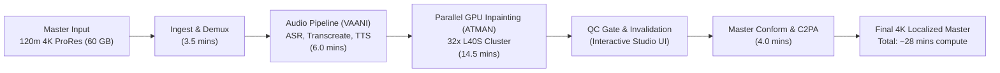
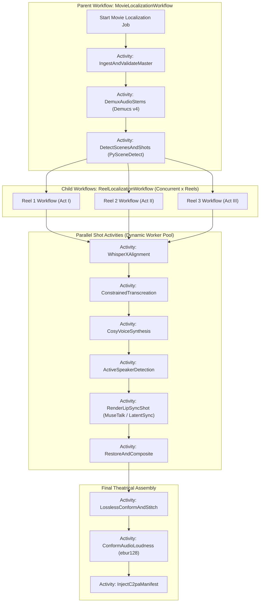
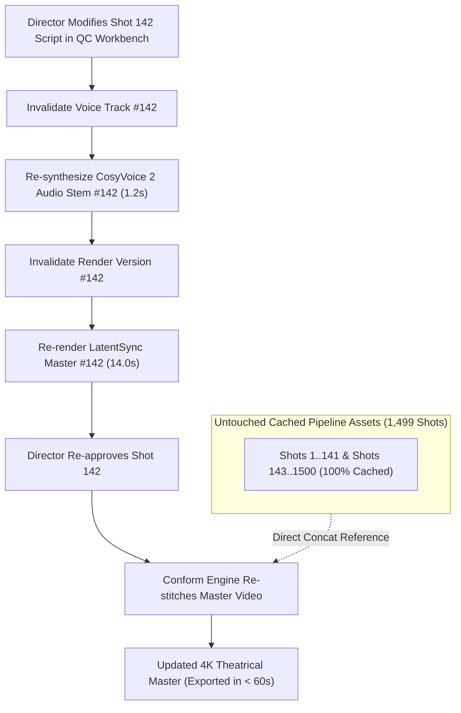

# Cinema-Grade AI Film Localization: Full-Movie Distributed Processing Pipeline
**Document ID:** PIPE-SPEC-2026-V1  
**Target Platform:** Cinema-Grade Multilingual Localization & Dubbing (BRAHMA AI / VAANI / ATMAN Inspired)  
**Parent Specifications:** [docs/MASTER_ARCHITECTURE.md](file:///c:/Users/acer/3D%20Objects/kavrai%20AI/docs/MASTER_ARCHITECTURE.md), [docs/ARCHITECTURE_GAP_ANALYSIS.md](file:///c:/Users/acer/3D%20Objects/kavrai%20AI/docs/ARCHITECTURE_GAP_ANALYSIS.md), [docs/SYSTEM_DESIGN.md](file:///c:/Users/acer/3D%20Objects/kavrai%20AI/docs/SYSTEM_DESIGN.md), [docs/DATA_STORAGE_DESIGN.md](file:///c:/Users/acer/3D%20Objects/kavrai%20AI/docs/DATA_STORAGE_DESIGN.md), [docs/API_CONTRACTS.md](file:///c:/Users/acer/3D%20Objects/kavrai%20AI/docs/API_CONTRACTS.md)  
**Status:** Canonical Pipeline Architecture Specification  

---

## 1. Executive Summary & Pipeline Throughput Targets

Processing a full-length theatrical feature film (90–180 minutes, 4K/2K DCI, 24/25 fps) into a localized multilingual release involves rendering **130,000 to 260,000 frames** across **1,200 to 2,000 discrete shots** alongside multi-track 5.1/7.1 audio beds. 

A failure in frame rate conversion, audio drift, GPU worker memory allocation, or network transit can ruin theatrical delivery or corrupt studio intellectual property. This specification defines the fault-tolerant, distributed processing pipeline governing full-movie localization.

### 1.1 Theatrical Throughput Targets (Standard 120-minute 4K Feature)
- **Input Film Scope:** 120 minutes @ 24.000 fps = **172,800 frames** across ~**1,500 shots**.
- **Dialogue Density:** ~40% average dialogue coverage = ~**600 dialogue shots** (~69,120 frames requiring visual manipulation).
- **Target Compute Time:** Less than **30 minutes total elapsed compute time** across a standard studio cluster of $32 \times \text{NVIDIA L40S}$ GPUs.
- **Timeline Drift Invariant:** **0 frames drift ($\pm 0.0\text{ ms}$)** across the entire 120-minute timeline.



---

## 2. Temporal.io Workflow Hierarchy & State Machines

To eliminate the fragility of custom distributed state machines, the entire movie lifecycle is orchestrated using **Temporal.io Code-as-Workflows**. Temporal guarantees durable execution, automatic state persistence, sub-workflow chunking, and deterministic replay upon worker node crashes.

### 2.1 Workflow Hierarchy Topology



### 2.2 Temporal Python Workflow Definition
```python
from datetime import timedelta
from temporalio import workflow
from temporalio.common import RetryPolicy

# Define retry policies for transient GPU / network failures
gpu_retry_policy = RetryPolicy(
    initial_interval=timedelta(seconds=5),
    backoff_coefficient=2.0,
    maximum_interval=timedelta(minutes=2),
    maximum_attempts=5,
    non_retryable_error_types=["PerformerConsentRevokedError", "CorruptMediaFrameError"]
)

@workflow.defn
class MovieLocalizationWorkflow:
    @workflow.run
    async def run(self, input_params: dict) -> dict:
        project_id = input_params["project_id"]
        target_lang = input_params["target_language"]
        
        # Stage 1: Ingest & Validate Master
        ingest_result = await workflow.execute_activity(
            "IngestAndValidateMasterActivity",
            input_params,
            start_to_close_timeout=timedelta(minutes=15),
            retry_policy=gpu_retry_policy
        )

        # Stage 2: Separate Audio Stems (Demucs v4)
        stems = await workflow.execute_activity(
            "DemuxAudioStemsActivity",
            {"project_id": project_id, "audio_uri": ingest_result["master_audio_uri"]},
            start_to_close_timeout=timedelta(minutes=20),
            heartbeat_timeout=timedelta(seconds=30),
            retry_policy=gpu_retry_policy
        )

        # Stage 3: Detect Scenes & Shots (PySceneDetect)
        shots = await workflow.execute_activity(
            "DetectScenesAndShotsActivity",
            {"project_id": project_id, "video_uri": ingest_result["master_video_uri"]},
            start_to_close_timeout=timedelta(minutes=15),
            retry_policy=gpu_retry_policy
        )

        # Stage 4: Process Reels in Parallel via Child Workflows
        reel_futures = []
        for reel in ingest_result["reels"]:
            reel_future = workflow.execute_child_workflow(
                ReelLocalizationWorkflow.run,
                {
                    "reel": reel,
                    "target_language": target_lang,
                    "vocals_stem_uri": stems["vocals_stem_uri"],
                    "shots": [s for s in shots if s["reel_id"] == reel["id"]]
                },
                id=f"reel-{reel['id']}-{target_lang}"
            )
            reel_futures.append(reel_future)

        # Await all child reel workflows
        processed_reels = await workflow.gather(*reel_futures)

        # Stage 5: Final Conform, Audio Mastering & C2PA Signing
        final_master = await workflow.execute_activity(
            "ConformMasterAndSignActivity",
            {
                "project_id": project_id,
                "reels": processed_reels,
                "m_and_e_uri": stems["m_and_e_stem_uri"],
                "target_language": target_lang
            },
            start_to_close_timeout=timedelta(minutes=30),
            retry_policy=gpu_retry_policy
        )

        return final_master
```

---

## 3. Stage-by-Stage Processing Architecture

### Stage 1: Ingestion, Validation & Bit-Depth Verification
- **Ingestion Container:** Scans source video container (Apple ProRes 422 HQ / 4444, Avid DNxHR, or uncompressed DPX/TIFF frame sequences).
- **Format Integrity Checks:**
  1. Validates frame rate against strict cinematic constants (`23.976`, `24.000`, `25.000`, `29.970`).
  2. Extracts SMPTE start timecode (e.g., `00:59:58:00` or `01:00:00:00`) and validates continuous frame counts.
  3. Verifies color space metadata (ACEScc, Rec.709, DCI-P3, HDR10/Dolby Vision RPU metadata).
  4. Checks audio track layouts (Discrete 5.1/7.1 stems: L, R, C, LFE, Ls, Rs).

### Stage 2: Audio Demixing & M&E Bed Extraction (Demucs v4)
- **Tool:** Meta Hybrid Demucs v4 (`htdemucs_ft`).
- **Processing:** Strips mixed audio into `vocals.wav` and non-vocal bed `m_and_e.wav`.
- **Invariance:** The extracted M&E bed is preserved bit-for-bit without dynamic compression or filtering, ensuring the original composer's musical score and Foley sound design remain untouched.

### Stage 3: Scene Cut Detection & Shot Indexing (PySceneDetect)
- **Tool:** PySceneDetect using `ContentDetector(threshold=27.0)` and `ThresholdDetector`.
- **Indexing:** Produces deterministic, non-overlapping shot chunks:
  $$\text{Shot } i = [T_{\text{start}}, T_{\text{end}}), \quad T_{\text{start}}^{i+1} = T_{\text{end}}^i$$
- **Passthrough Classification:** Every shot is inspected for active dialogue. Shots with zero dialogue are marked `PASSTHROUGH_DIRECT` and bypass visual neural manipulation completely.

### Stage 4: Speech-to-Text & Diarization (WhisperX + PyAnnote 3.1)
- **Tool:** WhisperX (`large-v3`) with wav2vec2 forced alignment and PyAnnote 3.1 diarization.
- **Output:** Word- and phoneme-level millisecond alignment linked with persistent actor tokens (`ACTOR_LEAD_MALE`, `ACTOR_SUPPORT_FEMALE`).

### Stage 5: Syllable-Constrained Transcreation
- **Engine:** Claude 3.5 Sonnet / self-hosted vLLM Qwen-2.5-72B-Instruct.
- **Constraint Enforcement:** Target script syllable count must match source syllables ($\pm 1$ syllable). Bilabial consonants (`[p, b, m]`) are anchored to original lip-closure keyframes.

### Stage 6: Voice Cloning & Room Convolution (CosyVoice 2 / StyleTTS 2)
- **Voice Synthesis:** Zero-shot cross-lingual voice cloning transfers actor timbre, vocal tract length, and emotional intonation (whispering, rage, grief).
- **Acoustic Convolution:** Estimates direct-to-reverberant ratio and convolved room impulse response ($RT_{60}$) matching scene physical acoustics.

### Stage 7: Active Speaker Detection & Face Tracking (TalkNet + Mediapipe)
- **Active Speaker Verification:** Audio-visual cross-attention verifies whether the speaker is visible on screen.
- **Off-Screen Routing:** If speech occurs off-screen or the character's back is turned, the shot is routed to visual passthrough while localized audio continues.

### Stage 8: Distributed Neural Lip-Sync Inpainting
- **Tier 1 (Interactive Studio Preview):** MuseTalk executes at 32 FPS (1080p) for immediate director timeline scrubbing.
- **Tier 2 (Theatrical Cinema Master):** LatentSync executes latent diffusion with temporal attention at 6.2 FPS, producing flicker-free mouth articulation.

### Stage 9: Detail Restoration & Multi-Band Laplacian Compositing
- **Face Restoration:** RestoreFormer++ / GFPGAN restores natural teeth wetness, skin pores, and facial stubble.
- **Compositing:** Multi-band Laplacian pyramid blending combined with RAFT bi-directional optical flow eliminates all boundary seamlines.

### Stage 10: Theatrical Conform, ACEScc Grading & C2PA Provenance Signing
- **Assembly:** Concat demuxer losslessly stitches processed dialogue shots with untouched passthrough shots.
- **Audio Mastering:** EBU R128 / ITU-R BS.1770-4 mastering normalizes dialogue to $-24.0\text{ LKFS} \pm 0.5\text{ dB}$ across 5.1/7.1 channels.
- **Provenance:** Cryptographic C2PA manifest signed with the studio private key is injected into the container header.

---

## 4. GPU Worker Topology & Dynamic Batch Scheduling

Processing 600 dialogue shots within 30 minutes requires an optimized, heterogeneous worker cluster.

### 4.1 Kubernetes Worker Pool Sizing & Topology

```
+---------------------------------------------------------------------------------------------------+
|  POOL 1: GPU RENDER POOL (Kubernetes Node Group: g6e.12xlarge - 4x NVIDIA L40S 48GB per Node)      |
|  - Nodes: 8 Nodes (32x L40S GPUs total) | Autoscaling: KEDA queue-depth (2 to 16 nodes)            |
|  - Primary Tasks: LatentSync Tier 2 Master Inpainting, MuseTalk Tier 1 Preview, RestoreFormer++    |
+---------------------------------------------------------------------------------------------------+
                                                  │
+---------------------------------------------------------------------------------------------------+
|  POOL 2: GPU AI AUDIO & LLM POOL (Kubernetes Node Group: p4d.24xlarge - 8x NVIDIA A100 40GB)      |
|  - Nodes: 2 Nodes (16x A100 GPUs total) | Dedicated Reserved Instances                            |
|  - Primary Tasks: Meta Demucs v4 Demixing, WhisperX Alignment, CosyVoice 2 Cloning, vLLM Qwen-2.5  |
+---------------------------------------------------------------------------------------------------+
                                                  │
+---------------------------------------------------------------------------------------------------+
|  POOL 3: CPU MASTERING & CONFORM POOL (Kubernetes Node Group: c6i.16xlarge - 64 vCPU, 128GB RAM)   |
|  - Nodes: 4 Nodes | High network bandwidth (25 Gbps)                                              |
|  - Primary Tasks: FFmpeg shot chunking, PySceneDetect, Concat demuxing, ACES grading, C2PA signing|
+---------------------------------------------------------------------------------------------------+
```

### 4.2 Priority Preemption & Interactive Queue Scheduling
To ensure sound supervisors and directors using the Studio QC Workbench never wait behind long-running background batch jobs:

```
REDIS PRIORITY QUEUE STRATEGY
├── Priority 1 (CRITICAL / INTERACTIVE): User scrubbing Studio QC timeline (MuseTalk Preview)
│   └── Immediately preempts GPU batch queue; latency target < 2.5 seconds
├── Priority 2 (HIGH): Single shot Tier 2 re-render after director viseme nudge
│   └── Dispatched to next available L40S worker; target latency < 15 seconds
├── Priority 3 (NORMAL / BATCH): Initial full-movie automated localization pass
│   └── Standard distributed batch rendering across all 32 L40S cards
└── Priority 4 (LOW): Archive package re-encoding and alternate format transcoding
```

---

## 5. Checkpointing, Resumption & Frame-Accurate State Persistence

### 5.1 Shot-Level Atomic Checkpointing Protocol
Each shot (3–10 seconds, 72–240 frames) is treated as an **atomic, idempotent unit of execution**:
1. **Local NVMe Scratch Ingest:** Worker streams source video chunk and synthesized audio stem to `/mnt/scratch/shots/{shotId}/`.
2. **Heartbeat Emission:** During neural diffusion passes, the worker emits a Temporal heartbeat every **15 seconds** containing `{ current_frame, total_frames, elapsed_ms }`.
3. **Atomic Commit Token:** Upon successful restoration and Laplacian blending, the rendered video chunk is uploaded to S3, and an atomic commit record is written to PostgreSQL:
   ```sql
   UPDATE shots 
   SET active_render_version_id = 'rv_12345', qc_status = 'IN_REVIEW' 
   WHERE id = 'shot_0142';
   ```
4. **Instantaneous Spot Recovery:** If a GPU worker suffers preemption or hardware failure mid-shot:
   - Temporal detects the missed heartbeat after **30 seconds**.
   - The job is reassigned to another available GPU worker.
   - The new worker executes the single 3-second shot in ~10 seconds.
   - **Zero impact on the other 1,499 already-completed shots.**

---

## 6. Error Classification, Retries & Dead-Letter Queues (DLQ)

Failures are categorized into three distinct operational tiers to prevent infinite retry loops:

```
                                  PIPELINE ERROR DETECTED
                                             │
               ┌─────────────────────────────┼─────────────────────────────┐
               ▼                             ▼                             ▼
       [TRANSIENT ERROR]             [SEMANTIC ERROR]              [FATAL / CRITICAL]
       - CUDA OOM (VRAM Spike)       - Syllable budget delta > 3   - Revoked SAG-AFTRA Consent
       - S3 Network Timeout          - Acoustic SNR < 12 dB        - Corrupt Video Frame Bitstream
       - Worker Pod Spot Eviction    - Unnatural viseme alignment  - Output Loudness Mismatch
               │                             │                             │
               ▼                             ▼                             ▼
       AUTOMATIC RETRY               AI RE-PROMPTING / QC          IMMEDIATE PIPELINE HALT
       - Exponential Backoff         - Re-prompt LLM transcreator  - Quarantine Project
       - Model memory purge          - Route to Studio QC UI       - Trigger Studio Alarm
       - Max 3 retries               - Await director adjustment   - Log Security Audit Event
```

### 6.1 Exponential Backoff Jitter Formula
For transient retries:
$$T_{\text{wait}} = \min\left(T_{\text{max}}, \; T_{\text{initial}} \times 2^{\text{attempt}}\right) \pm \text{Uniform}(0, \; 0.1 \times T_{\text{wait}})$$
Where $T_{\text{initial}} = 5\text{ seconds}$, $T_{\text{max}} = 120\text{ seconds}$.

---

## 7. Cancellation, Preemption & Resource Reclamation

### 7.1 Kubernetes Spot Instance Eviction Handling
When AWS/GCP issues an EC2 Spot Interruption Notice (giving a 2-minute termination notice):
1. **Node Termination Handler:** Traps the termination event and sends `SIGTERM` to the worker process.
2. **Graceful Draining (30-second window):**
   - If the in-flight shot is $\ge 80\%$ complete, the worker finishes the final frames, uploads the chunk, and exits cleanly.
   - If the in-flight shot is $< 80\%$ complete, the worker cancels the task, releases the Redis Redlock mutex, and exits.
3. **Secure Scratch Erasure:** Executes `shred -u /mnt/scratch/shots/*` to destroy decrypted cinematic frames in compliance with TPN Gold Shield regulations.

---

## 8. Audio-Video Synchronization & Cut Continuity

A major failure point in amateur localization is cumulative timeline drift caused by L-cuts, J-cuts, or floating-point audio sample rate rounding.

```
THEATRICAL L-CUT / J-CUT TIMELINE CONTINUITY
Shot 141 (Actor A on screen)        │ Shot 142 (Actor B listening)     │ Shot 143 (Actor A resumes)
[ Actor A speaks: "We cannot cross" ]                                  [ Actor A: "before dusk." ]
                                    [ Actor A speech CONTINUES         ]
                                    [ off-screen over Actor B reaction ]
───────────────────────────────────────────────────────────────────────────────────────────────────
PIPELINE EXECUTION:
Shot 141: Active Lip-Sync Render ──► ATMAN Lip Inpainting applied
Shot 142: Visual Passthrough ──────► Speech detected, but Actor A is OFF-SCREEN. Visuals untouched!
Shot 143: Active Lip-Sync Render ──► ATMAN Lip Inpainting resumes
───────────────────────────────────────────────────────────────────────────────────────────────────
RESULT: Pristine speech flow, zero unnatural mouth movements on Actor B, exactly 0.0 ms timeline drift.
```

### 8.1 Drift Prevention Standards
1. **Strict Integer Sample Mapping:** Audio is maintained strictly at **48,000 Hz 24-bit PCM**. At 24.000 fps, exactly **2,000 audio samples correspond to exactly 1 video frame**:
   $$\text{Samples per Frame} = \frac{48,000 \text{ samples/sec}}{24 \text{ frames/sec}} = 2,000 \text{ samples/frame (exact)}$$
2. **Micro-Crossfade Splicing:** At shot cut boundaries, audio stems are crossfaded using a 5.0 ms equal-power cosine curve, preventing audible DC-offset pops or clicks.
3. **Off-Screen Dialogue Passthrough:** TalkNet audio-visual verification prevents the system from hallucinating mouth movements onto secondary characters who are merely listening.

---

## 9. Human-in-the-Loop (HITL) QC Invalidation DAG

When a film director requests a script tweak or viseme nudge on Shot 142, re-rendering the entire 2-hour movie is completely unnecessary. The pipeline implements a **Granular Dependency Invalidation DAG**:



---

## 10. Failure Scenarios & Disaster Recovery Playbooks

### Playbook A: GPU Worker Host Hardware Crash
- **Symptom:** Worker node suddenly ceases sending heartbeats mid-shot.
- **Automated Mitigation:** Temporal detects missed heartbeat after 30 seconds; terminates dead activity; schedules replacement activity on a healthy worker. Shot is re-rendered in ~10 seconds.
- **Manual Intervention:** None.

### Playbook B: Network Partition Between Cluster and S3 Storage
- **Symptom:** S3 PUT/GET requests fail with `503 Slow Down` or `Connection Reset`.
- **Automated Mitigation:** Temporal applies exponential backoff jitter (up to 5 attempts over 2 minutes). Local worker holds rendered frames on high-speed NVMe scratch until connectivity restores.
- **Manual Intervention:** If outage $> 10$ minutes, orchestrator pauses workflow execution without dropping pipeline state.

### Playbook C: Corrupt Video Bitstream at Frame 84,210
- **Symptom:** FFmpeg decoder throws `Invalid NAL unit size` / `non-existing PPS`.
- **Automated Mitigation:** Worker isolates corrupt frame; flags shot with `CorruptMediaFrameError`; halts automated retries to avoid wasting compute; notifies Studio QC Workbench with exact SMPTE timecode.
- **Manual Intervention:** VFX editor uploads replacement clean ProRes plate for the affected shot; pipeline resumes incrementally.

### Playbook D: Performer Consent Revocation Mid-Execution
- **Symptom:** Legal department revokes actor consent in `performer_consent_tokens`.
- **Automated Mitigation:** Database trigger writes revocation event to Redis. In-flight GPU activities immediately abort; unrendered voice and facial synthesis jobs are cancelled; audit log entry recorded.
- **Manual Intervention:** Legal review required before project can proceed with voice recast.

---

## 11. Pipeline Metrics, Observability & Distributed Tracing

### 11.1 OpenTelemetry Distributed Trace Propagation
Every pipeline activity propagates standard W3C Trace Context (`traceparent`, `tracestate`) across HTTP, gRPC, and Temporal boundaries:
- `trace_id`: Unique identifier for the entire full-movie localization run.
- `span_id`: Granular tracking for each individual shot activity (e.g. `atman.latentsync.render`).

### 11.2 Core Prometheus Production Metrics

```
# Pipeline Throughput
kavrai_pipeline_shots_total{status="completed", tier="master"}
kavrai_pipeline_processing_fps{worker_type="l40s", model="latentsync"}

# Quality Gate Metrics
kavrai_quality_lse_confidence{shot_id="shot_0142"} # Target >= 8.2
kavrai_quality_lpips_score{shot_id="shot_0142"}      # Target <= 0.04
kavrai_audio_measured_lufs{shot_id="shot_0142"}      # Target -24.0 +/- 0.5

# Infrastructure Health
kavrai_gpu_vram_allocated_bytes{node="g-node-01", gpu="0"}
kavrai_nvme_scratch_disk_used_percent{node="g-node-01"}
```

---

## 12. System Verification & Sign-Off

This document constitutes the canonical Distributed Pipeline Architecture specification for full-length theatrical film processing. Implementation of distributed workers, orchestrators, schedulers, and recovery mechanisms must conform strictly to the state machines, error taxonomies, and synchronization invariants defined herein.
