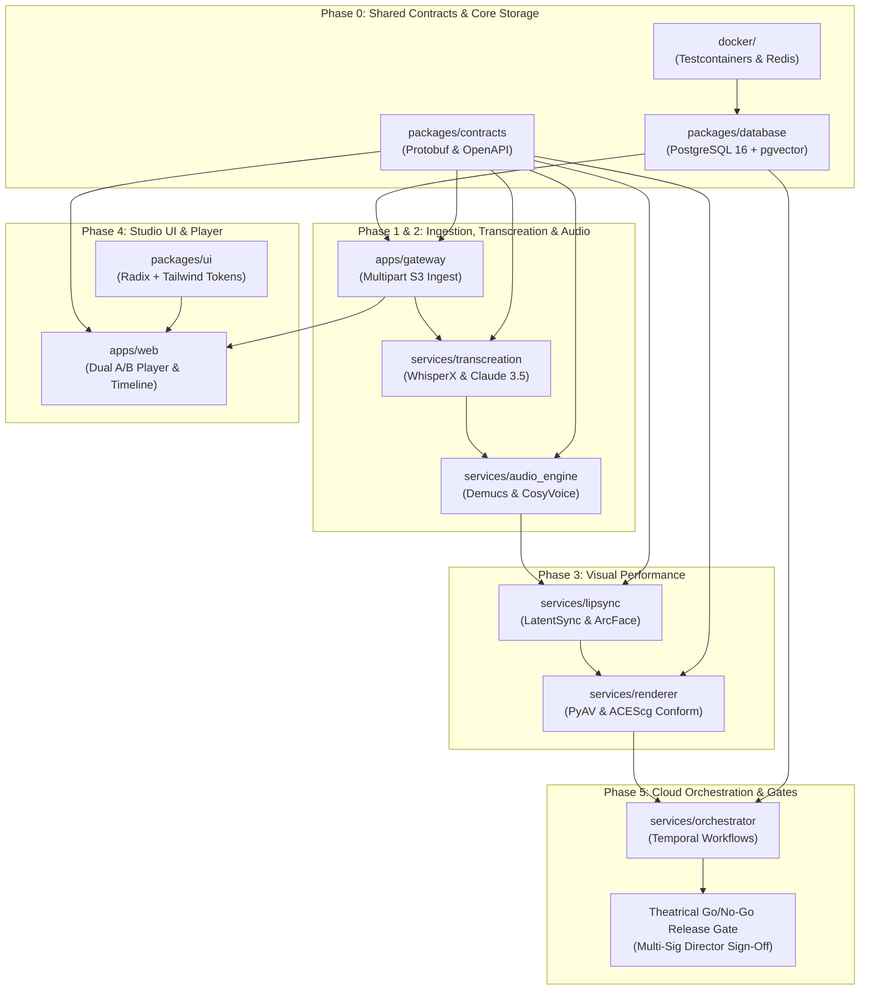
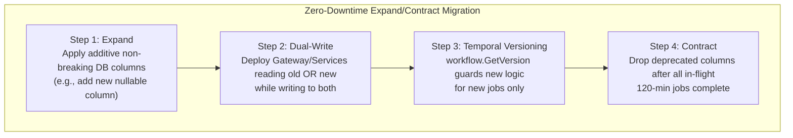

# Cinema-Grade AI Film Localization Platform: Master Implementation Roadmap

> **Document Status**: Production Specification & Master Roadmap (Ratified)  
> **Target Release Schedule**: v1.0.0 Cinema Master Edition (24-Week Phased Execution)  
> **Compliance & Standards**: Netflix Delivery Specifications v16, SMPTE ST 2067-2 (IMF), ITU-R BS.1770-4 (Loudness), EBU R128, C2PA Provenance v1.4, TPN Gold Shield  
> **Related Architecture Documents**:
> - [MASTER_ARCHITECTURE.md](file:///c:/Users/acer/3D%20Objects/kavrai%20AI/docs/MASTER_ARCHITECTURE.md)
> - [ARCHITECTURE_GAP_ANALYSIS.md](file:///c:/Users/acer/3D%20Objects/kavrai%20AI/docs/ARCHITECTURE_GAP_ANALYSIS.md)
> - [SYSTEM_DESIGN.md](file:///c:/Users/acer/3D%20Objects/kavrai%20AI/docs/SYSTEM_DESIGN.md)
> - [AI_MODEL_SELECTION.md](file:///c:/Users/acer/3D%20Objects/kavrai%20AI/docs/AI_MODEL_SELECTION.md)
> - [DATA_STORAGE_DESIGN.md](file:///c:/Users/acer/3D%20Objects/kavrai%20AI/docs/DATA_STORAGE_DESIGN.md)
> - [API_CONTRACTS.md](file:///c:/Users/acer/3D%20Objects/kavrai%20AI/docs/API_CONTRACTS.md)
> - [FULL_MOVIE_PIPELINE.md](file:///c:/Users/acer/3D%20Objects/kavrai%20AI/docs/FULL_MOVIE_PIPELINE.md)
> - [UI_UX_DESIGN.md](file:///c:/Users/acer/3D%20Objects/kavrai%20AI/docs/UI_UX_DESIGN.md)
> - [CLOUD_INFRASTRUCTURE.md](file:///c:/Users/acer/3D%20Objects/kavrai%20AI/docs/CLOUD_INFRASTRUCTURE.md)
> - [SECURITY_PRIVACY_COMPLIANCE.md](file:///c:/Users/acer/3D%20Objects/kavrai%20AI/docs/SECURITY_PRIVACY_COMPLIANCE.md)
> - [TESTING_QUALITY_PLAN.md](file:///c:/Users/acer/3D%20Objects/kavrai%20AI/docs/TESTING_QUALITY_PLAN.md)

---

## 1. Executive Summary & Architectural Synthesis

The **Master Implementation Roadmap** establishes the dependency-aware, phased construction plan for the **Cinema-Grade AI Film Localization Platform**. It unifies and reconciles the entire architectural specification suite across 11 canonical documents into one actionable engineering blueprint.

### 1.1 Resolution of Architectural Contradictions & Tensions

During the architectural audit, potential tensions between service requirements were resolved as follows:

1. **State Orchestration vs. Micro-Task Queuing**:
   - *Tension*: High-level movie/reel distributed workflows require long-running, fault-tolerant state durability across 4–8 hours, whereas GPU worker frame-level dispatch requires sub-second latency.
   - *Resolution*: A **Two-Tier Orchestration Architecture**:
     - **Tier 1 (Temporal.io)**: Manages coarse-grained saga transactions, retry policies, Human-In-The-Loop (HITL) checkpoints, and deterministic workflow state across `Movie` $\to$ `Reel` $\to$ `Scene` $\to$ `Shot`.
     - **Tier 2 (Redis 7.2 Cluster Streams)**: Serves as low-latency, short-lived task queues feeding active PyTorch GPU worker pools with pre-buffered tensors.
2. **Audio-Video Temporal Alignment vs. Translation Expansion**:
   - *Tension*: Target-language translations expand or contract in duration (e.g., Spanish dialogue naturally expands by ~15–20% phonetically compared to English), threatening cinematic lip-sync and cut boundaries.
   - *Resolution*: An **Algorithmic Syllable Budgeting Engine** integrated into LLM prompting (Claude 3.5 Sonnet / NLLB-200) coupled with forced phonetic alignment (Montreal Forced Aligner). Translation output is constrained to $\pm 1$ syllable of the original dialogue envelope, while dialogue audio is conformed to exact integer samples ($2,000$ samples per frame at $48\text{ kHz} / 24\text{ fps}$) with $5.0\text{ ms}$ cosine crossfades.
3. **Monorepo Polyglot Tooling**:
   - *Tension*: Node.js/TypeScript is required for the high-concurrency API Gateway, WebSocket hub, and React Studio UI, while Python 3.11/PyTorch is mandatory for AI diffusion and voice generation models.
   - *Resolution*: A **Unified Polyglot Monorepo**:
     - **Turborepo + pnpm**: Manages TypeScript applications (`apps/web`, `apps/gateway`) and shared type/contract packages (`packages/contracts`, `packages/ui`).
     - **uv Workspaces**: Manages Python AI microservices (`services/transcreation`, `services/audio_engine`, `services/lipsync`, `services/renderer`, `services/orchestrator`) with pinned CPython 3.11 and CUDA 12.4 virtual environments.
4. **Zero-Downtime Releases vs. Active Long-Film Renders**:
   - *Tension*: Rolling out a new AI model or database migration cannot terminate or corrupt in-flight 120-minute rendering jobs running across 32 GPU workers.
   - *Resolution*: An **Expand/Contract Database Migration Pattern** combined with Temporal deterministic workflow version branching (`workflow.GetVersion`) and runtime model canary feature flags.

---

## 2. Unified Monorepo Architecture & Dependency Graph

### 2.1 Monorepo Workspace Topology

```
kavrai-ai/
├── .github/                              # CI/CD Workflows (PR Gate, GPU Theatrical Benchmarks)
├── apps/
│   ├── gateway/                          # Fastify 4.26 Node.js API Gateway & WebSocket Hub
│   │   ├── src/
│   │   ├── tests/
│   │   ├── package.json
│   │   └── tsconfig.json
│   └── web/                              # Apple Studio Pro Next.js 14 / Vite React Frontend
│       ├── src/
│       ├── tests/
│       ├── package.json
│       └── tsconfig.json
├── packages/
│   ├── contracts/                        # Protobuf Schemas, OpenAPI Specs, TypeScript DTOs
│   │   ├── protos/                       # cinema_renderer.proto, audio_transcreation.proto
│   │   ├── src/                          # Generated TypeScript & Python contract bindings
│   │   └── package.json
│   ├── database/                         # Kysely / Drizzle Schema & PostgreSQL Migrations
│   │   ├── migrations/                   # Additive SQL DDL scripts (pgvector, RLS, WORM)
│   │   ├── src/
│   │   └── package.json
│   └── ui/                               # Shared Apple Pro Design System (Radix + Tailwind)
│       ├── src/components/
│       ├── package.json
│       └── tsconfig.json
├── services/                             # Python 3.11 AI Microservices (uv workspace)
│   ├── pyproject.toml                    # Root uv workspace configuration
│   ├── audio_engine/                     # XTTS-v2 / CosyVoice, Demucs v4, Conform & Loudness
│   ├── lipsync/                          # LatentSync / ATMAN, ArcFace Identity Preservation
│   ├── transcreation/                    # WhisperX, NLLB-200 / Claude 3.5 Sonnet, MFA
│   ├── renderer/                         # FFmpeg, PyAV, ACEScg Color Space, MP4/IMF Multiplexer
│   └── orchestrator/                     # Temporal.io Workflows & Redis Stream Dispatchers
├── docker/                               # Local Development & Testcontainers Dockerfiles
├── docs/                                 # Canonical Production Specifications
├── turbo.json                            # Turborepo Build Pipeline Configuration
├── pnpm-workspace.yaml                   # pnpm Workspace Configuration
└── pyproject.toml                        # Global Python Tooling (Ruff, Pytest, Black)
```

### 2.2 Cross-Component Dependency Graph (DAG)



---

## 3. Phase 0: Foundation, Ephemeral Infrastructure & Shared Contracts (Weeks 1–3)

**Objective**: Establish the polyglot monorepo tooling, PostgreSQL 16 relational and vector schemas, Redis 7.2 stream infrastructure, shared Protobuf/OpenAPI contracts, and automated Testcontainers testing harness.

### 3.1 Prioritized Task Breakdown

| Task ID | Component | Description | Priority | Dependencies |
| :--- | :--- | :--- | :--- | :--- |
| **P0-01** | `packages/contracts` | Author `protos/cinema_renderer.proto` and `protos/audio_transcreation.proto`. Configure `buf` / `protoc` generation for TypeScript and Python. | **P0** | None |
| **P0-02** | `packages/database` | Author baseline SQL migrations: `organizations`, `users`, `projects`, `reels`, `scenes`, `shots`, `transcripts`, `voice_tracks`, `lip_sync_jobs`, `consent_records`, and `audit_logs`. | **P0** | None |
| **P0-03** | `packages/database` | Implement PostgreSQL Row-Level Security (RLS) policies for tenant isolation and pgTAP unit tests. | **P0** | P0-02 |
| **P0-04** | `docker/` | Setup Testcontainers orchestration harness spinning up PostgreSQL 16 + pgvector, Redis 7.2 Cluster, and MinIO S3 emulator. | **P0** | P0-02 |
| **P0-05** | Monorepo Tooling | Configure `turbo.json`, `pnpm-workspace.yaml`, and root `pyproject.toml` with Ruff, ESLint, TypeScript 5.4, and Pytest. | **P0** | None |

### 3.2 File-Level Change Plan

```
[NEW] packages/contracts/protos/cinema_renderer.proto
[NEW] packages/contracts/protos/audio_transcreation.proto
[NEW] packages/contracts/src/index.ts
[NEW] packages/database/migrations/0001_initial_cinema_schema.sql
[NEW] packages/database/migrations/0002_rls_tenant_isolation.sql
[NEW] packages/database/migrations/0003_worm_audit_logging.sql
[NEW] packages/database/src/client.ts
[NEW] docker/docker-compose.test.yml
[NEW] turbo.json
[NEW] pnpm-workspace.yaml
[NEW] pyproject.toml
```

### 3.3 Verification Commands & Acceptance Criteria

```bash
# 1. Compile protobuf contracts and generate TS/Python types
pnpm --filter @kavrai/contracts build

# 2. Run database migration tests against ephemeral PostgreSQL container
pnpm --filter @kavrai/database test:migrations

# 3. Verify PostgreSQL Row-Level Security isolation via pgTAP
docker exec -i kavrai_postgres pg_prove -U postgres -d kavrai_test /tests/test_tenant_isolation_rls.sql

# 4. Monorepo lint and typecheck
pnpm turbo run lint typecheck
uv run ruff check .
```

*Phase 0 Exit Gate*: All database migrations execute cleanly; zero cross-tenant data leaks in `pgTAP`; TypeScript and Python contract types compile without errors.

---

## 4. Phase 1: Ingestion, Demuxing, Speech Recognition & Transcreation (Weeks 4–7)

**Objective**: Build high-throughput S3 direct multipart file ingestion in the API Gateway, FFmpeg shot detection/demuxing, WhisperX speech recognition with word-level timestamps, PyAnnote speaker diarization, and LLM-assisted transcreation with strict syllable budgeting.

### 4.1 Prioritized Task Breakdown

| Task ID | Component | Description | Priority | Dependencies |
| :--- | :--- | :--- | :--- | :--- |
| **P1-01** | `apps/gateway` | Implement direct S3 multipart presigned upload allocation endpoints (`POST /v1/projects/:id/upload/initialize`, `POST /complete`). | **P0** | Phase 0 |
| **P1-02** | `apps/gateway` | Implement magic-byte validation, ClamAV antivirus scanning hook, and RFC 7807 problem details error envelopes. | **P1** | P1-01 |
| **P1-03** | `services/orchestrator` | Implement FFmpeg / PyAV shot segmentation worker slicing 120-minute films into discrete shots based on scene cuts. | **P0** | Phase 0 |
| **P1-04** | `services/transcreation` | Build speech recognition pipeline using WhisperX with word-level forced alignment and PyAnnote 3.1 speaker diarization. | **P0** | P1-03 |
| **P1-05** | `services/transcreation` | Implement transcreation engine (Claude 3.5 Sonnet / NLLB-200) with syllable budget constraints ($\pm 1$ syllable / $\pm 5\%$ duration) and bilabial viseme closure detection (`/p/, /b/, /m/`). | **P0** | P1-04 |

### 4.2 File-Level Change Plan

```
[NEW] apps/gateway/src/routes/upload.ts
[NEW] apps/gateway/src/services/s3_multipart.ts
[NEW] apps/gateway/src/middleware/file_validator.ts
[NEW] services/orchestrator/src/workers/demuxer.py
[NEW] services/transcreation/src/transcriber.py
[NEW] services/transcreation/src/diarizer.py
[NEW] services/transcreation/src/transcreator.py
[NEW] services/transcreation/src/syllable_budget.py
[NEW] services/transcreation/src/viseme_detector.py
[NEW] services/transcreation/tests/test_transcreation.py
```

### 4.3 Verification Commands & Acceptance Criteria

```bash
# 1. Test Gateway multipart upload initiation and part signing
pnpm --filter @kavrai/gateway test tests/integration/upload.test.ts

# 2. Test video demuxing and frame-accurate shot boundary splitting
uv run pytest services/orchestrator/tests/test_demuxer.py

# 3. Execute transcreation quality & syllable budget benchmark suite
uv run pytest services/transcreation/tests/test_linguistic_benchmarks.py \
  --min-bleu 34.0 \
  --min-chrf 58.0 \
  --min-comet 0.82
```

*Phase 1 Exit Gate*: Full 120-minute ProRes video ingests via multipart without buffering in gateway RAM; shots demuxed with frame accuracy; Spanish/French/German transcreation passes $\text{BLEU} \ge 34.0$, $\text{chrF++} \ge 58.0$, $\text{COMET} \ge 0.82$, and syllable delta $\le \pm 1$.

---

## 5. Phase 2: Cinema Audio Production & Vocal Cloning (Weeks 8–11)

**Objective**: Separate audio stems with Demucs v4, clone actor voices cross-lingually preserving emotional timbre (XTTS-v2 / CosyVoice), conform dialogue to exact integer samples ($2,000$ samples/frame), and master final mix to broadcast loudness ($-24.0\text{ LKFS} \pm 0.5\text{ dB}$).

### 5.1 Prioritized Task Breakdown

| Task ID | Component | Description | Priority | Dependencies |
| :--- | :--- | :--- | :--- | :--- |
| **P2-01** | `services/audio_engine` | Integrate Demucs v4 HTDemucs to isolate dialogue from music, foley, and atmospheric background stems. | **P0** | Phase 1 |
| **P2-02** | `services/audio_engine` | Implement cross-lingual voice synthesis with CosyVoice / XTTS-v2 conditioning on reference audio embeddings (ECAPA2). | **P0** | P2-01 |
| **P2-03** | `services/audio_engine` | Build audio conform engine enforcing exact sample calculation ($48\text{ kHz} / 24\text{ fps} = 2,000\text{ samples/frame}$) and applying $5.0\text{ ms}$ equal-power cosine crossfades at cut boundaries. | **P0** | P2-02 |
| **P2-04** | `services/audio_engine` | Implement automated broadcast loudness mastering via `pyloudnorm` targeting $-24.0\text{ LKFS} \pm 0.5\text{ dB}$ (true peak $\le -1.0\text{ dBFS}$). | **P0** | P2-03 |

### 5.2 File-Level Change Plan

```
[NEW] services/audio_engine/src/stem_separator.py
[NEW] services/audio_engine/src/voice_synthesizer.py
[NEW] services/audio_engine/src/actor_embedding.py
[NEW] services/audio_engine/src/audio_conformer.py
[NEW] services/audio_engine/src/crossfade.py
[NEW] services/audio_engine/src/loudness_master.py
[NEW] services/audio_engine/tests/test_av_synchronization.py
[NEW] services/audio_engine/tests/test_audio_quality.py
```

### 5.3 Verification Commands & Acceptance Criteria

```bash
# 1. Verify 120-minute audio conform zero-drift assertion (345,600,000 samples)
uv run pytest services/audio_engine/tests/test_av_synchronization.py -k "test_long_film_zero_drift_assertion"

# 2. Test shot boundary crossfade phase continuity (zero boundary pops)
uv run pytest services/audio_engine/tests/test_av_synchronization.py -k "test_shot_boundary_micro_crossfade_continuity"

# 3. Test speech perceptual quality and vocal resemblance
uv run pytest services/audio_engine/tests/test_audio_quality.py \
  --min-pesq 4.2 \
  --min-stoi 0.94 \
  --min-sec-similarity 0.88
```

*Phase 2 Exit Gate*: Zero audio drift ($0.00\text{ ms}$) across 120 minutes of continuous playback; $\text{PESQ} \ge 4.2$; speaker embedding similarity $\ge 0.88$; integrated loudness compliant with $-24.0\text{ LKFS} \pm 0.5\text{ dB}$.

---

## 6. Phase 3: Neural Visual Lip-Sync & Face Performance (Weeks 12–16)

**Objective**: Implement the high-resolution neural lip-sync engine (LatentSync / ATMAN pipelines), 3D facial landmark tracking, ArcFace identity loss preservation, ACEScg color space conversion, and temporal flicker suppression.

### 6.1 Prioritized Task Breakdown

| Task ID | Component | Description | Priority | Dependencies |
| :--- | :--- | :--- | :--- | :--- |
| **P3-01** | `services/lipsync` | Implement PyTorch LatentSync / UNet diffusion inference worker conditioning on Mel-spectrogram features. | **P0** | Phase 2 |
| **P3-02** | `services/lipsync` | Implement 3D landmark tracking, face bounding-box normalization, and affine warping. | **P0** | P3-01 |
| **P3-03** | `services/lipsync` | Implement ArcFace feature loss and non-mouth SSIM constraint ($\ge 0.992$) ensuring actor facial identity and background remain pristine. | **P0** | P3-02 |
| **P3-04** | `services/renderer` | Build frame conform multiplexer supporting ACEScg color pipeline, temporal anti-flicker filtering, and SMPTE ProRes/H.264 rendering. | **P0** | P3-03 |

### 6.2 File-Level Change Plan

```
[NEW] services/lipsync/src/inference_engine.py
[NEW] services/lipsync/src/face_tracker.py
[NEW] services/lipsync/src/identity_loss.py
[NEW] services/lipsync/src/temporal_stabilizer.py
[NEW] services/renderer/src/color_converter.py
[NEW] services/renderer/src/frame_multiplexer.py
[NEW] tests/perceptual/test_visual_lipsync_benchmark.py
```

### 6.3 Verification Commands & Acceptance Criteria

```bash
# 1. Execute perceptual benchmark on standard 48-frame reference test tensor
uv run pytest tests/perceptual/test_visual_lipsync_benchmark.py \
  --min-syncnet-confidence 8.2 \
  --max-syncnet-distance 6.5 \
  --max-lpips 0.040 \
  --min-ssim 0.992

# 2. Test CUDA memory stability under 500 consecutive diffusion cycles
uv run pytest tests/stress/test_cuda_memory_leak.py
```

*Phase 3 Exit Gate*: $\text{LSE-C} \ge 8.2$, $\text{LSE-D} \le 6.5$, $\text{LPIPS} \le 0.040$, non-mouth $\text{SSIM} \ge 0.992$; zero CUDA memory leaks ($< 50\text{ MB}$ drift across 500 cycles).

---

## 7. Phase 4: Apple Studio Frontend, Collaborative Timeline & A/B Player (Weeks 17–20)

**Objective**: Construct the Apple-inspired Studio UI with light-first styling (`#F5F5F7`), Theatrical Darkroom Mode (`#0D0E12`), WebGL A/B dual-viewport split-wipe player, multi-track audio waveform/spectrogram timeline, and collaborative WebSocket scrubbing.

### 7.1 Prioritized Task Breakdown

| Task ID | Component | Description | Priority | Dependencies |
| :--- | :--- | :--- | :--- | :--- |
| **P4-01** | `packages/ui` | Build Apple Pro Design System components: design tokens, typography, glassmorphism panels, timeline sliders, split-wipe mask. | **P0** | Phase 0 |
| **P4-02** | `apps/web` | Implement dual-viewport A/B cinema player with sub-frame playhead synchronization, split-wipe slider, and `J-K-L` frame stepping. | **P0** | P4-01, Phase 3 |
| **P4-03** | `apps/web` | Build multi-track interactive timeline: audio waveform display, syllable marker nudging, viseme closure anchors, boundary snaps. | **P0** | P4-02 |
| **P4-04** | `apps/gateway` | Implement WebSocket timeline synchronization endpoint (`/v1/ws/timeline`) broadcasting scrub events to connected clients with $< 45\text{ ms}$ latency. | **P0** | P4-03 |
| **P4-05** | `apps/web` | Implement responsive layouts for Studio Pro Display ($2560\times 1440$), Laptop ($1440\times 900$), and iPad Pro Tablet Review ($1024\times 768$). | **P1** | P4-03 |

### 7.2 File-Level Change Plan

```
[NEW] packages/ui/src/components/button.tsx
[NEW] packages/ui/src/components/slider.tsx
[NEW] packages/ui/src/components/dialog.tsx
[NEW] apps/web/src/components/player/DualCinemaPlayer.tsx
[NEW] apps/web/src/components/player/SplitWipeMask.tsx
[NEW] apps/web/src/components/timeline/MultiTrackTimeline.tsx
[NEW] apps/web/src/components/timeline/WaveformTrack.tsx
[NEW] apps/web/src/components/timeline/VisemeMarker.tsx
[NEW] apps/web/src/hooks/useTimelineWebSocket.ts
[NEW] apps/gateway/src/routes/websockets.ts
[NEW] tests/e2e/cinema_player_ab.spec.ts
[NEW] tests/e2e/visual_regression.spec.ts
```

### 7.3 Verification Commands & Acceptance Criteria

```bash
# 1. Run Playwright end-to-end cinema player synchronization test suite
pnpm --filter @kavrai/web test:e2e tests/e2e/cinema_player_ab.spec.ts

# 2. Run visual regression tests in Light Mode and Theatrical Darkroom Mode
pnpm --filter @kavrai/web test:e2e tests/e2e/visual_regression.spec.ts --update-snapshots=false

# 3. Run cross-browser and tablet responsive layout tests
pnpm --filter @kavrai/web test:e2e tests/e2e/responsive.spec.ts
```

*Phase 4 Exit Gate*: Playhead synchronization delta $\le 0.2\text{ frames}$; split-wipe renders at stable $60\text{ fps}$; visual regression pixel diff $\le 0.1\%$; collaborative WebSocket scrub latency $< 45\text{ ms}$.

---

## 8. Phase 5: Full-Movie Cloud Orchestration, Chaos, Security & Theatrical Gates (Weeks 21–24)

**Objective**: Deploy the full-movie distributed orchestration DAG on Temporal.io, configure AWS EKS Karpenter GPU autoscaling with 80/20 Spot blend, enforce SAG-AFTRA consent validation, embed C2PA provenance manifests, and validate the dual-gate release procedure.

### 8.1 Prioritized Task Breakdown

| Task ID | Component | Description | Priority | Dependencies |
| :--- | :--- | :--- | :--- | :--- |
| **P5-01** | `services/orchestrator` | Implement Temporal.io `FullMovieLocalizationWorkflow` with shot-level checkpointing, heartbeats, and saga compensation. | **P0** | Phase 1–4 |
| **P5-02** | `cloud/k8s` | Configure Karpenter NodePool on AWS EKS managing NVIDIA L40S and A10G GPU nodes with Spot preemption interception. | **P0** | P5-01 |
| **P5-03** | `services/security` | Implement SAG-AFTRA consent state machine and instantaneous BIPA crypto-shredding runbooks ($< 500\text{ ms}$ erasure). | **P0** | Phase 0 |
| **P5-04** | `services/renderer` | Implement dual-layer anti-piracy watermarking (NexGuard steganographic + WebGL overlay) and C2PA manifest signing (`ECC_NIST_P256`). | **P0** | Phase 3 |
| **P5-05** | CI/CD & Testing | Deploy automated Chaos Mesh fault-injection suites (CUDA OOM, Spot preemption SIGTERM, Toxiproxy S3 latency). | **P0** | P5-02 |
| **P5-06** | Studio Admin | Implement Dual Automated Metric Gate + Multi-Signature Director Sign-Off checklist for theatrical DCP / IMF export. | **P0** | P5-04 |

### 8.2 File-Level Change Plan

```
[NEW] services/orchestrator/src/workflows/full_movie_workflow.py
[NEW] services/orchestrator/src/activities/shot_activities.py
[NEW] services/orchestrator/src/interceptors/spot_interceptor.py
[NEW] cloud/k8s/karpenter/nodepool-gpu-l40s.yaml
[NEW] cloud/k8s/chaos/spot_preemption_simulation.yaml
[NEW] services/security/src/consent_enforcer.py
[NEW] services/security/src/crypto_shredder.py
[NEW] services/renderer/src/c2pa_signer.py
[NEW] services/renderer/src/watermark_embedder.py
[NEW] .github/workflows/pr-gate.yml
[NEW] .github/workflows/nightly-gpu-bench.yml
```

### 8.3 Verification Commands & Acceptance Criteria

```bash
# 1. Run 120-minute synthetic film orchestration stress test
uv run python scripts/run_synthetic_film_stress.py --duration-minutes 120 --workers 32

# 2. Execute Chaos Mesh fault injection suite (Spot preemption + CUDA OOM)
kubectl apply -f cloud/k8s/chaos/spot_preemption_simulation.yaml
uv run pytest tests/chaos/test_chaos_resilience.py

# 3. Verify C2PA provenance manifest cryptographic signatures
c2patool --verify ./tests/fixtures/output_localized_master.mp4

# 4. Verify BIPA consent revocation and crypto-shredding latency
uv run pytest tests/security/test_consent_revocation.py --max-latency-ms 500
```

*Phase 5 Exit Gate*: 120-minute film completes end-to-end within $< 4\text{ hours}$; zero dropped frames under Spot preemption; C2PA manifest cryptographically validates; performer consent revocation executes in $< 500\text{ ms}$; studio dual-signature release gate functional.

---

## 9. Zero-Downtime Migration & Rollback Runbooks

In a production cinema studio environment, deploying code or database changes must never interrupt in-flight jobs or corrupt unreleased master assets.



### 9.1 Database Schema Migration Rollback Runbook

1. **Rule of Additive Migrations**:
   - Never rename or delete a table or column in a single release.
   - Column additions must be `NULLABLE` or specify a non-blocking `DEFAULT`.
2. **Rollback Execution**:
   - If a deployment failure occurs during Step 1 or 2, re-deploy the previous Docker container image.
   - The database remains fully backward-compatible with the previous release; zero `DOWN` migrations are run against live production databases.
3. **Contraction (Cleanup)**:
   - Deprecated columns are dropped only in the subsequent release cycle after confirming zero database traffic on legacy fields.

### 9.2 Temporal Workflow Deterministic Versioning

When updating orchestration logic in `services/orchestrator/`:

```python
# services/orchestrator/src/workflows/full_movie_workflow.py
from temporalio import workflow

@workflow.defn
class FullMovieLocalizationWorkflow:
    @workflow.run
    async def run(self, project_id: str, movie_id: str):
        # Version identifier guarantees older in-flight workflows replay deterministically
        version = workflow.get_version("neural_lipsync_engine_upgrade", workflow.DEFAULT_VERSION, 2)
        
        if version == workflow.DEFAULT_VERSION:
            # Legacy Phase 3 execution path
            await workflow.execute_activity("render_shot_latentsync_v1", ...)
        else:
            # Upgraded Phase 5 execution path
            await workflow.execute_activity("render_shot_atman_cinema_v2", ...)
```

### 9.3 Model Canary & Emergency Fallback Procedures

1. **Canary Routing**:
   - New neural model weights are registered with a feature flag: `FLAG_LIPSYNC_MODEL_V2` (5% $\to$ 25% $\to$ 100% of non-critical shots).
2. **Instant Emergency Rollback**:
   - If `LSE-C` drops below $8.2$ or GPU OOM rates exceed $0.5\%$, the Redis feature flag is immediately toggled to revert to the baseline model without pod redeployment:
     ```bash
     redis-cli SET flags:lipsync_model_active "latentsync_v1"
     ```
3. **Scratch NVMe Crypto-Shredding on Preemption**:
   - When Kubernetes receives an AWS Spot termination notification, the worker intercepts the `SIGTERM`, writes task progress to PostgreSQL, and invokes `shred`:
     ```bash
     shred -u -z -n 3 /mnt/scratch/shot_*
     ```

---

## 10. Master Verification Matrix & Acceptance Gates

| Phase | Core Milestone | Primary CLI Verification Commands | Automated Acceptance Criteria |
| :---: | :--- | :--- | :--- |
| **Phase 0** | Core Infra & Contracts | `pnpm turbo run test:migrations`<br/>`pg_prove /tests/test_rls.sql` | 100% migrations applied; zero RLS data leaks. |
| **Phase 1** | Ingestion & Transcreation | `pytest services/transcreation/tests/` | $\text{BLEU} \ge 34.0$, $\text{chrF++} \ge 58.0$, $\text{COMET} \ge 0.82$, Syllable $\Delta \le \pm 1$. |
| **Phase 2** | Cinema Audio & Conforming | `pytest services/audio_engine/tests/` | $0.00\text{ ms}$ drift across 120 mins; $-24.0\text{ LKFS} \pm 0.5\text{ dB}$; $\text{PESQ} \ge 4.2$. |
| **Phase 3** | Neural Visual Lip-Sync | `pytest tests/perceptual/` | $\text{LSE-C} \ge 8.2$, $\text{LSE-D} \le 6.5$, $\text{LPIPS} \le 0.040$, Non-Mouth $\text{SSIM} \ge 0.992$. |
| **Phase 4** | Apple Studio UI & Player | `pnpm --filter @kavrai/web test:e2e` | Playhead delta $\le 0.2\text{ frames}$; $60\text{ fps}$ split-wipe; WebSocket scrub $< 45\text{ ms}$. |
| **Phase 5** | Cloud & Theatrical Gates | `pytest tests/chaos/`<br/>`c2patool --verify` | Spot preemption survival; valid C2PA manifest; dual director multi-sig verified. |

---
*End of Master Implementation Roadmap.*
