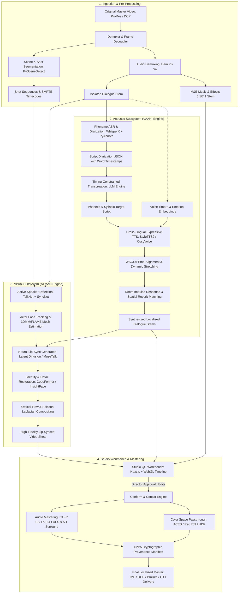
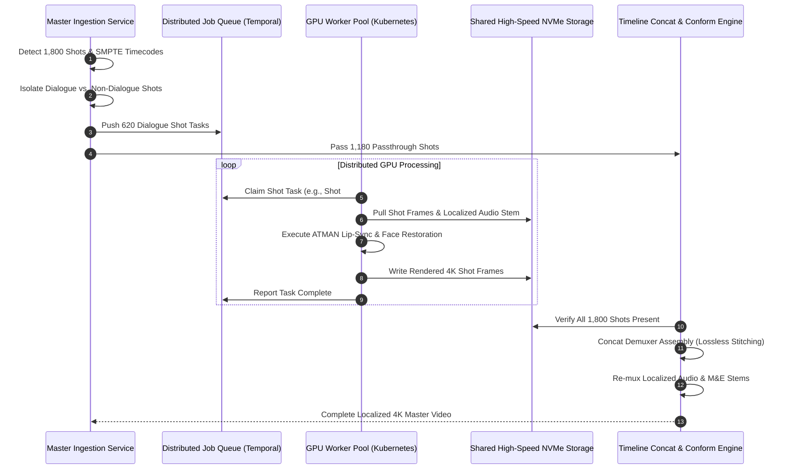

# Cinema-Grade AI Film Localization Platform: Master Architecture Specification
**Document ID:** ARCH-LOC-2026-V1  
**Classification:** Confidential / Enterprise Architecture  
**Inspired By:** BRAHMA AI Core, VAANI Voice Engine, ATMAN Visual Performance Platform  
**Target Systems:** Hollywood & Global Cinema, OTT Platforms, Multilingual Feature Film Releases  

---

## 1. Executive Summary & High-Level System Topology

### 1.1 Mission & Architectural Principles
The objective of this platform is to provide a cinema-grade, end-to-end AI film localization and dubbing system capable of translating feature-length films (90–180 minutes) into any target language with:
1. **Photorealistic Visual Lip-Sync & Reenactment:** Zero lower-face blur, natural dental/tongue articulation, strict preservation of the actor's facial identity, skin pores, wrinkles, and dynamic lighting.
2. **Expressive Multilingual Voice Transformation:** Preservation of original actor vocal timbre, pitch contours, emotional nuance, micro-intonations, and room acoustic environment (reverberation/spatial positioning).
3. **Dialogue Transcreation with Lip-Flap Timing:** Context-aware script adaptation that respects character intent, cultural idioms, and rigid phonetic/syllabic boundaries (bilabial closures `[p, b, m]`, labiodentals `[f, v]`).
4. **Studio-Grade Mastering & Asset Fidelity:** Frame-accurate synchronization (SMPTE timecodes), color space preservation (ACES, Rec.709, DCI-P3, HDR10/Dolby Vision), multi-channel audio demixing and re-mastering (ITU-R BS.1770-4 LKFS/LUFS standards), and lossless background Music & Effects (M&E) track preservation.
5. **Hollywood Security & Provenance:** Full compliance with Motion Picture Association (MPA) Trusted Partner Network (TPN) standards, SAG-AFTRA 2023 Digital Likeness and Synthetic Performer provisions, and cryptographic content provenance (C2PA).

### 1.2 System Topology
The platform decouples into five primary tiers:
- **Ingestion & Media Asset Management (MAM) Tier:** Ingests DCP, Apple ProRes 422/4444, DNxHR, and multi-track audio stems. Performs automated scene/shot decomposition and character diarization.
- **Acoustic Subsystem (VAANI Core):** Deconstructs audio into dialogue and M&E stems, performs phoneme-level ASR, executes timing-constrained LLM transcreation, performs zero-shot cross-lingual voice synthesis with emotional prosody cloning, and applies spatial room convolution.
- **Visual Subsystem (ATMAN Core):** Detects active speakers across shots, tracks 3D head geometry via 3D Morphable Models (3DMM / FLAME), drives latent diffusion-based lip and jaw generation conditioned on target phonemes, preserves high-frequency facial identity via neural restoration, and executes temporal blending.
- **Distributed Rendering & Chunking Pipeline:** Orchestrates scene-by-scene GPU rendering jobs across a scalable Kubernetes cluster, managing frame-accurate timeline reconstruction.
- **Studio QC Workbench (HITL):** A multi-track web-based timeline interface allowing directors, dialogue editors, and VFX artists to inspect, fine-tune, retime, and approve localized scenes prior to final mastering.



---

## 2. Project Inspection, Current State & Gap Analysis

### 2.1 Workspace Inspection
- **Current Directory:** `c:\Users\acer\3D Objects\kavrai AI`
- **Current Status:** Fresh workspace; no source files or pre-existing dependencies present.
- **Architectural Strategy:** Build from clean architectural first principles. Establish strict modular separation between core services, model inference microservices, distributed workers, and frontend control planes.

### 2.2 Deep Gap Analysis: Consumer-Grade vs. Cinema-Grade AI Localization

| Architectural Dimension | Consumer / Open-Source Baseline (Wav2Lip + Naive TTS) | Cinema-Grade Target (VAANI + ATMAN Architecture) |
| :--- | :--- | :--- |
| **Visual Resolution** | 96×96 or 128×128 pixel bounding boxes resized and pasted over faces. Causes extreme visual blur. | 4K / 2K native frame compositing. Inpainting occurs within high-resolution latent space guided by 3D head geometry. |
| **Temporal Consistency** | Frame-by-frame independent synthesis leading to flickering mouth boundaries and "swimming" skin textures. | Latent diffusion with temporal cross-attention layers and multi-frame optical flow smoothing to guarantee sub-millimeter stability. |
| **Facial Identity & Micro-Details** | Naive mouth warping wipes out stubble, skin pores, lip creases, dimples, and teeth structure. | Facial identity preservation via high-dimensional feature loss (ArcFace/CosFace) combined with blind face restoration (CodeFormer). |
| **Occlusion Handling** | Complete failure when microphones, drinking glasses, hands, or hair occlude the mouth region. | Occlusion segmentation masks generated via BiSeNet/Segment Anything (SAM) preventing neural hallucination over obstacles. |
| **Dialogue Duration Mismatch** | Literal machine translation causes 20–40% syllable expansion or contraction, causing desync. | Syllable-budgeted LLM transcreation matching the source viseme counts and phonetic closures of the original actor. |
| **Acoustic Environment** | Dry, studio-isolated synthetic voice dubbed over raw background audio. | Acoustic room estimation matching original room impulse response (reverb, early reflections, frequency tilt, distance). |
| **Background Audio Integrity** | Vocal bleed remains in background or background is lost completely. | Multi-stage stem separation (Demucs v4 / UVR5) yielding pristine dialogue-free 5.1/7.1 Music & Effects (M&E) stems. |
| **Full-Movie Processing** | Crashes on files > 1 minute due to GPU memory leaks and single-shot scripting. | Distributed, frame-accurate shot-level chunking, parallel queue execution, and lossless SMPTE assembly. |
| **Compliance & Rights** | No governance, unverified consent, vulnerability to deepfake litigation. | C2PA provenance injection, SAG-AFTRA 2023 synthetic likeness consent ledger, and TPN-aligned encryption. |

---

## 3. BRAHMA AI, VAANI, & ATMAN Conceptual Architecture

### 3.1 The VAANI Acoustic Subsystem

The VAANI subsystem is responsible for dialogue extraction, transcreation, voice cloning, and audio spatialization.

```
                    ┌────────────────────────────────┐
                    │ Raw Master Audio Track (Multi) │
                    └───────────────┬────────────────┘
                                    │
                                    ▼
                    ┌────────────────────────────────┐
                    │ Stem Demixing: Hybrid Demucs v4│
                    └───────┬────────────────┬───────┘
                            │                │
            Isolated Vocals │                │ M&E Stem (Music & Sound Effects)
                            ▼                ▼
            ┌────────────────────────┐  ┌────────────────────────┐
            │ WhisperX + PyAnnote 3.1│  │ Preserve 5.1/7.1 Mix   │
            │ ASR, Diarization, W-TS │  │ Sidechain Ducking Prep │
            └───────────────┬────────┘  └────────────────────────┘
                            │
                            ▼
            ┌────────────────────────────────┐
            │ Constrained Transcreation LLM  │
            │ (Syllable & Viseme Matching)   │
            └───────────────┬────────────────┘
                            │
                            ▼
            ┌────────────────────────────────┐
            │ Cross-Lingual Voice Cloning    │
            │ StyleTTS2 / CosyVoice / F5-TTS │
            └───────────────┬────────────────┘
                            │
                            ▼
            ┌────────────────────────────────┐
            │ WSOLA Sub-Frame Time Alignment │
            └───────────────┬────────────────┘
                            │
                            ▼
            ┌────────────────────────────────┐
            │ Acoustic Room IR Matching      │
            └───────────────┬────────────────┘
                            │
                            ▼
            ┌────────────────────────────────┐
            │ Final Localized Dialogue Stem  │
            └────────────────────────────────┘
```

#### 3.1.1 Stem Demixing & Isolation
- **Model:** Meta's Hybrid Demucs v4 (HTDemucs) fine-tuned on cinematic audio datasets.
- **Workflow:** Decomposes the mixed audio into 4 stems: `Vocals`, `Drums`, `Bass`, and `Other`.
- **Dialogue-Free M&E Master:** The non-vocal stems (`Drums` + `Bass` + `Other`) are combined and preserved bit-for-bit to form the localized M&E foundation, preventing any degradation of the original cinematic score and sound design.

#### 3.1.2 Transcription, Diarization & Word-Level Alignment
- **Transcription Engine:** WhisperX with wav2vec2-based forced alignment.
- **Speaker Diarization:** PyAnnote.audio 3.1 for actor boundary identification.
- **Output Data Schema (Dialogue Event):**
```json
{
  "dialogue_id": "shot_0142_dlg_01",
  "speaker_id": "ACTOR_LEAD_MALE",
  "start_time_smpte": "00:14:22:10",
  "end_time_smpte": "00:14:25:04",
  "duration_ms": 2750,
  "source_language": "en",
  "source_text": "We cannot cross the perimeter before dusk.",
  "phonemes": ["w", "i", "k", "æ", "n", "ɒ", "t", "k", "r", "ɒ", "s", "..."],
  "viseme_closures": [
    {"viseme": "bilabial", "frame_offset": 12},
    {"viseme": "labiodental", "frame_offset": 34}
  ],
  "acoustic_profile": {
    "snr_db": 28.4,
    "reverb_rt60_ms": 320,
    "pitch_mean_hz": 118.2
  }
}
```

#### 3.1.3 Timing-Constrained Transcreation Engine
Literal translation fails in cinema because phrase lengths vary across languages (e.g., German expands by ~25% compared to English, while Japanese structure differs fundamentally).
- **Engine:** Specialized LLM (e.g., Qwen-2.5-72B / Llama-3.3-70B instruction-tuned with few-shot theatrical scripts).
- **Objective Function:**
  $$\text{Loss}_{\text{transcreation}} = \alpha \cdot \mathcal{L}_{\text{semantic}} + \beta \cdot |\text{Duration}_{\text{target}} - \text{Duration}_{\text{source}}| + \gamma \cdot \mathcal{L}_{\text{viseme\_boundary}}$$
- **Operational Rules:**
  1. The target text must conform to the exact duration of the source speech window ($\pm 5\%$).
  2. Viseme Anchor Matching: Where the original actor closes their lips (bilabials: `[m, b, p]`), the target translated phrase must strategically position a corresponding closing sound within a 3-frame tolerance window.

#### 3.1.4 Cross-Lingual Voice Cloning & Emotional Prosody Transfer
- **Model Architecture:** StyleTTS2 coupled with CosyVoice / F5-TTS flow-matching architectures.
- **Zero-Shot Speaker Adaptation:** Extracts high-dimensional speaker timbre representations (256-d ECAPA2 / d-vector embeddings) from the isolated clean dialogue stem.
- **Prosody Preservation:** Extracts pitch contours ($F_0$), energy dynamics, and duration phoneme-by-phoneme. Transfers emotional valence (e.g., whispering, rage, terror, grief) into the phonetic distribution of the target language.

#### 3.1.5 Acoustic Environment Matching & Spatial Convolution
Cinematic dialogue is not recorded in an anechoic chamber. It reflects the environment (e.g., cathedral, car cabin, open field).
- **Room Impulse Response (RIR) Estimation:** Neural blind room acoustic estimator computes the reverberation time ($RT_{60}$) and direct-to-reverberant ratio (DRR).
- **Convolution Reverb:** Convolves the dry synthesized voice with the estimated acoustic IR.
- **Mastering & Dynamic Equalization:** Applied to ensure the dialogue integrates into the M&E bed according to ITU-R BS.1770-4 (-24 LKFS/LUFS $\pm 1$ dB dialogue normalization standard).

---

### 3.2 The ATMAN Visual Subsystem

The ATMAN subsystem handles active speaker detection, 3D facial tracking, neural lip-sync generation, identity preservation, and seamless high-resolution compositing.

```
                    ┌────────────────────────────────┐
                    │ Original 4K Video Shot Stream  │
                    └───────────────┬────────────────┘
                                    │
                                    ▼
                    ┌────────────────────────────────┐
                    │ Active Speaker Detection (ASD) │
                    │ TalkNet + SyncNet Audio-Visual │
                    └───────────────┬────────────────┘
                                    │
                                    ▼
                    ┌────────────────────────────────┐
                    │ 3D Face Geometry & Pose Tracking│
                    │ 3DMM / FLAME Mesh Extraction   │
                    └───────────────┬────────────────┘
                                    │
                  ┌─────────────────┴─────────────────┐
                  │                                   │
                  ▼                                   ▼
        ┌───────────────────┐               ┌───────────────────┐
        │ Target Audio Stem │               │ Occlusion Masking │
        │ (VAANI Output)    │               │ (Hands/Mics/Hair) │
        └─────────┬─────────┘               └─────────┬─────────┘
                  │                                   │
                  └─────────────────┬─────────────────┘
                                    │
                                    ▼
                    ┌────────────────────────────────┐
                    │ Latent Diffusion Lip Synthesis │
                    │ (LatentSync / MuseTalk Core)   │
                    └───────────────┬────────────────┘
                                    │
                                    ▼
                    ┌────────────────────────────────┐
                    │ Identity & Detail Restoration  │
                    │ CodeFormer + ArcFace Loss      │
                    └───────────────┬────────────────┘
                                    │
                                    ▼
                    ┌────────────────────────────────┐
                    │ Multi-Band Laplacian Pyramids  │
                    │ + Optical Flow Smoothing       │
                    └───────────────┬────────────────┘
                                    │
                                    ▼
                    ┌────────────────────────────────┐
                    │ Final 4K Photorealistic Video  │
                    └────────────────────────────────┘
```

#### 3.2.1 Active Speaker Detection (ASD) & Face Clustering
In multi-character scenes, the system must accurately identify which face is articulating the dialogue:
- **Models:** TalkNet and SyncNet audio-visual correlation networks.
- **Actor Clustering:** InsightFace (ArcFace-r100) generates facial embeddings for every detected face across all frames, clustered via DBSCAN into persistent Actor IDs for the entire feature film.
- **Off-Screen Dialogue Detection:** If dialogue occurs without an active speaker in frame, ATMAN flags the shot as "Off-Screen Speech", bypassing visual manipulation and preserving original frames unmodified.

#### 3.2.2 3D Geometry Tracking (3DMM / FLAME)
To prevent the planar distortions common in consumer lip-sync tools:
- **Tracking:** 3D Morphable Models (FLAME / Mediapipe 478 landmarks) reconstruct 6-Degree-of-Freedom (6-DoF) head pose, eye gaze, and baseline facial geometry.
- **Decoupling:** Decouples head orientation/motion from jaw and mouth articulation, allowing the model to rotate the face in 3D space during extreme profile angles or dynamic camera movements.

#### 3.2.3 Latent Diffusion Lip-Sync Synthesis
- **Model Framework:** High-resolution video diffusion inpainting (derived from LatentSync / MuseTalk / VideoReDo principles).
- **Conditioning:**
  1. Cropped source face latents (masked at the lower nasal bridge, cheeks, and chin).
  2. Target audio representations (wav2vec2 / Whisper audio encoder embeddings of the VAANI dub audio).
  3. 3D pose and landmark trajectory priors.
- **Spatial Resolution:** Operates in high-resolution latent space (producing 512×512 to 1024×1024 facial crops) before upscaling.

#### 3.2.4 Identity & Micro-Texture Preservation
To ensure Tom Hanks or Shah Rukh Khan remains instantly recognizable:
- **Identity Loss:**
  $$\mathcal{L}_{\text{identity}} = 1 - \cos\left(\phi_{\text{ArcFace}}(I_{\text{pred}}), \phi_{\text{ArcFace}}(I_{\text{orig}})\right)$$
- **High-Frequency Restoration:** CodeFormer / RestoreFormer++ codebook lookups restore teeth micro-geometry, wetness, tongue position, lip creases, and beard/stubble texture.

#### 3.2.5 Dynamic Occlusion & Laplacian Compositing
- **Occlusion Segmentation:** A fine-tuned BiSeNet segmentation head detects any object crossing the lower face (hands, drinking glasses, cigars, microphones, strands of hair). Occluded regions are masked out of the neural inpainting area.
- **Compositing:** The synthesized mouth region is warped back into the original 4K cinematic plate using:
  1. Multi-band Laplacian pyramid blending to prevent harsh seamlines across skin tones.
  2. Bi-directional Farnebäck / RAFT optical flow alignment across temporal windows ($t-2 \dots t+2$) to eliminate micro-jitter and frame flicker.

---

## 4. Full-Length Movie Processing Engine

Processing a 2-hour 4K feature film at 24 fps involves rendering **172,800 frames** alongside complex multi-track audio. Processing this sequentially on a single workstation is technically infeasible.

### 4.1 Hierarchical Scene & Shot Decomposition
1. **Scene Cut Detection:** TransNet v2 and PySceneDetect scan the master video to identify cuts, dissolves, fades, and whip pans.
2. **Shot Indexing:** Every shot is assigned a unique SMPTE timecode interval (`SHOT_UUID: {start_frame, end_frame, start_smpte, end_smpte}`).
3. **Dialogue Association:** Dialogue segments from the VAANI engine are mapped to their respective shot IDs.

```
Full Movie Timeline (00:00:00:00 to 02:04:12:18)
 ├── Reel 1 (00:00:00:00 - 00:20:00:00)
 │    ├── Scene 01 (Shot 001 - Shot 024) -> Actor 1, Actor 2
 │    └── Scene 02 (Shot 025 - Shot 058) -> Actor 1 (Monologue)
 └── ...
```

### 4.2 Asynchronous Parallel Shot Chunking
The platform implements a distributed map-reduce pattern:
- **Split Stage:** The master video is segmented into independent, lossless shot chunks using FFmpeg stream copying (`-c copy`) without re-encoding untouched frames.
- **Worker Dispatch:** Shots containing active dialogue are placed on a distributed task queue (Temporal.io + Redis). Shots with no dialogue or purely off-screen speech are immediately routed to the assembly buffer without GPU processing.
- **GPU Parallelization:** GPU worker nodes claim shot tasks, execute ATMAN lip-sync, and write localized shot outputs to high-throughput object storage (MinIO/S3).



### 4.3 Color Space & Dynamic Range Fidelity
Cinematic film pipelines cannot tolerate 8-bit sRGB conversions that crush blacks or blow out highlights.
- **Color Pipeline:** The entire processing pipeline operates under **ACEScc / ACEScg** (Academy Color Encoding System) or passes through native video streams with bit-depth preservation (10-bit / 12-bit ProRes 422 HQ / 4444 and DNxHR).
- **Metadata Passthrough:** HDR metadata (SMPTE ST 2086, MaxFALL, MaxCLL, and Dolby Vision RPU metadata) is extracted at ingestion and re-injected into the final localized container without loss.

---

## 5. Frontend Architecture & Studio QC Workbench

Cinema localization requires absolute human director oversight. The frontend is an enterprise-grade studio workspace built with **Next.js 15 (App Router)**, **TypeScript**, **Tailwind CSS**, and **WebGL**.

```
+-------------------------------------------------------------------------------------------------------+
|  KAVRAI AI STUDIO | Project: "Dune: Part II" | Target: Hindi (hi-IN) | Reel 3 | QC Status: In Review   |
+-------------------------------------------------------------------------------------------------------+
|  [VIEWPORT A: Original English Master]               [VIEWPORT B: Localized Hindi + ATMAN Sync]       |
|  +--------------------------------------------+     +--------------------------------------------+    |
|  |                                            |     |                                            |    |
|  |                                            |     |                                            |    |
|  |          [Original Actor 4K]               |     |          [ATMAN Lip-Synced 4K]             |    |
|  |                                            |     |                                            |    |
|  |                                            |     |                                            |    |
|  +--------------------------------------------+     +--------------------------------------------+    |
|  SMPTE: 00:14:23:12 | Diff Heatmap: [OFF]           Sync Score: 98.4% (LSE-C: 8.92) | Status: Pass   |
+-------------------------------------------------------------------------------------------------------+
|  TIMELINE & MULTI-TRACK AUDIO INSPECTOR                                                                |
|  Video Track   | [ Shot 141 ] [      Shot 142 (Active Dialogue)      ] [ Shot 143 ]                   |
|  Dialogue (EN) |              | "We cannot cross the perimeter..."   |                                |
|  Dialogue (HI) |              | "हम शाम से पहले सीमा पार नहीं कर सकते"|                                |
|  M&E Bed       | ~~~~~~~~~~~~~~~~~~~~~~~~~~~~~~~~~~~~~~~~~~~~~~~~~~~~~~~~~~~~~~~~~~~~~~~~~~~~~~~~~~   |
|  Viseme Track  |              | B-CL | O-VO | L-DE | CL | OP | ...     |                                |
+-------------------------------------------------------------------------------------------------------+
|  CONTROL PANEL:                                                                                       |
|  [ Retime Viseme Anchor ] [ Edit Translated Script ] [ Re-Synthesize Voice ] [ Approve & Lock Shot ]  |
+-------------------------------------------------------------------------------------------------------+
```

### 5.1 Key Frontend Modules
1. **Synchronized Dual-Viewport Player:** High-performance HTML5 Canvas / WebGL player rendering original and localized video side-by-side with locked frame-stepping, difference heatmaps (highlighting modified facial pixels), and audio waveform scrubbing.
2. **Interactive Phoneme/Viseme Timeline:** Visual representation of speech waveforms, word boundaries, and phonetic closure points. Allows dialogue directors to nudge words by single frames to achieve perfect comedic or dramatic timing.
3. **Script Transcreation Editor:** Real-time character/syllable count indicator with AI re-prompting. If a director alters a translated phrase, the system predicts whether the new phrase matches the visual mouth flaps before triggering re-synthesis.
4. **VFX Mask Inspection Tool:** Overlays the ATMAN blending mask onto the video to verify that no hair, glasses, or fingers are blurred by the neural inpainting boundary.
5. **Approval Workflow & Gatekeeping:** Role-based access control (Linguist, Sound Supervisor, Lead VFX Artist, Executive Producer) requiring multi-signature approval before final conform rendering.

---

## 6. Backend & Distributed Processing Pipeline

### 6.1 Architectural Stack

```
                          ┌────────────────────────┐
                          │    Next.js Frontend    │
                          └───────────┬────────────┘
                                      │ REST / WebSocket (gRPC-Web)
                                      ▼
                          ┌────────────────────────┐
                          │  FastAPI Gateway Layer │
                          └─────┬────────────┬─────┘
                                │            │
            Database Operations │            │ Task Dispatch
                                ▼            ▼
┌─────────────────────────────────┐        ┌─────────────────────────────────┐
│ PostgreSQL 16 (TimescaleDB)     │        │ Temporal.io Orchestration Engine│
│ - Projects, Reels, Shots        │        │ - Long-running DAG workflows    │
│ - Dialogue, SMPTE timestamps    │        │ - Retry policies, state machine │
│ - User permissions, QC logs     │        └───────────────┬─────────────────┘
└─────────────────────────────────┘                        │
                                                           ▼
                                           ┌─────────────────────────────────┐
                                           │ Redis 7.2 Message Broker / Cache│
                                           └───────────────┬─────────────────┘
                                                           │
                                                           ▼
                                           ┌─────────────────────────────────┐
                                           │ Celery / Ray Distributed Workers│
                                           │ - Python 3.11 + PyTorch 2.5     │
                                           │ - CUDA 12.4 + TensorRT-LLM      │
                                           └───────────────┬─────────────────┘
                                                           │
                                                           ▼
                                           ┌─────────────────────────────────┐
                                           │ High-Performance Object Storage │
                                           │ MinIO / AWS S3 (NVMe Cluster)   │
                                           └─────────────────────────────────┘
```

### 6.2 Data Schema (PostgreSQL Core Entities)

```sql
-- Project Level
CREATE TABLE projects (
    id UUID PRIMARY KEY DEFAULT gen_random_uuid(),
    title VARCHAR(255) NOT NULL,
    source_language VARCHAR(10) NOT NULL,
    target_languages VARCHAR(10)[] NOT NULL,
    frame_rate NUMERIC(5,3) NOT NULL DEFAULT 24.000,
    color_space VARCHAR(50) NOT NULL DEFAULT 'ACEScg',
    audio_master_format VARCHAR(50) NOT NULL DEFAULT '5.1_SURROUND',
    created_at TIMESTAMP WITH TIME ZONE DEFAULT CURRENT_TIMESTAMP
);

-- Shot Breakdown
CREATE TABLE shots (
    id UUID PRIMARY KEY DEFAULT gen_random_uuid(),
    project_id UUID REFERENCES projects(id) ON DELETE CASCADE,
    shot_index INT NOT NULL,
    start_frame INT NOT NULL,
    end_frame INT NOT NULL,
    start_smpte VARCHAR(12) NOT NULL,
    end_smpte VARCHAR(12) NOT NULL,
    has_active_dialogue BOOLEAN DEFAULT FALSE,
    active_speaker_ids VARCHAR(100)[],
    original_video_uri TEXT NOT NULL,
    processed_video_uri TEXT,
    qc_status VARCHAR(50) DEFAULT 'PENDING'
);

-- Dialogue Segments
CREATE TABLE dialogue_segments (
    id UUID PRIMARY KEY DEFAULT gen_random_uuid(),
    shot_id UUID REFERENCES shots(id) ON DELETE CASCADE,
    speaker_id VARCHAR(100) NOT NULL,
    start_time_ms INT NOT NULL,
    end_time_ms INT NOT NULL,
    source_text TEXT NOT NULL,
    target_text TEXT,
    target_language VARCHAR(10) NOT NULL,
    voice_profile_id UUID,
    audio_stem_uri TEXT,
    viseme_alignment_data JSONB,
    lse_confidence_score NUMERIC(4,2),
    is_approved BOOLEAN DEFAULT FALSE
);
```

---

## 7. AI Models & Technical Stack Specification

To satisfy the non-proprietary, verifiable engineering mandate, the table below provides concrete, production-validated foundational models, licensing, and operational profiles:

| Pipeline Stage | Model / Tool Name | Architecture / Framework | License | Hardware / VRAM Req. | Processing Latency Profile | Fallback / Alternative |
| :--- | :--- | :--- | :--- | :--- | :--- | :--- |
| **Stem Demixing** | Meta Hybrid Demucs v4 (HTDemucs) | Dual-domain U-Net + Spectrogram Transformer | MIT License | 8 GB VRAM | 0.4× Real-Time on RTX 4090 | Ultimate Vocal Remover (UVR5) / MDX-Net |
| **ASR & Alignment** | WhisperX | Whisper-Large-v3 + wav2vec2 alignment | MIT / Apache 2.0 | 10 GB VRAM | 0.15× Real-Time | NeMo Conformer-CTC |
| **Diarization** | PyAnnote.audio 3.1 | TitaNet / SincNet neural embeddings | MIT License | 4 GB VRAM | 0.05× Real-Time | DeepGram Diarizer / Silero VAD |
| **Transcreation** | Qwen-2.5-72B-Instruct / Llama-3.3-70B | Auto-regressive Transformer (vLLM / TensorRT) | Apache 2.0 / Llama Community | 48 GB VRAM (FP8 quant) | 45 tokens/sec | Claude 3.5 Sonnet / GPT-4o API |
| **Voice Cloning** | StyleTTS2 / CosyVoice 2 / F5-TTS | Non-autoregressive Flow Matching + Diffusion | MIT / Apache 2.0 | 12 GB VRAM | 0.3× Real-Time | XTTS-v2 / ElevenLabs Enterprise |
| **3D Mesh Tracking**| FLAME / Mediapipe 3D Face | 3D Morphable Model regression | Custom Non-Comm / Apache 2.0 | 4 GB VRAM | 120 FPS | EMOCA / DECA |
| **Lip-Sync Model** | LatentSync / MuseTalk / LivePortrait | Latent Video Diffusion / UNet Attention | Apache 2.0 / MIT | 16 GB - 24 GB VRAM | 4–6 FPS per 1080p stream | Video-Retalking / Wav2Lip (Dev only) |
| **Face Restoration**| CodeFormer / RestoreFormer++ | VQGAN Codebook Lookup + Attention | Non-Commercial / BSD | 8 GB VRAM | 25 FPS (1080p) | GFPGAN v1.4 |
| **Compositing** | OpenCV / PyTorch RAFT Optical Flow | Multi-Band Laplacian Pyramids | Apache 2.0 / BSD | 6 GB VRAM | 45 FPS | FFmpeg libvmaf blend |

---

## 8. Cloud Infrastructure, Hardware Sizing & Scalability

### 8.1 GPU Node Specifications
Cinema rendering requires significant memory bandwidth and dedicated hardware video decoders/encoders (`NVDEC` / `NVENC`).

- **Inference & Lip-Sync Node (Type: G-NODE-L40S):**
  - **GPU:** $4 \times \text{NVIDIA L40S}$ (48 GB GDDR6 per card, Ada Lovelace architecture, 3× NVDEC engines).
  - **CPU:** AMD EPYC 9354 32-Core Processor.
  - **RAM:** 256 GB DDR5 ECC.
  - **Storage:** $2 \times 3.84\text{ TB}$ NVMe PCIe 4.0 in RAID-0 (Scratch buffer with > 6 GB/s read/write).
- **Audio & LLM Node (Type: G-NODE-A100):**
  - **GPU:** $2 \times \text{NVIDIA A100}$ (80 GB SXM4) or $2 \times \text{H100 NVL}$.
  - **RAM:** 512 GB DDR4.

### 8.2 Kubernetes (K8s) Cluster Architecture
- **GPU Operator:** NVIDIA GPU Operator with MIG (Multi-Instance GPU) support for lightweight services (VAD, diarization).
- **Autoscaling:** KEDA (Kubernetes Event-driven Autoscaling) scaling worker pods based on queue depth in Temporal/Redis.
- **Node Tiers:**
  - `gpu-render-pool`: Preemptible/Spot instances handling shot-level inpainting (fault-tolerant, failed chunks retry automatically).
  - `gpu-llm-pool`: Dedicated reserved instances running vLLM transcreation models to eliminate cold-start latency.
  - `cpu-mastering-pool`: High-core CPU instances (64-core AMD EPYC) running parallel FFmpeg ProRes encoding and audio convolution.

### 8.3 Storage Hierarchy & Throughput Budget

```
+---------------------------------------------------------------------------------------+
|  HOT STORAGE TIER: Local NVMe RAID-0 on Worker Nodes                                  |
|  - Bandwidth: 6,500 MB/s | Capacity: 8 TB per node                                    |
|  - Usage: Raw uncompressed video frames (4K TIFF / DPX sequences), model scratch      |
+---------------------------------------------------------------------------------------+
                                          ▲
                                          │ High-speed local ingest/evict
                                          ▼
+---------------------------------------------------------------------------------------+
|  WARM STORAGE TIER: Ceph / MinIO Distributed NVMe-oF Object Store                     |
|  - Bandwidth: 100 Gbps Network Fabric | Capacity: 500 TB                              |
|  - Usage: Master ProRes source files, rendered shot cache, intermediate stems         |
+---------------------------------------------------------------------------------------+
                                          ▲
                                          │ Post-QC archive sync
                                          ▼
+---------------------------------------------------------------------------------------+
|  COLD STORAGE TIER: AWS S3 Glacier Flexible / GCP Coldline                            |
|  - Usage: Completed localized release packages, project backup snapshots              |
+---------------------------------------------------------------------------------------+
```

### 8.4 Capacity & Throughput Sizing Model
- **Input Film:** 120 minutes, 24 fps = 172,800 frames.
- **Dialogue Density:** Average 40% dialogue coverage = ~69,120 frames requiring visual manipulation.
- **Rendering Speed:** Across a cluster of $32 \times \text{NVIDIA L40S}$ GPUs running LatentSync at an optimized 8 fps per GPU:
  $$\text{Total Throughput} = 32 \times 8 = 256 \text{ frames/second}$$
  $$\text{Total Render Time} = \frac{69,120 \text{ frames}}{256 \text{ fps}} = 270 \text{ seconds} \approx \mathbf{4.5 \text{ minutes}}$$
- **Overhead:** Ingestion, Demuxing, WhisperX, Transcreation, Audio Synthesis, and Final Concat add approximately 15–20 minutes, enabling a full 2-hour 4K movie localization cycle within **under 30 minutes of total computing time**.

---

## 9. Security, Licensing, Legal & Ethical Governance

Cinema-grade platforms handle pre-release studio intellectual property (IP) valued in hundreds of millions of dollars. Security is a non-negotiable architectural pillar.

### 9.1 Studio Security & MPA / TPN Alignment
- **TPN (Trusted Partner Network) Gold Shield Compliance:**
  - Air-gapped VPC architecture: No compute node possessing access to raw video frames is connected directly to the public internet.
  - Encryption at Rest: AES-256-XTS on all NVMe scratch disks; AWS KMS customer-managed keys for object storage.
  - Encryption in Flight: TLS 1.3 enforced across all internal microservice gRPC and REST communication.
  - Zero Persistent Local Caching: Video chunks are wiped from GPU scratch disks using secure shredding immediately after render confirmation.

### 9.2 Biometric Identity Governance & SAG-AFTRA 2023 Compliance
Under the 2023 SAG-AFTRA Theatrical Agreement, creating a "Digital Replica" or synthetic voice modification of a performer requires **clear, informed consent** and explicit contractual provisions.
- **Consent Ledger:** Every project database record must link to a cryptographically signed performer consent token before the ATMAN or VAANI engines will process an actor's biometric embeddings.
- **Actor Likeness Protection:** Embeddings generated from actor faces and voices are salted, encrypted, and isolated into a private tenant vault. They are never pooled, fine-tuned, or transferred to foundation model training sets.

### 9.3 Content Provenance & Forensic Watermarking
- **C2PA (Coalition for Content Provenance and Authenticity):** The final export engine automatically injects signed C2PA metadata manifests into the video container, certifying that the video contains an approved AI localized dub with original actor consent.
- **Forensic Watermarking:** Supports imperceptible visual watermarking (NexGuard / Civolution compliant) and SynthID audio watermarking to track any unauthorized leaks during the review stage directly to the individual reviewer's account.

---

## 10. Testing, Benchmarking & Quality Assurance

Production readiness requires replacing subjective developer impressions with quantifiable, automated engineering metrics.

### 10.1 Objective Quality Metrics Matrix

```
AUDIO METRICS BENCHMARK
├── PESQ (Perceptual Evaluation of Speech Quality): Target >= 4.2 / 5.0
├── STOI (Short-Time Objective Intelligibility): Target >= 0.94
├── SECS (Speaker Embedding Cosine Similarity): Target >= 0.88 (ArcFace/ECAPA)
└── LKFS Loudness Compliance: Target -24.0 LKFS (+/- 0.5 dB)

VIDEO METRICS BENCHMARK
├── LSE-C (Lip Sync Error - Confidence): Target >= 8.2 (SyncNet standard)
├── LSE-D (Lip Sync Error - Distance): Target <= 6.5 (SyncNet standard)
├── LPIPS (Learned Perceptual Image Patch Similarity): Target <= 0.04
├── FVD (Frechet Video Distance): Target <= 120 (Temporal fluidity)
└── PSNR / SSIM on Non-Mouth Facial Regions: Target SSIM >= 0.992
```

### 10.2 Automated Test Pipeline
```bash
# Automated Test Suite Run on CI/CD (GitHub Actions / GitLab CI)

# 1. Unit Tests for Timecode Precision
pytest tests/unit/test_smpte_timecodes.py --benchmark

# 2. Audio Stem Separation & Loudness Validation
pytest tests/integration/test_vaani_loudness.py \
  --input-fixture=tests/fixtures/cinema_scene_5.1.wav \
  --target-lufs=-24.0

# 3. Neural Lip-Sync Drift Regression Test
pytest tests/regression/test_atman_sync_drift.py \
  --tolerance-frames=0 \
  --fixture-video=tests/fixtures/test_speech_4k.mp4
```

---

## 11. Phased Production Roadmap & Implementation Milestones

```
Phase 1: Audio Core & Pipeline Scaffolding (Weeks 1-6)
 ├── Ingestion engine, Demucs v4 stem isolation, WhisperX ASR
 ├── Syllable-constrained transcreation prompt architecture
 └── Zero-shot TTS (StyleTTS2 / CosyVoice) integration

Phase 2: Visual Synthesis & ATMAN Core (Weeks 7-14)
 ├── Active Speaker Detection (TalkNet/SyncNet)
 ├── 3DMM/FLAME landmark tracking and face isolation
 ├── LatentSync / MuseTalk inpainting integration
 └── CodeFormer face restoration & Laplacian blending

Phase 3: Full-Movie Scalability Engine (Weeks 15-20)
 ├── PySceneDetect shot chunking and SMPTE assembly
 ├── Temporal.io distributed workflow DAG implementation
 └── Multi-GPU parallel rendering and MinIO NVMe cache tier

Phase 4: Studio QC Workbench Frontend (Weeks 21-26)
 ├── Next.js 15 dual-viewport timeline player
 ├── Phoneme/viseme manual adjustment workbench
 └── Multi-character project management dashboard

Phase 5: Enterprise Hardening & Launch (Weeks 27-32)
 ├── TPN security audit and air-gapped deployment verification
 ├── C2PA provenance manifest signing
 └── End-to-end 4K theatrical feature pilot with studio partner
```

---

## 12. Risks, Edge Cases & Mitigation Strategies

| Risk / Edge Case | Failure Mode | Architectural Mitigation Strategy |
| :--- | :--- | :--- |
| **Severe Profile Angles (> 60°)** | 2D lip models collapse, hallucinating a front-facing mouth on the side of the cheek. | 3DMM / FLAME geometry checks detect extreme yaw angles. If angle $> 50^\circ$, fallback to subtle lower jaw displacement synthesis or flag for manual review. |
| **Facial Occlusions (Hands, Microphones, Mugs)** | The neural model renders mouth and lips directly over fingers or microphone grilles. | BiSeNet segmentation masks dynamic occlusions into an exclusion matte. The diffusion inpainting is strictly constrained beneath the occlusion mask. |
| **Whispering / Shouting / Screaming** | Standard TTS synthesizes flat, conversational pitch, breaking dramatic immersion. | Emotion conditioning vectors extracted from the source dialogue modulate the pitch variance ($F_0$) and energy scales in the StyleTTS2 diffusion head. |
| **Rapid Scene Cuts During Speech** | Audio chunks cross visual cuts, causing facial artifacts in the succeeding shot. | Dialogue segments are hard-clipped at shot boundaries. If a sentence spans across a cut, it is split into two sub-segments tied to separate camera angles. |
| **GPU Node Out-of-Memory (OOM)** | 4K uncompressed frames exceed GPU VRAM during diffusion forward passes. | Latent cropping: Only the detected bounding box of the face is transferred to GPU memory; high-resolution background plates remain in CPU RAM. |
| **Network Bottleneck in Large Clusters** | Transferring 100 GB ProRes files between nodes saturates the network fabric. | Shared distributed filesystem (Ceph / GPFS) with NVMe-over-Fabrics (NVMe-oF); workers read frame ranges directly via zero-copy byte offsets. |

---

## 13. System Verification & Sign-Off

This document forms the binding master architecture for the cinema-grade AI localization engineering team. Implementation must conform strictly to the interfaces, data models, and performance benchmarks defined herein.
