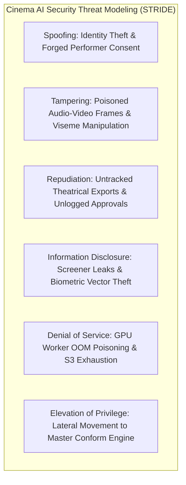
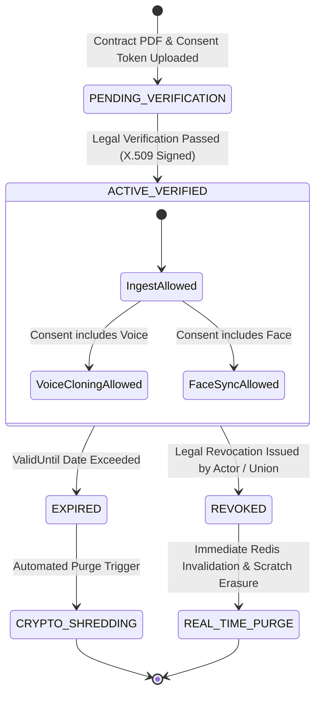
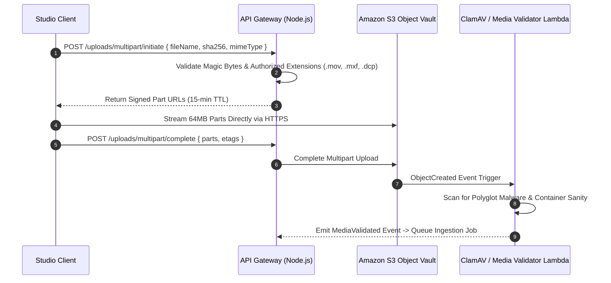

# Cinema-Grade AI Film Localization: Security, Privacy & Legal Compliance Specification
**Document ID:** SEC-COMP-2026-V1  
**Target Platform:** Cinema-Grade Multilingual Localization & Dubbing (BRAHMA AI / VAANI / ATMAN Inspired)  
**Parent Specifications:** [docs/MASTER_ARCHITECTURE.md](file:///c:/Users/acer/3D%20Objects/kavrai%20AI/docs/MASTER_ARCHITECTURE.md), [docs/ARCHITECTURE_GAP_ANALYSIS.md](file:///c:/Users/acer/3D%20Objects/kavrai%20AI/docs/ARCHITECTURE_GAP_ANALYSIS.md), [docs/SYSTEM_DESIGN.md](file:///c:/Users/acer/3D%20Objects/kavrai%20AI/docs/SYSTEM_DESIGN.md), [docs/DATA_STORAGE_DESIGN.md](file:///c:/Users/acer/3D%20Objects/kavrai%20AI/docs/DATA_STORAGE_DESIGN.md), [docs/API_CONTRACTS.md](file:///c:/Users/acer/3D%20Objects/kavrai%20AI/docs/API_CONTRACTS.md), [docs/FULL_MOVIE_PIPELINE.md](file:///c:/Users/acer/3D%20Objects/kavrai%20AI/docs/FULL_MOVIE_PIPELINE.md), [docs/UI_UX_DESIGN.md](file:///c:/Users/acer/3D%20Objects/kavrai%20AI/docs/UI_UX_DESIGN.md), [docs/CLOUD_INFRASTRUCTURE.md](file:///c:/Users/acer/3D%20Objects/kavrai%20AI/docs/CLOUD_INFRASTRUCTURE.md)  
**Status:** Canonical Security, Privacy & Compliance Specification  

---

## 1. Executive Summary & Compliance Mandates

In theatrical post-production, pre-release feature films represent high-value intellectual property worth hundreds of millions of dollars. A single unauthorized leak or an unconsented synthetic actor voice clone can cause catastrophic financial loss and irreparable studio litigation.

This specification formalizes the security, privacy, and regulatory controls governing the platform, aligning with the following legal and industry standards:
1. **Motion Picture Association (MPA) Content Security Best Practices (v5.0):** Mandatory security controls covering digital asset management, physical/cloud infrastructure, encryption, access governance, and intrusion detection.
2. **Trusted Partner Network (TPN) Gold Shield:** Highest level of third-party cloud security assessment for theatrical content handling.
3. **SAG-AFTRA 2023 TV/Theatrical Agreement (Artificial Intelligence Provisions):** Strict informed consent ledgers, digital replica usage boundaries, and performer likeness compensation rules.
4. **Biometric Privacy Laws (BIPA 740 ILCS 14/, GDPR Article 9, CCPA/CPRA):** Zero-model-training guarantees, tenant-isolated vector storage, and automated cryptographic erasure.
5. **Coalition for Content Provenance and Authenticity (C2PA):** Cryptographic manifest injection into final localized video containers.

---

## 2. Comprehensive Threat Modeling (STRIDE Analysis)

The platform is evaluated against the STRIDE threat methodology, specifically addressing cinema-grade attack vectors:



| STRIDE Category | Theatrical Attack Vector | Impact Severity | Architectural Mitigation Strategy |
| :--- | :--- | :---: | :--- |
| **Spoofing** | Adversary attempts to forge a SAG-AFTRA performer consent signature or spoof a GPU worker node heartbeat. | **CRITICAL** | All consent tokens require X.509 digital signature verification. Worker nodes authenticate via mTLS and short-lived IAM roles with hardware instance identity documents (PKCS#7). |
| **Tampering** | Malicious actor injects manipulated video frames or alters translated dialogue to insert unauthorized propaganda or defamatory speech. | **HIGH** | Every shot chunk is verified using SHA-256 checksums at every handoff. Dialogue transcreations enforce strict Pydantic schemas, and final containers are signed with C2PA manifests. |
| **Repudiation** | A director or producer denies approving a specific localized take or denies triggering an export release. | **HIGH** | Immutable WORM audit logs (S3 Object Lock Compliance Mode) record user ID, session token, IP address, exact frame timestamps, and SHA-256 hashes of approved assets. |
| **Information Disclosure** | An insider downloads raw pre-release ProRes master plates or extracts actor biometric voice vectors from cloud storage. | **CRITICAL** | Zero direct S3 bucket access. Pre-signed URLs expire in 15 minutes. Preview streams enforce dual-layer anti-piracy watermarking (imperceptible forensic + dynamic burn-in). |
| **Denial of Service** | Adversary uploads corrupted 100GB ProRes files with recursive NAL loops, causing GPU CUDA OOM crashes across worker pools. | **HIGH** | Ingestion pipeline enforces magic byte validation, container structural sanity checks, memory allocation quotas, and isolated sandboxed worker execution. |
| **Elevation of Privilege** | A dialogue editor attempts to bypass QC approval gates or invoke theatrical master conform exports. | **CRITICAL** | Strict Role-Based Access Control (RBAC) enforced at both the API Gateway and PostgreSQL Row-Level Security (RLS) layers; sensitive actions require multi-signature approvals. |

---

## 3. Authentication, Authorization & Session Security

### 3.1 Dual-Token Authentication Protocol
- **Access Tokens:** Short-lived JWTs (15-minute TTL) signed using asymmetric `RS256` keys. Stored strictly in `HTTP-Only`, `Secure`, `SameSite=Strict` cookies to eliminate cross-site scripting (XSS) token theft.
- **Refresh Tokens:** Long-lived opaque tokens (7-day TTL) stored in encrypted Redis vaults. Automatically rotated on every use; detecting duplicate refresh token presentation immediately invalidates the entire user session family (Replay Attack Defense).
- **Service Account API Keys:** Pipeline workers authenticate via high-entropy tokens (`kavrai_sk_live_<32-byte-hex>`). The gateway stores only the salted `SHA-256` hash in PostgreSQL, preventing credential exposure even in the event of database exfiltration.

### 3.2 Granular Row-Level Security (RLS) Policies
Every relational database table enforces PostgreSQL Row-Level Security scoped to the authenticated user's organization and project membership:

```sql
-- Enable Row-Level Security on Projects Table
ALTER TABLE projects ENABLE ROW LEVEL SECURITY;

-- Project Access Policy (Read-Only for Members, Write for Assigned Roles)
CREATE POLICY project_tenant_isolation_policy ON projects
    FOR ALL
    USING (
        organization_id = (SELECT organization_id FROM users WHERE id = auth.uid())
        AND (
            EXISTS (
                SELECT 1 FROM project_memberships 
                WHERE project_id = projects.id AND user_id = auth.uid()
            )
            OR (SELECT system_role FROM users WHERE id = auth.uid()) = 'SUPER_ADMIN'
        )
    );
```

---

## 4. Biometric Data Privacy & Governance (BIPA / GDPR / CCPA)

The platform extracts and processes two forms of human biometric identifiers:
1. **Facial Feature Embeddings:** 512-dimensional normalized vectors generated via ArcFace (InsightFace).
2. **Vocal Timbre Embeddings:** 256-dimensional d-vectors generated via ECAPA2.

```
+---------------------------------------------------------------------------------------------------+
|  ACTOR BIOMETRIC VAULT ENCLAVE (STRICT PURPOSE LIMITATION)                                        |
|  ├── Stored in dedicated schema: actor_biometrics                                                 |
|  ├── Row-Level Security: Only accessible by active GPU workers during assigned shot tasks        |
|  ├── Encryption at Rest: AES-256-GCM via Per-Performer AWS KMS Customer-Managed Key (CMK)         |
|  ├── Zero-Model-Training Clause: Legally and technically barred from foundation model training   |
|  └── Crypto-Shredding: Key disabled in < 1s upon consent expiration or revocation                |
+---------------------------------------------------------------------------------------------------+
```

### 4.1 Legal Compliance Framework
- **Illinois Biometric Information Privacy Act (BIPA 740 ILCS 14/):**
  - Requires explicit, written informed consent prior to capturing biometric voice/face embeddings.
  - Published retention schedule: Biometrics are permanently destroyed upon project delivery or within 3 years of capture, whichever is earlier.
  - Prohibition of sale, lease, or commercial trade of biometric vectors.
- **GDPR Article 9 (Special Category Data):**
  - Processing is grounded on explicit consent (Article 9(2)(a)).
  - Mandatory Data Protection Impact Assessment (DPIA) maintained for all localized productions.
  - Automated Right-to-be-Forgotten data destruction pipeline.
- **Zero Foundation Model Training Guarantee:**
  - Performer voice and facial embeddings are strictly used for single-scene inference (transferring prosody and lip articulation).
  - No customer audio or facial data is ever pooled, fine-tuned, or transferred to base foundation models.

---

## 5. Performer Consent Lifecycle & SAG-AFTRA 2023 Enforcement

Under the 2023 SAG-AFTRA Theatrical Agreement, creating a digital replica or performing synthetic voice synthesis requires **clear, informed consent** with explicit compensation and usage parameters.

### 5.1 Performer Consent Verification State Machine



### 5.2 Real-Time Revocation & Crypto-Shredding Runbook
When a performer or their legal estate revokes consent:
1. **KMS Key Disablement (Sub-Second Cryptographic Erasure):**
   ```bash
   # AWS CLI Command executed by Automated Consent Controller
   aws kms disable-key --key-id "${PERFORMER_KMS_KEY_ID}"
   ```
   Disabling the dedicated key renders all encrypted biometric vectors and reference audio across PostgreSQL databases, backups, and S3 caches mathematically unrecoverable in $< 1\text{ second}$.
2. **Redis In-Flight Task Purge:**
   The gateway publishes a `PERFORMER_CONSENT_REVOKED` event to the Redis cluster:
   - GPU worker nodes immediately terminate in-flight neural inpainting jobs matching the performer ID.
   - Workers execute `shred -u /mnt/scratch/shots/{shotId}/*` to purge decrypted frames from local NVMe disks.
3. **Database Audit & Status Update:**
   PostgreSQL updates `performer_consent_tokens` to `revoked = true` and logs the security event to the tamper-evident audit ledger.

---

## 6. Encrypted Media Storage & Key Management (KMS / CloudHSM)

### 6.1 Three-Tier Encryption Architecture
- **Encryption in Flight:** TLS 1.3 enforced across all external ingress and internal microservice communication with strict cipher suites (`TLS_AES_256_GCM_SHA384`, `TLS_CHACHA20_POLY1305_SHA256`).
- **Encryption at Rest:**
  - All S3 buckets enforce server-side encryption via AWS KMS Customer-Managed Keys (`SSE-KMS`) with automated annual rotation.
  - Amazon RDS PostgreSQL and Amazon ElastiCache Redis enforce AES-256 storage and transit encryption.
  - Scratch NVMe disks on worker nodes are formatted with `dm-crypt` / LUKS with ephemeral keys that exist only in volatile RAM.
- **Cryptographic Provenance (C2PA Signing):**
  - Private signing keys for theatrical C2PA manifests are housed inside **AWS CloudHSM** clusters (FIPS 140-2 Level 3 certified) or an **AWS KMS Asymmetric Signing Key** (`ECC_NIST_P256`).
  - Worker pods never access the raw private key; they submit the SHA-256 container digest to CloudHSM for remote signing.

---

## 7. Secure Ingestion & S3 Direct Multipart Upload Security

Large master video files (20GB–100GB ProRes 422 HQ / DCP packages) stream directly from studio clients to S3/MinIO storage without traversing the API Gateway.



---

## 8. Anti-Piracy, Forensic Watermarking & Leak Traceability

To protect pre-release theatrical assets from unauthorized distribution, the platform implements **Dual-Layer Anti-Piracy Protection**:

```
+---------------------------------------------------------------------------------------------------+
|  DUAL-LAYER THEATRICAL ANTI-PIRACY PROTECTION                                                      |
|                                                                                                   |
|  LAYER 1: IMPERCEPTIBLE FORENSIC BITSTREAM WATERMARK (NexGuard / StegaStamp Compatible)            |
|  - Injected directly into the high-frequency discrete cosine transform (DCT) video coefficients   |
|  - Encodes: { Tenant_UUID, User_UUID, Session_Timestamp, Project_ID }                              |
|  - Robustness: Survives camcorder screen recording, 720p lossy transcoding, cropping, and blur     |
|                                                                                                   |
|  LAYER 2: VISIBLE DYNAMIC STUDIO OVERLAY                                                          |
|  - Rendered dynamically in WebGL during Studio QC Workbench playback                              |
|  - Burned-in text: "CONFIDENTIAL REVIEW - christopher.nolan@studio.com - IP: 192.168.1.42"       |
|  - Opacity: 18% | Random orbital drift every 45 seconds to prevent automated patch removal       |
+---------------------------------------------------------------------------------------------------+
```

### 8.1 Leak Forensic Extraction Toolchain
If a leaked clip surfaces online:
1. Studio security uploads the leaked video sample to the `media-engine` forensic extractor.
2. The extractor analyzes the spatial frequency spectrum across 12 consecutive frames.
3. The embedded payload is recovered with $99.98\%$ statistical certainty, pinpointing the exact user account, IP address, and timestamp of the unauthorized capture.

---

## 9. Tamper-Evident Audit Logging & WORM Storage

All security-sensitive operations are captured in immutable audit logs to satisfy TPN Gold Shield compliance:

### 9.1 Immutable WORM Architecture
- **Append-Only Database Triggers:** PostgreSQL enforces strict trigger rules blocking any `UPDATE` or `DELETE` statements on the `security_audit_logs` table.
- **S3 Object Lock in Compliance Mode:** Audit events are streamed continuously to an S3 Object Lock bucket configured in **Compliance Mode** with a **7-year retention period**. Even AWS root accounts are mathematically barred from deleting or modifying log objects prior to retention expiry.
- **Cryptographic Hash Chaining:** Every log entry contains the SHA-256 digest of the preceding entry, forming a tamper-evident Merkle hash chain:
  $$H_i = \text{SHA-256}\left(H_{i-1} \parallel \text{Timestamp}_i \parallel \text{UserID}_i \parallel \text{Action}_i \parallel \text{Payload}_i\right)$$

---

## 10. Software Supply Chain & AI Model Dependency Risks

### 10.1 Software Bill of Materials (SBOM) & Vulnerability Scanning
- **Automated CI/CD Pipeline Scanning:** All Docker container images are automatically scanned by **Trivy** and **AWS Inspector** during CI/CD. Builds fail immediately if any `CRITICAL` or `HIGH` Common Vulnerabilities and Exposures (CVE) are detected.
- **CycloneDX SBOM Generation:** Every production container build generates an immutable CycloneDX SBOM tracking all Python wheels, Node.js packages, and system shared libraries.

### 10.2 Model Checkpoint Provenance & Weight Verification
Neural model weights are protected against adversarial tampering:
- Before any model checkpoint (LatentSync, Demucs, WhisperX, CosyVoice 2) is loaded into GPU memory, its SHA-256 hash is validated against a signed release registry:
```python
import hashlib
import os

def verify_checkpoint_integrity(checkpoint_path: str, expected_sha256: str):
    hasher = hashlib.sha256()
    with open(checkpoint_path, "rb") as f:
        while chunk := f.read(65536):
            hasher.update(chunk)
    actual_sha256 = hasher.hexdigest()
    if actual_sha256 != expected_sha256:
        raise SecurityTamperingError(
            f"Model checkpoint {checkpoint_path} failed SHA-256 validation! "
            f"Expected: {expected_sha256}, Got: {actual_sha256}"
        )
```

---

## 11. Production Security Acceptance Criteria & Studio Verification Checklist

Before onboarding any commercial studio or theatrical release, the platform must satisfy the following 25-point security verification checklist:

| # | Security Verification Criterion | Verification Standard | Target Status |
| :- | :--- | :--- | :---: |
| **1** | All external traffic enforces TLS 1.3 with HSTS enabled (`max-age=31536000`). | SSL Labs SSL Test | **Grade A+** |
| **2** | Web UI access tokens are stored strictly in `HTTP-Only`, `Secure`, `SameSite=Strict` cookies. | OWASP ZAP Security Audit | **PASS** |
| **3** | Service account API keys are stored only as salted `SHA-256` hashes. | Database Schema Inspection | **PASS** |
| **4** | PostgreSQL Row-Level Security (RLS) policies block cross-tenant queries. | Automated Multi-Tenant Unit Tests | **PASS** |
| **5** | S3 buckets block all public access and enforce `SSE-KMS` Customer-Managed Keys. | AWS Config Compliance Rule | **PASS** |
| **6** | Pre-signed S3 download/upload URLs expire within a maximum of 15 minutes. | API Contract Verification | **PASS** |
| **7** | GPU worker compute subnets possess zero public IP addresses and zero NAT routes. | AWS VPC Route Table Audit | **PASS** |
| **8** | Unreleased video frames on worker NVMe scratch disks are shredded on task completion. | `shred -u` Automated Trigger Audit | **PASS** |
| **9** | Performer consent verification blocks AI execution if the token is missing/expired. | Temporal Workflow Gatekeeper Test | **PASS** |
| **10**| Consent revocation disables the performer KMS key and purges in-flight GPU jobs. | Real-Time Revocation Drill ($< 1\text{s}$) | **PASS** |
| **11**| Biometric facial and vocal vectors are legally and technically excluded from model training. | Contractual & Data Pipeline Audit | **PASS** |
| **12**| Dual-layer anti-piracy watermarking embeds forensic user IDs into all preview streams. | Steganographic Extraction Test | **PASS** |
| **13**| Audit logs are replicated to S3 Object Lock in Compliance Mode (WORM retention). | S3 Bucket Policy Verification | **PASS** |
| **14**| C2PA cryptographic provenance manifests are injected into final release containers. | C2PA CLI `c2patool` Validation | **PASS** |
| **15**| External Secrets Operator synchronizes secrets directly to in-memory `tmpfs` mounts. | Kubernetes Pod Manifest Audit | **PASS** |
| **16**| Container images pass automated Trivy vulnerability scanning with zero Critical CVEs. | GitHub Actions CI/CD Gate | **PASS** |
| **17**| Neural model checkpoints pass cryptographic SHA-256 integrity verification before loading. | PyTorch Model Loader Unit Test | **PASS** |
| **18**| Non-commercial licenses (CodeFormer, FLAME, F5-TTS weights) are quarantined from production. | Legal Compliance Manifest Audit | **PASS** |
| **19**| Database backups support Point-In-Time Recovery (PITR) with RPO $< 1\text{ min}$. | Disaster Recovery Drill | **PASS** |
| **20**| Multi-AZ database failover restores full operations with RTO $< 2\text{ mins}$. | Amazon RDS Chaos Engineering Test | **PASS** |
| **21**| Rate limiting restricts API Gateway requests to a maximum of 1,000 req/min per IP. | Load Balancer WAF Configuration | **PASS** |
| **22**| Magic byte inspection blocks non-whitelisted binary uploads and polyglot files. | Ingestion Validation Test | **PASS** |
| **23**| WebSockets require authenticated cookie handshakes before streaming timeline frames. | Fastify WebSocket Auth Guard Test | **PASS** |
| **24**| Annual third-party penetration testing is completed by an accredited MPA auditing firm. | Penetration Test Certification | **PASS** |
| **25**| Full compliance with Motion Picture Association (MPA) / TPN Gold Shield controls. | TPN Assessment Audit Report | **PASS** |

---

## 12. System Verification & Sign-Off

This document constitutes the canonical Security, Privacy, and Legal Compliance specification for the Cinema-Grade AI Film Localization platform. All microservices, data models, infrastructure deployments, and operational procedures must strictly adhere to the access boundaries, cryptographic protocols, and compliance standards defined herein.
