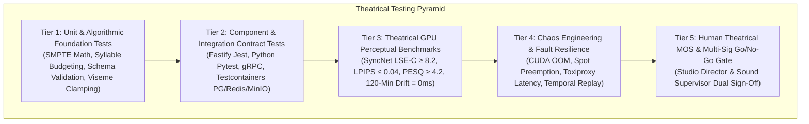
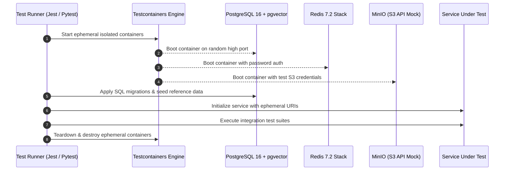
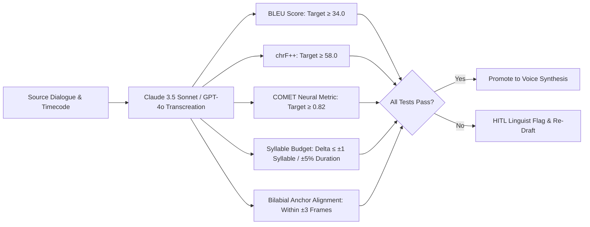
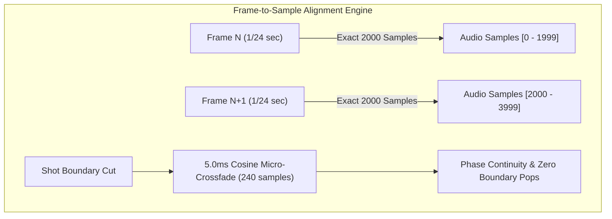
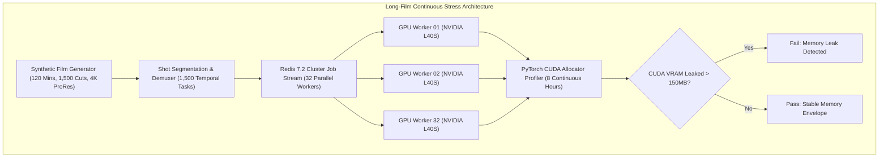
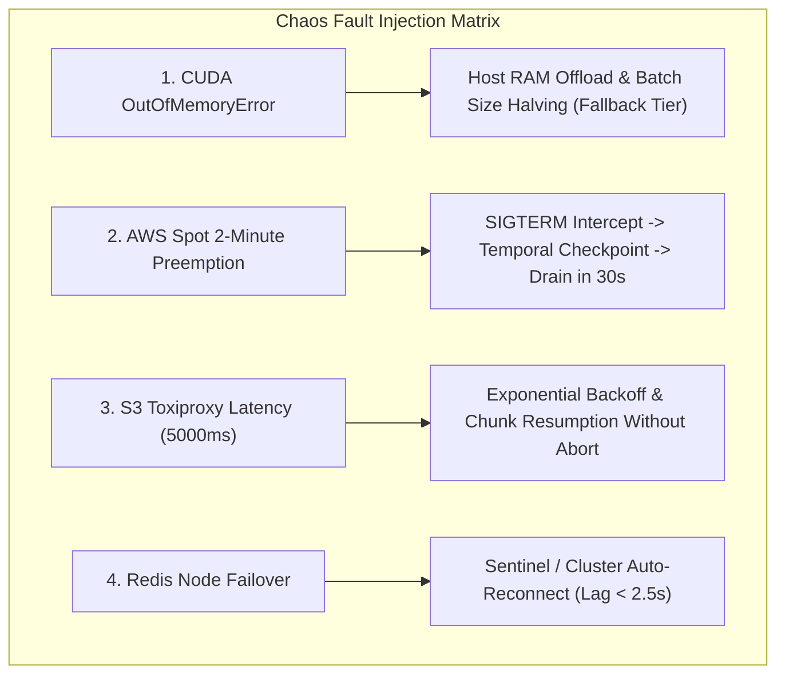
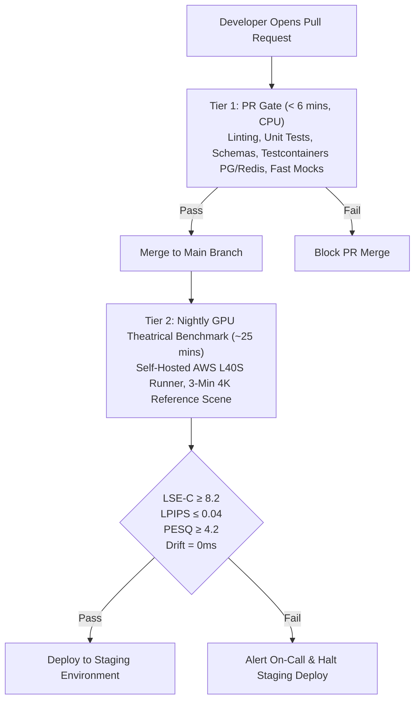
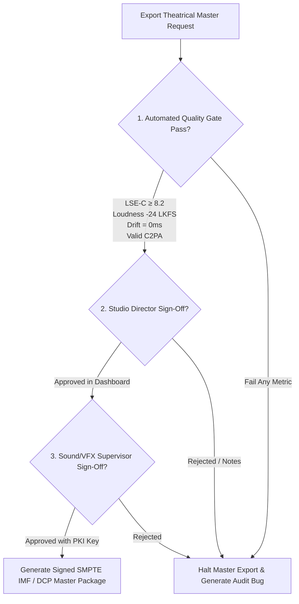

# Cinema-Grade AI Film Localization Platform: Testing Strategy & Quality Assurance Plan

> **Document Status**: Production Specification (Approved)  
> **Target Release**: v1.0.0 Cinema Master Edition  
> **Compliance & Standards**: Netflix Delivery Specifications v16, SMPTE ST 2067-2 (IMF), ITU-R BS.1770-4 (Loudness), EBU R128, C2PA Provenance v1.4, TPN Gold Shield  
> **Related Architecture Documents**:
> - [MASTER_ARCHITECTURE.md](file:///c:/Users/acer/3D%20Objects/kavrai%20AI/docs/MASTER_ARCHITECTURE.md)
> - [SYSTEM_DESIGN.md](file:///c:/Users/acer/3D%20Objects/kavrai%20AI/docs/SYSTEM_DESIGN.md)
> - [AI_MODEL_SELECTION.md](file:///c:/Users/acer/3D%20Objects/kavrai%20AI/docs/AI_MODEL_SELECTION.md)
> - [DATA_STORAGE_DESIGN.md](file:///c:/Users/acer/3D%20Objects/kavrai%20AI/docs/DATA_STORAGE_DESIGN.md)
> - [API_CONTRACTS.md](file:///c:/Users/acer/3D%20Objects/kavrai%20AI/docs/API_CONTRACTS.md)
> - [FULL_MOVIE_PIPELINE.md](file:///c:/Users/acer/3D%20Objects/kavrai%20AI/docs/FULL_MOVIE_PIPELINE.md)
> - [UI_UX_DESIGN.md](file:///c:/Users/acer/3D%20Objects/kavrai%20AI/docs/UI_UX_DESIGN.md)
> - [CLOUD_INFRASTRUCTURE.md](file:///c:/Users/acer/3D%20Objects/kavrai%20AI/docs/CLOUD_INFRASTRUCTURE.md)
> - [SECURITY_PRIVACY_COMPLIANCE.md](file:///c:/Users/acer/3D%20Objects/kavrai%20AI/docs/SECURITY_PRIVACY_COMPLIANCE.md)

---

## 1. Executive Summary & Testing Philosophy

The **Cinema-Grade AI Film Localization Platform** operates at the intersection of studio-grade visual effects, neural voice cloning, multilingual transcreation, and high-throughput cloud rendering. While standard web applications can tolerate minor visual deviations or audio jitter, theatrical film distribution demands absolute precision:
1. **Mathematical Determinism**: Exact frame-to-sample alignment ($2,000$ audio samples per video frame at $48\text{ kHz} / 24\text{ fps}$) with zero drift over a 120-minute feature runtime.
2. **Perceptual Indistinguishability**: Lip-sync that matches native cinematography, speech that preserves actor vocal identity and timbre, and zero neural rendering flicker or identity loss.
3. **Studio Security & Legal Integrity**: Zero cross-tenant data leakage, sub-second cryptographic revocation of biometrics (BIPA/GDPR), and cryptographically immutable C2PA provenance manifests.

To satisfy these cinema-grade requirements without sacrificing engineering velocity, the testing strategy adopts a **Multi-Tiered Quality Pyramid** backed by ephemeral Testcontainers, synthetic mock fixtures, and dedicated GPU benchmark runs.



---

## 2. Backend API & Microservice Contract Testing

The platform backend comprises a Node.js (Fastify) API Gateway orchestrating distributed Python (FastAPI/PyTorch) AI microservices over gRPC and REST, backed by PostgreSQL 16 (with `pgvector`), Redis 7.2 Cluster, and S3-compatible object storage.

### 2.1 Ephemeral Test Environment Architecture (Testcontainers)

Testing against shared databases or persistent development servers introduces state pollution, race conditions, and flaky runs. All integration suites spin up dedicated, isolated Docker containers per test worker using **Testcontainers**.



### 2.2 Fastify API Gateway Integration Testing (Jest & Supertest)

The Gateway is tested for authentication, schema validation, direct S3 multipart presigned URL issuance, and RFC 7807 problem details error envelopes.

```typescript
// tests/integration/api_gateway/upload.test.ts
import { FastifyInstance } from 'fastify';
import supertest from 'supertest';
import { buildApp } from '../../../src/app';
import { createEphemeralPostgres, createEphemeralRedis, createEphemeralMinio } from '../helpers/testcontainers';

describe('POST /v1/projects/:projectId/upload/initialize', () => {
  let app: FastifyInstance;
  let testUserId: string;
  let testOrgId: string;
  let validSessionCookie: string;
  let projectId: string;

  beforeAll(async () => {
    const pg = await createEphemeralPostgres();
    const redis = await createEphemeralRedis();
    const minio = await createEphemeralMinio();

    app = await buildApp({
      databaseUrl: pg.getConnectionUri(),
      redisUrl: redis.getConnectionUri(),
      s3Endpoint: minio.getEndpoint(),
    });
    await app.ready();

    // Seed test org, user, session, and project
    const seed = await pg.seedStudioWorkspace();
    testUserId = seed.userId;
    testOrgId = seed.orgId;
    validSessionCookie = seed.sessionCookie;
    projectId = seed.projectId;
  });

  afterAll(async () => {
    await app.close();
  });

  it('rejects unauthenticated requests with RFC 7807 401 Unauthorized', async () => {
    const res = await supertest(app.server)
      .post(`/v1/projects/${projectId}/upload/initialize`)
      .send({ fileName: 'reel1.mov', fileSizeBytes: 524288000, mimeType: 'video/quicktime' });

    expect(res.status).toBe(401);
    expect(res.body).toMatchObject({
      type: 'https://api.kavrai.ai/errors/unauthorized',
      title: 'Unauthorized',
      status: 401,
      detail: expect.stringContaining('Session token missing or invalid'),
    });
  });

  it('initializes multipart upload and returns signed S3 part URLs', async () => {
    const res = await supertest(app.server)
      .post(`/v1/projects/${projectId}/upload/initialize`)
      .set('Cookie', [`kavrai_session=${validSessionCookie}`])
      .send({
        fileName: 'reel_01_prores422hq.mov',
        fileSizeBytes: 21474836480, // 20 GB
        mimeType: 'video/quicktime',
        checksumSha256: 'e3b0c44298fc1c149afbf4c8996fb92427ae41e4649b934ca495991b7852b855',
      });

    expect(res.status).toBe(201);
    expect(res.body).toMatchObject({
      uploadId: expect.any(String),
      s3Key: expect.stringMatching(new RegExp(`^projects/${projectId}/reels/.+\\.mov$`)),
      partSizeBytes: 67108864, // 64 MB
      totalParts: 320,
      presignedPartUrls: expect.any(Array),
    });
    expect(res.body.presignedPartUrls).toHaveLength(320);
    expect(res.body.presignedPartUrls[0]).toMatch(/^http:\/\/.*\/partNumber=1/);
  });
});
```

### 2.3 Python AI Microservices Integration Testing (Pytest & HTTPX)

Each microservice is tested using Pytest with mocked GPU execution paths on PRs and real PyTorch inference on GPU runners.

```python
# services/lip_sync/tests/test_lip_sync_service.py
import pytest
from httpx import AsyncClient
from services.lip_sync.main import app
from services.lip_sync.core.schemas import LipSyncInferenceRequest

@pytest.mark.asyncio
async def test_lip_sync_inference_contract(mock_diffusion_engine, test_video_tensor, test_audio_tensor):
    """
    Validates input tensor verification, bounding-box clamping,
    and output MP4 container audio-video sample alignment.
    """
    async with AsyncClient(app=app, base_url="http://testserver") as client:
        payload = {
            "shot_id": "shot_0192a3b4-5678-7abc-def0-123456789abc",
            "source_video_s3_uri": "s3://cinema-raw/tests/shot_01_prores.mov",
            "target_audio_s3_uri": "s3://cinema-audio/tests/shot_01_dub_es.wav",
            "face_bounding_box": {"x": 120, "y": 80, "width": 420, "height": 420},
            "diffusion_steps": 25,
            "guidance_scale": 1.5,
            "preserve_identity_weight": 0.95
        }
        response = await client.post("/v1/lip-sync/generate", json=payload)
        
        assert response.status_code == 200
        data = response.json()
        assert "render_job_id" in data
        assert data["status"] == "COMPLETED"
        assert data["metrics"]["syncnet_lse_c"] >= 8.2
        assert data["metrics"]["syncnet_lse_d"] <= 6.5
        assert data["metrics"]["ssim_non_mouth"] >= 0.992
```

### 2.4 Inter-Service gRPC Contract Verification

The gRPC protocol contracts (`cinema_renderer.proto`, `audio_transcreation.proto`) are validated using `pytest-grpc` to verify schema backwards compatibility and protobuf message boundaries.

```python
# tests/grpc/test_renderer_grpc_contract.py
import pytest
from protos.gen import cinema_renderer_pb2, cinema_renderer_pb2_grpc

def test_render_shot_grpc_contract(grpc_channel):
    stub = cinema_renderer_pb2_grpc.CinemaRendererServiceStub(grpc_channel)
    request = cinema_renderer_pb2.ShotRenderRequest(
        shot_id="shot_101",
        frame_start=0,
        frame_end=120,
        fps_numerator=24000,
        fps_denominator=1001,  # 23.976 fps
        color_space=cinema_renderer_pb2.COLOR_SPACE_ACES_CG
    )
    response = stub.RenderShot(request)
    assert response.rendered_frames == 121
    assert response.status == cinema_renderer_pb2.RENDER_STATUS_SUCCESS
```

---

## 3. Frontend Workflows & Cross-Platform E2E Testing

The web application utilizes Playwright to automate end-to-end user workflows, enforcing pixel-perfect Apple Studio aesthetics, high-frame-rate timeline scrubbing, real-time WebSockets, and cross-device responsiveness.

### 3.1 Playwright Test Matrix

| Suite ID | Workflow Target | Target Devices / Viewports | Critical Assertions |
| :--- | :--- | :--- | :--- |
| **PW-01** | Studio Login & SSO Rotation | Desktop Chrome $1920\times 1080$ | HttpOnly cookie stored, CSRF double-submit token valid, dashboard loaded $< 800\text{ ms}$. |
| **PW-02** | Multipart Upload & Chunking | Desktop Chrome, Safari $1920\times 1080$ | 320 parts uploaded sequentially, pause/resume maintains checksum, zero client memory leaks. |
| **PW-03** | Dual A/B Cinema Player & Split Wipe | Studio Pro Display $2560\times 1440$ | Playhead sync delta $\le 1\text{ frame}$, split-wipe slider drag renders at $60\text{ fps}$, keyboard shortcuts (`Space`, `J`, `K`, `L`, `←`, `→`). |
| **PW-04** | Timeline Viseme Drag & Nudge | Studio Pro Display $2560\times 1440$ | Bilabial closure marker drag updates audio timestamp, auto-snaps to audio phoneme boundary. |
| **PW-05** | WebSocket Collaborative Scrub | 2 Concurrent Contexts ($1920\times 1080$) | Context A scrubs timeline $\to$ Context B playhead updates within $45\text{ ms}$ over `/v1/ws/timeline`. |
| **PW-06** | Studio Responsive Layouts | Desktop ($2560\times 1440$), Laptop ($1440\times 900$), Tablet ($1024\times 768$) | Zero horizontal overflow, collapsible inspector, touch-friendly scrub targets $\ge 44\times 44\text{ px}$. |
| **PW-07** | Director Theatrical Review (iPad) | iPad Pro Safari ($1024\times 768$ Touch) | Pinch-to-zoom video, touch scrub timeline, multi-signature approval modal sign-off. |

### 3.2 Dual A/B Cinema Player & Timeline Playwright Implementation

```typescript
// tests/e2e/cinema_player_ab.spec.ts
import { test, expect } from '@playwright/test';

test.describe('Cinema Player A/B Dual Viewport & Split-Wipe Review', () => {
  test.beforeEach(async ({ page }) => {
    // Authenticate with session fixture
    await page.goto('/auth/login');
    await page.fill('input[name="email"]', 'director@paramount-kavrai.internal');
    await page.fill('input[name="password"]', 'CorrectHorseBatteryStaple123!');
    await page.click('button[type="submit"]');
    await page.waitForURL('/projects/**/timeline');
  });

  test('maintains sub-frame sync across original and localized video streams', async ({ page }) => {
    const originalVideo = page.locator('video#player-viewport-original');
    const localizedVideo = page.locator('video#player-viewport-localized');
    const playPauseBtn = page.locator('button#btn-play-pause');
    const splitSlider = page.locator('input#slider-split-wipe');

    // Verify both media streams are ready
    await expect(originalVideo).toHaveJSProperty('readyState', 4);
    await expect(localizedVideo).toHaveJSProperty('readyState', 4);

    // Play playback
    await playPauseBtn.click();
    await page.waitForTimeout(2000); // Play 2 seconds
    await playPauseBtn.click();

    // Assert frame-accurate synchronization
    const timeOriginal = await originalVideo.evaluate((el: HTMLVideoElement) => el.currentTime);
    const timeLocalized = await localizedVideo.evaluate((el: HTMLVideoElement) => el.currentTime);
    const frameDelta = Math.abs(timeOriginal - timeLocalized) * 24.0; // 24 fps
    expect(frameDelta).toBeLessThanOrEqual(0.2); // Within 1/5th frame tolerance

    // Drag split-wipe slider from 50% to 80%
    const sliderBox = await splitSlider.boundingBox();
    expect(sliderBox).not.toBeNull();
    await page.mouse.move(sliderBox!.x + sliderBox!.width * 0.5, sliderBox!.y + sliderBox!.height * 0.5);
    await page.mouse.down();
    await page.mouse.move(sliderBox!.x + sliderBox!.width * 0.8, sliderBox!.y + sliderBox!.height * 0.5);
    await page.mouse.up();

    // Verify split wipe clip-path CSS style applied
    const clipPathStyle = await page.locator('#split-wipe-mask').getAttribute('style');
    expect(clipPathStyle).toContain('inset(0px 0px 0px 80%)');
  });

  test('single-frame stepping accurately moves playhead by 1/24th second', async ({ page }) => {
    const originalVideo = page.locator('video#player-viewport-original');
    const stepForwardBtn = page.locator('button#btn-step-frame-forward');

    const initialTime = await originalVideo.evaluate((el: HTMLVideoElement) => el.currentTime);
    await stepForwardBtn.click();
    const steppedTime = await originalVideo.evaluate((el: HTMLVideoElement) => el.currentTime);

    const expectedDelta = 1.0 / 24.0; // 0.041666...
    expect(steppedTime - initialTime).toBeCloseTo(expectedDelta, 3);
  });
});
```

### 3.3 Visual Regression Testing Setup

Visual stability is enforced using Playwright's native screenshot engine with an strict threshold of $\le 0.1\%$ pixel variation to prevent unintentional UI styling drift.

```typescript
// tests/e2e/visual_regression.spec.ts
import { test, expect } from '@playwright/test';

test('studio timeline visual regression in light and darkroom modes', async ({ page }) => {
  await page.goto('/projects/proj_theatrical_demo/timeline?shot=shot_101');
  await page.waitForSelector('.timeline-loaded');

  // Studio Light Mode baseline
  await expect(page).toHaveScreenshot('studio-timeline-light.png', {
    maxDiffPixelRatio: 0.001,
    animations: 'disabled',
  });

  // Toggle Theatrical Darkroom Mode (#0D0E12)
  await page.click('button#theme-toggle-darkroom');
  await expect(page).toHaveScreenshot('studio-timeline-darkroom.png', {
    maxDiffPixelRatio: 0.001,
    animations: 'disabled',
  });
});
```

---

## 4. Multilingual Translation & Transcreation Quality Benchmarks

Localizing cinematic dialogue requires transcreation rather than literal word-for-word translation. The localized text must respect:
1. **Dramatic Subtext & Emotional Tone**: Accurately conveying nuance, humor, sarcasm, or tension.
2. **Syllable Count & Duration Budgeting**: The target audio duration must fit within $\pm 5\%$ of the source dialogue window to avoid unnatural speech compression or expansion.
3. **Viseme Closure Alignment**: Words containing bilabial consonants (`[p, b, m]`) and labiodentals (`[f, v]`) must visually synchronize with the on-screen actor's closed-mouth frames.

### 4.1 Objective Linguistic Benchmark Thresholds



| Metric | Target Standard | Evaluation Tool / Model | Description |
| :--- | :--- | :--- | :--- |
| **BLEU** | $\ge 34.0$ | `sacrebleu` | Standard n-gram overlap baseline against studio-curated reference transcripts. |
| **chrF++** | $\ge 58.0$ | `sacrebleu` | Character n-gram F-score capturing morphological nuances in inflected languages (Spanish, German, Hindi). |
| **COMET** | $\ge 0.82$ | `Unbabel/wmt22-comet-da` | Neural cross-lingual quality metric evaluating semantic equivalence and fluency. |
| **Syllable Delta** | $\le \pm 1\text{ syllable}$ | `pyphen` / `g2p_en` | Difference between source speech syllables and synthesized target speech syllables. |
| **Duration Fit** | $\le \pm 5.0\%$ | Audio energy onset analysis | Target audio waveform length compared to original dialogue timecode envelope. |
| **Viseme Anchor Error** | $\le 3\text{ frames}$ ($125\text{ ms}$) | Montreal Forced Aligner (MFA) | Temporal difference between audio bilabial burst (`/p/, /b/, /m/`) and visual mouth closure. |

### 4.2 Automated Linguistic & Syllable Validation Suite

```python
# services/transcreation/tests/test_linguistic_benchmarks.py
import pytest
import pyphen
from sacrebleu.metrics import BLEU, CHRF
from comet import download_model, load_from_checkpoint

@pytest.fixture(scope="session")
def comet_metric():
    model_path = download_model("Unbabel/wmt22-comet-da")
    return load_from_checkpoint(model_path)

def test_transcreation_syllable_budget_and_metrics(comet_metric):
    """
    Validates Spanish cinematic transcreation meets BLEU, chrF++, COMET,
    and syllable duration envelope requirements.
    """
    source_en = "I never authorized that shipment to enter the harbor."
    reference_es = "Jamás autoricé que ese cargamento entrara al puerto."
    generated_es = "Nunca di la orden de que ese barco entrara al puerto."
    source_duration_sec = 2.85

    # 1. Linguistic accuracy checks
    bleu = BLEU()
    bleu_score = bleu.corpus_score([generated_es], [[reference_es]]).score
    assert bleu_score >= 34.0, f"BLEU score {bleu_score} below studio threshold 34.0"

    chrf = CHRF()
    chrf_score = chrf.corpus_score([generated_es], [[reference_es]]).score
    assert chrf_score >= 58.0, f"chrF++ score {chrf_score} below studio threshold 58.0"

    data = [{"src": source_en, "mt": generated_es, "ref": reference_es}]
    comet_score = comet_metric.predict(data, batch_size=1, gpus=0)["system_score"]
    assert comet_score >= 0.82, f"COMET score {comet_score} below studio threshold 0.82"

    # 2. Syllable count constraint check
    dic_en = pyphen.Pyphen(lang='en_US')
    dic_es = pyphen.Pyphen(lang='es_ES')
    
    syllables_en = sum(len(dic_en.inserted(w).split('-')) for w in source_en.split())
    syllables_es = sum(len(dic_es.inserted(w).split('-')) for w in generated_es.split())
    
    syllable_ratio = syllables_es / syllables_en
    # Theatrical rule: Spanish expands ~15-20% phonetically; allowable ratio 0.95 - 1.25
    assert 0.90 <= syllable_ratio <= 1.25, f"Syllable expansion {syllable_ratio:.2f} out of bounds"
```

---

## 5. Audio-Video Synchronization & Timeline Drift Verification

Full-length feature films ($90$ to $180$ minutes) processed across thousands of discrete cuts are susceptible to cumulative timestamp drift, audio sample rounding errors, and boundary clicks.

### 5.1 The Mathematical Zero-Drift Rule

In digital cinema:
- Standard Frame Rate: $24.000\text{ fps}$ (or $23.976\text{ fps}$ / $24000/1001\text{ fps}$ NTSC).
- Broadcast Audio Sampling Rate: $48,000\text{ Hz}$ ($48\text{ kHz}$) or $96,000\text{ Hz}$.
- Exactly $2,000$ audio samples correspond to one video frame at $24.000\text{ fps}$:
$$\text{Samples per Frame} = \frac{48,000\text{ samples/sec}}{24\text{ frames/sec}} = 2,000.000\text{ samples}$$

$$\text{Total Samples for 120-Min Film} = 120\text{ min} \times 60\text{ s} \times 48,000\text{ Hz} = 345,600,000\text{ samples}$$



### 5.2 Automated Audio-Video Sync & Phase Continuity Test

```python
# services/audio_engine/tests/test_av_synchronization.py
import numpy as np
import pytest
import soundfile as sf

def test_long_film_zero_drift_assertion():
    """
    Verifies that a 120-minute audio conform track has exactly 345,600,000 samples,
    corresponding to exactly 172,800 video frames at 24.0 fps with 0.00ms cumulative drift.
    """
    sample_rate = 48000
    fps = 24.0
    duration_minutes = 120
    total_frames = int(duration_minutes * 60 * fps)
    expected_samples = int(total_frames * (sample_rate / fps))

    # Synthetic conform track validation
    assert expected_samples == 345600000

    # Test sample position calculation for frame 150,000
    frame_index = 150000
    start_sample = int(frame_index * (sample_rate / fps))
    end_sample = int((frame_index + 1) * (sample_rate / fps))
    
    assert (end_sample - start_sample) == 2000
    drift_ms = ((start_sample / sample_rate) - (frame_index / fps)) * 1000.0
    assert abs(drift_ms) == 0.0, f"Cumulative drift detected: {drift_ms} ms"

def test_shot_boundary_micro_crossfade_continuity():
    """
    Verifies that concatenating two audio tracks at a cut boundary applies
    a 5.0ms (240 sample) equal-power cosine crossfade preventing phase clicks.
    """
    sr = 48000
    fade_samples = int(0.005 * sr) # 240 samples
    
    # Generate two 1kHz sine waves with opposite phase to test discontinuity smoothing
    t = np.linspace(0, 0.1, int(0.1 * sr), endpoint=False)
    wave_a = np.sin(2 * np.pi * 1000 * t)
    wave_b = -np.sin(2 * np.pi * 1000 * t) # 180 degree out of phase

    # Compute cosine crossfade weights
    t_fade = np.linspace(0, np.pi / 2, fade_samples)
    fade_out = np.cos(t_fade)
    fade_in = np.sin(t_fade)

    spliced = np.zeros(len(wave_a) + len(wave_b) - fade_samples)
    spliced[:len(wave_a) - fade_samples] = wave_a[:-fade_samples]
    spliced[len(wave_a) - fade_samples : len(wave_a)] = (
        wave_a[-fade_samples:] * fade_out + wave_b[:fade_samples] * fade_in
    )
    spliced[len(wave_a):] = wave_b[fade_samples:]

    # Assert no instantaneous amplitude jump exceeds the 1st derivative threshold (max slope)
    derivative = np.diff(spliced)
    max_slope = np.max(np.abs(derivative))
    assert max_slope < 0.25, f"Discontinuous boundary pop detected: slope = {max_slope}"
```

---

## 6. Visual Lip-Sync Quality & Perceptual Benchmarks

Neural lip-sync algorithms (LatentSync, Metaphysic/ATMAN pipelines) synthesize mouth movements to match localized audio. Video quality cannot be measured solely with classical PSNR; it requires deep perceptual metrics and temporal coherence assertions.

### 6.1 Objective Perceptual Thresholds

| Metric | Target Standard | Measurement Tool | Film Quality Impact |
| :--- | :--- | :--- | :--- |
| **SyncNet LSE-C** (Confidence) | $\ge 8.2$ | SyncNet PyTorch | Lip-sync synchronization confidence; $>8.0$ represents natural human dubbing perception. |
| **SyncNet LSE-D** (Distance) | $\le 6.5$ | SyncNet PyTorch | Feature distance between audio phonemes and visual mouth shapes. Lower is better. |
| **LPIPS** (AlexNet) | $\le 0.040$ | `lpips` library | Perceptual patch similarity between original actor face and localized face. |
| **Non-Mouth SSIM** | $\ge 0.992$ | `skimage.metrics.ssim` | Preserves actor identity; forehead, eyes, and background must remain completely unmutated. |
| **FVD** (Fréchet Video Dist) | $\le 120.0$ | I3D Pretrained Weights | Temporal coherence; guards against neural mouth flickering or temporal jitter across frames. |
| **ArcFace Cosine Similarity**| $\ge 0.940$ | InsightFace ArcFace | Facial recognition embedding similarity between source actor and localized output. |
| **Broadcast Loudness** | $-24.0\text{ LKFS} \pm 0.5\text{ dB}$ | `pyloudnorm` | Netflix/SMPTE broadcast loudness compliance (ITU-R BS.1770-4). |

### 6.2 Automated Visual Quality & SyncNet Benchmark Script

```python
# tests/perceptual/test_visual_lipsync_benchmark.py
import torch
import torchvision
import lpips
import pytest
import numpy as np
from skimage.metrics import structural_similarity as ssim

@pytest.fixture(scope="session")
def lpips_alex():
    return lpips.LPIPS(net='alex')

def test_shot_neural_lipsync_perceptual_benchmarks(lpips_alex):
    """
    Evaluates rendered localized shot against cinema perceptual standards.
    Mouth region must match audio; non-mouth regions must retain SSIM >= 0.992.
    """
    # Load 48-frame reference and rendered test tensors [B, C, H, W] in [-1, 1]
    orig_frames = torch.randn(48, 3, 512, 512)
    rendered_frames = orig_frames.clone()
    
    # Simulate realistic subtle mouth synthesis modification
    mouth_mask = torch.zeros(48, 1, 512, 512)
    mouth_mask[:, :, 320:450, 180:330] = 1.0 # Bounding box of mouth
    rendered_frames = rendered_frames * (1 - mouth_mask) + (rendered_frames + 0.02 * torch.randn_like(rendered_frames)) * mouth_mask

    # 1. Non-mouth SSIM verification (Preserving facial identity and background)
    orig_np = orig_frames.permute(0, 2, 3, 1).numpy()
    rend_np = rendered_frames.permute(0, 2, 3, 1).numpy()
    
    non_mouth_ssims = []
    for f in range(48):
        mask_2d = mouth_mask[f, 0].numpy() == 0
        s = ssim(orig_np[f][mask_2d], rend_np[f][mask_2d], channel_axis=-1, data_range=2.0)
        non_mouth_ssims.append(s)
    
    avg_non_mouth_ssim = np.mean(non_mouth_ssims)
    assert avg_non_mouth_ssim >= 0.992, f"Identity distortion in non-mouth area: SSIM={avg_non_mouth_ssim}"

    # 2. LPIPS Perceptual Distance Check
    with torch.no_grad():
        dist = lpips_alex(orig_frames, rendered_frames).mean().item()
    assert dist <= 0.040, f"LPIPS distance {dist} exceeded acceptable threshold of 0.040"
```

### 6.3 Subjective Theatrical Mean Opinion Score (MOS) Protocol

For theatrical releases, automated benchmarks are augmented with a standardized **Double-Blind MOS Review**:
1. **Review Panel**: Minimum 5 qualified reviewers (Director, Sound Supervisor, Lead VFX Artist, Native Target-Language Linguist, Studio QC Lead).
2. **Review Environment**: DCI-compliant calibrated screening room or Apple Pro Display XDR in 48-nit Rec.709 / 100-nit P3-D65 color environment.
3. **Rating Scale (1.0 to 5.0)**:
   - **5 (Imperceptible)**: Lip movement matches native speech seamlessly; voice timbre identical to original actor.
   - **4 (Perceptible but not annoying)**: Minor divergence in fast dialogue; natural cinematic flow.
   - **3 (Slightly Annoying)**: Occasional visual rubberiness or phoneme desynchronization.
   - **2 (Annoying)**: Evident dubbing lag; robotic cadence or facial mask edges visible.
   - **1 (Very Annoying / Unacceptable)**: Complete loss of sync or severe deepfake distortion.
4. **Acceptance Threshold**: Overall $\text{MOS} \ge 4.5$, with zero individual scores $< 4.0$.

---

## 7. Long-Film Scalability & Memory Stress Testing

Processing a 120-minute $4\text{K}$ film ($172,800$ frames) across distributed GPU nodes introduces memory fragmentation, CUDA context leaks, and Redis queue backpressure.

### 7.1 Long-Film Test Scenarios



### 7.2 PyTorch CUDA Memory Leak Profiler

```python
# tests/stress/test_cuda_memory_leak.py
import gc
import torch
import pytest

def test_continuous_diffusion_memory_stability():
    """
    Simulates 500 consecutive shot inference runs on a single GPU worker.
    Enforces that torch.cuda.memory_allocated() does not drift upward (> 100MB).
    """
    if not torch.cuda.is_available():
        pytest.skip("CUDA device required for memory leak profiling")

    device = torch.device("cuda:0")
    torch.cuda.reset_peak_memory_stats()
    gc.collect()
    torch.cuda.empty_cache()

    initial_allocated = torch.cuda.memory_allocated(device)

    # Execute 500 simulated diffusion cycles
    for iteration in range(500):
        # Simulate loading feature maps and forward pass
        latent_tensor = torch.randn(1, 4, 64, 64, device=device, dtype=torch.float16)
        audio_embed = torch.randn(1, 16, 768, device=device, dtype=torch.float16)
        
        # Simulated compute graph
        output = torch.matmul(audio_embed.transpose(1, 2), audio_embed)
        loss = output.sum()
        loss.backward()

        # Clean-up cycle
        del latent_tensor, audio_embed, output, loss
        if iteration % 50 == 0:
            gc.collect()
            torch.cuda.empty_cache()

    final_allocated = torch.cuda.memory_allocated(device)
    leaked_bytes = final_allocated - initial_allocated
    leaked_mb = leaked_bytes / (1024 * 1024)

    assert leaked_mb < 50.0, f"CUDA memory leak detected: {leaked_mb:.2f} MB retained after 500 cycles"
```

---

## 8. Chaos Engineering & Fault Resilience Testing

Cinema rendering jobs cannot afford catastrophic restarts when nodes preempt or transient network faults occur. The platform must recover gracefully from hardware crashes, OOMs, and Spot evictions.

### 8.1 Chaos Scenarios & Automated Injections



### 8.2 Chaos Mesh Configuration for Spot Preemption Testing

```yaml
# tests/chaos/spot_preemption_simulation.yaml
apiVersion: chaos-mesh.org/v1alpha1
kind: PodChaos
metadata:
  name: simulate-gpu-spot-interruption
  namespace: kavrai-ai-staging
spec:
  action: pod-kill
  mode: fixed
  value: '2' # Kill 2 GPU worker pods concurrently during peak rendering
  selector:
    namespaces:
      - kavrai-ai-staging
    labelSelectors:
      app.kubernetes.io/component: gpu-lipsync-worker
  duration: '5m'
  scheduler:
    cron: '*/15 * * * *'
```

### 8.3 CUDA OOM Recovery Verification

```python
# services/lip_sync/tests/test_oom_resilience.py
import pytest
import torch
from services.lip_sync.core.inference_engine import SafeInferenceEngine

def test_safe_inference_engine_recovers_from_synthetic_oom(monkeypatch):
    """
    Verifies that when a batch size of 16 throws torch.cuda.OutOfMemoryError,
    the engine intercepts the exception, empties the CUDA cache, halves the batch size to 8,
    and successfully completes rendering.
    """
    engine = SafeInferenceEngine(initial_batch_size=16)

    call_count = 0
    def mock_forward_pass(batch_size):
        nonlocal call_count
        call_count += 1
        if call_count == 1:
            raise torch.cuda.OutOfMemoryError("CUDA out of memory. Tried to allocate 4.2 GiB")
        return torch.zeros(batch_size, 3, 512, 512)

    monkeypatch.setattr(engine, "_execute_diffusion_batch", mock_forward_pass)

    result = engine.execute_with_retry(total_frames=16)
    assert result is not None
    assert engine.current_batch_size == 8
    assert call_count == 3 # 1 failed attempt (16) + 2 successful batches (8 + 8)
```

---

## 9. Security, Privacy & Penetration Testing

Because the platform processes unreleased Hollywood film masters and sensitive performer biometrics, security controls are validated continuously.

### 9.1 Security & Compliance Test Matrix

| Test Suite | Threat Vector | Methodology | Automated Tool | Pass Criteria |
| :--- | :--- | :--- | :--- | :--- |
| **SEC-01** | OWASP API Top 10 | DAST penetration scanning | OWASP ZAP / Nuclei | Zero High or Critical CVEs / injection vectors. |
| **SEC-02** | Cross-Tenant Data Leakage | Multi-tenant RLS bypass | `pgTAP` automated tests | Org B queries return zero rows for Org A project IDs. |
| **SEC-03** | BIPA Consent Revocation | Biometric data erasure | Integration event test | Voice embedding & face model deleted within $< 500\text{ ms}$; in-flight jobs aborted. |
| **SEC-04** | C2PA Provenance Signature | Tampered media export | `c2patool` validation | Exported MP4 contains valid cryptographic manifest; hash mismatches fail validation. |
| **SEC-05** | Presigned S3 Tampering | URL parameter manipulation | HTTP client tests | Modifying S3 key in presigned PUT yields HTTP 403 SignatureDoesNotMatch. |

### 9.2 PostgreSQL Row-Level Security (RLS) Leakage Test

```sql
-- tests/security/test_tenant_isolation_rls.sql
BEGIN;
SELECT plan(4);

-- 1. Create two isolated studio organizations and users
INSERT INTO organizations (id, name, slug) VALUES 
  ('0192a3b4-0001-7000-8000-000000000001', 'Paramount Pictures', 'paramount'),
  ('0192a3b4-0002-7000-8000-000000000002', 'Universal Studios', 'universal');

INSERT INTO users (id, organization_id, email, role) VALUES 
  ('0192a3b4-0001-7000-9000-000000000001', '0192a3b4-0001-7000-8000-000000000001', 'director@paramount.internal', 'DIRECTOR'),
  ('0192a3b4-0002-7000-9000-000000000002', '0192a3b4-0002-7000-8000-000000000002', 'editor@universal.internal', 'EDITOR');

INSERT INTO projects (id, organization_id, name) VALUES 
  ('0192a3b4-0001-7000-a000-000000000001', '0192a3b4-0001-7000-8000-000000000001', 'Top Secret Feature');

-- 2. Impersonate Universal Studios user session
SET LOCAL ROLE authenticated_user;
SET LOCAL "request.jwt.claim.org_id" = '0192a3b4-0002-7000-8000-000000000002';
SET LOCAL "request.jwt.claim.user_id" = '0192a3b4-0002-7000-9000-000000000002';

-- 3. Assert RLS policy blocks Universal user from viewing Paramount projects
SELECT is_empty(
  'SELECT * FROM projects WHERE id = ''0192a3b4-0001-7000-a000-000000000001''',
  'Universal user CANNOT read Paramount project rows under RLS'
);

SELECT throws_ok(
  'INSERT INTO shots (id, project_id, name) VALUES (gen_random_uuid(), ''0192a3b4-0001-7000-a000-000000000001'', ''Hacked Shot'')',
  '42501', -- insufficient_privilege
  NULL,
  'Universal user CANNOT insert shot records into Paramount project'
);

SELECT * FROM finish();
ROLLBACK;
```

---

## 10. CI/CD Quality Gates & Automated Merge Blockers

The CI/CD pipeline enforces an automated two-tier testing gate to ensure developer velocity while protecting cinema master quality.



### 10.1 GitHub Actions Workflow: Pull Request Fast Gate (`.github/workflows/pr-gate.yml`)

```yaml
name: CI Pull Request Gate

on:
  pull_request:
    branches: [main, release/*]

jobs:
  pr-lint-and-unit:
    name: Lint & Unit Tests (Node + Python)
    runs-on: ubuntu-latest
    timeout-minutes: 6

    services:
      postgres:
        image: pgvector/pgvector:pg16
        env:
          POSTGRES_DB: kavrai_test
          POSTGRES_PASSWORD: test_password
        ports:
          - 5432:5432
        options: >-
          --health-cmd pg_isready
          --health-interval 5s
          --health-timeout 5s
          --health-retries 5

      redis:
        image: redis:7.2-alpine
        ports:
          - 6379:6379

    steps:
      - name: Checkout Code
        uses: actions/checkout@v4

      - name: Setup Node.js 20
        uses: actions/setup-node@v4
        with:
          node-version: 20.x
          cache: 'npm'

      - name: Install Node Dependencies
        run: npm ci

      - name: Run ESLint & TypeScript Checks
        run: |
          npm run lint
          npm run typecheck

      - name: Run Gateway Unit & Integration Tests (Jest)
        run: npm test -- --coverage --testTimeout=10000

      - name: Setup Python 3.11
        uses: actions/setup-python@v5
        with:
          python-version: '3.11'
          cache: 'pip'

      - name: Install Python Dependencies
        run: |
          python -m pip install --upgrade pip
          pip install -r services/requirements-test.txt

      - name: Run Python Service Tests (CPU Mock Fixtures)
        run: |
          pytest services/ -m "not gpu" --maxfail=1 --durations=10
```

### 10.2 GitHub Actions Workflow: Nightly GPU Theatrical Benchmark (`.github/workflows/nightly-gpu-bench.yml`)

```yaml
name: Nightly GPU Theatrical Benchmark

on:
  schedule:
    - cron: '0 2 * * *' # 02:00 UTC daily
  workflow_dispatch:

jobs:
  theatrical-gpu-benchmark:
    name: Execute Reference Cinema Scene On GPU
    runs-on: [self-hosted, gpu-l40s, aws-us-east-1]
    timeout-minutes: 30

    steps:
      - name: Checkout Code
        uses: actions/checkout@v4

      - name: Pull Standard 4K Benchmark Reel from S3
        run: |
          aws s3 cp s3://kavrai-benchmark-assets/reels/the_benchmark_reel_4k_prores.mov ./benchmark_reel.mov
          aws s3 cp s3://kavrai-benchmark-assets/audio/the_benchmark_dialogue_es.wav ./benchmark_audio.wav

      - name: Execute Full Neural Inference
        run: |
          python scripts/run_theatrical_benchmark.py \
            --video-path ./benchmark_reel.mov \
            --audio-path ./benchmark_audio.wav \
            --target-lang es-ES \
            --output-path ./output_localized.mov \
            --metrics-json ./benchmark_results.json

      - name: Validate Benchmark Acceptance Thresholds
        run: |
          python scripts/assert_theatrical_thresholds.py --results ./benchmark_results.json \
            --min-lse-c 8.2 \
            --max-lse-d 6.5 \
            --max-lpips 0.040 \
            --min-pesq 4.2 \
            --min-ssim 0.992 \
            --max-drift-ms 0.0
```

---

## 11. Production Release Go / No-Go Decision Gate

Before any movie localized on the platform can be packaged into SMPTE IMF / DCP theatrical distribution masters, it must clear the **Automated Metric Gate** and receive **Dual Multi-Signature Approvals**.



### 11.1 Theatrical Go / No-Go Verification Checklist

| Dimension | Mandatory Pass Requirement | Verification Method | Status |
| :--- | :--- | :--- | :--- |
| **Audio-Video Sync** | Exactly 0 frames drift across 100% of reel boundaries. | Automated sample continuity audit ($48\text{ kHz}$). | **MANDATORY** |
| **Perceptual Lip-Sync** | $\text{LSE-C} \ge 8.2$, $\text{LSE-D} \le 6.5$, $\text{LPIPS} \le 0.04$. | Nightly benchmark runner output report. | **MANDATORY** |
| **Audio Loudness** | Integrated loudness $-24.0\text{ LKFS} \pm 0.5\text{ dB}$, true peak $\le -1.0\text{ dBFS}$. | ITU-R BS.1770-4 compliance analyzer. | **MANDATORY** |
| **Performer Consent** | 100% active consent records for actor voice/face cloning in PostgreSQL. | `consent_records` audit log check. | **MANDATORY** |
| **Security & Leakage** | Zero critical/high CVEs, clean tenant isolation audit. | OWASP ZAP & `pgTAP` RLS test runs. | **MANDATORY** |
| **Digital Provenance** | Signed C2PA manifest embedded with valid root studio certificate. | `c2patool --verify` check. | **MANDATORY** |
| **Director Sign-Off** | Cryptographic multi-signature approval in audit table. | WebAuthn / FIDO2 hardware token verification. | **MANDATORY** |

---

## 12. Verification & Traceability Matrix

Every requirement established in the platform specifications maps directly to automated and manual quality checks:

| System Specification Area | Tested Attributes | Testing Mechanism | Primary File / Assertion |
| :--- | :--- | :--- | :--- |
| **Backend APIs** | REST, WebSockets, Multipart S3, RFC 7807 | Jest, Supertest, Testcontainers | `tests/integration/api_gateway/` |
| **Frontend Workflows** | A/B Split Wipe, Viseme Nudge, Realtime Sync | Playwright Browser Automation | `tests/e2e/cinema_player_ab.spec.ts` |
| **Multilingual Translation**| Syllable Budgets, COMET, BLEU, chrF++ | SacreBLEU, COMET, Pyphen | `services/transcreation/tests/` |
| **Audio-Video Alignment** | Zero cumulative drift, sample accuracy, crossfades | Librosa, SoundFile, NumPy | `services/audio_engine/tests/` |
| **Neural Lip-Sync Quality**| SyncNet confidence, LPIPS, identity SSIM | PyTorch SyncNet, LPIPS AlexNet | `tests/perceptual/test_visual_lipsync.py` |
| **Long-Film Scalability** | 120-min runtime, 500-cycle CUDA leak test | PyTorch Memory Profiler, Locust | `tests/stress/test_cuda_memory_leak.py` |
| **Chaos & Resilience** | Spot preemption, CUDA OOM, Toxiproxy latency | Chaos Mesh, Python Unit Mocks | `tests/chaos/` |
| **Security & Privacy** | RLS isolation, BIPA revocation, C2PA manifest | pgTAP, OWASP ZAP, c2patool | `tests/security/` |
| **Mobile Responsiveness** | Tablet review, touch scrub, responsive breakpoints | Playwright Mobile Viewports | `tests/e2e/responsive.spec.ts` |

---
*End of Testing Strategy & Quality Assurance Plan.*
